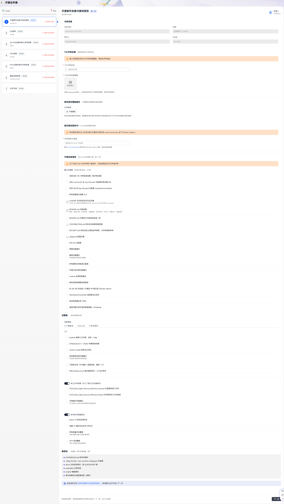
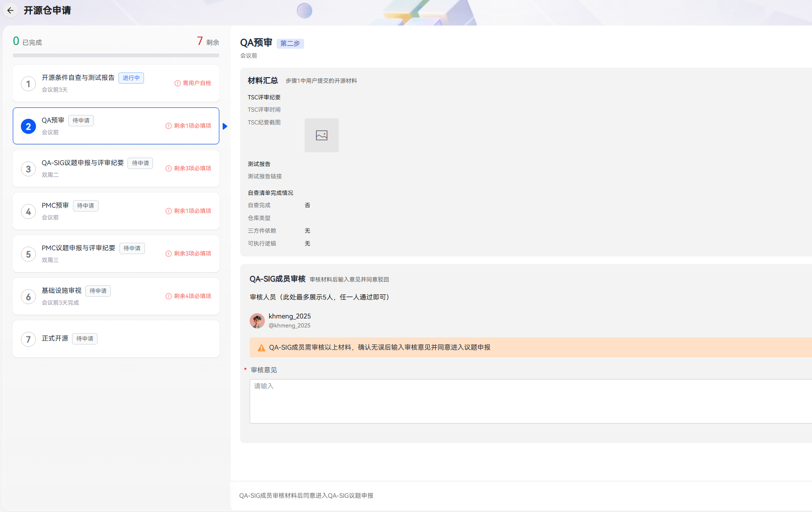
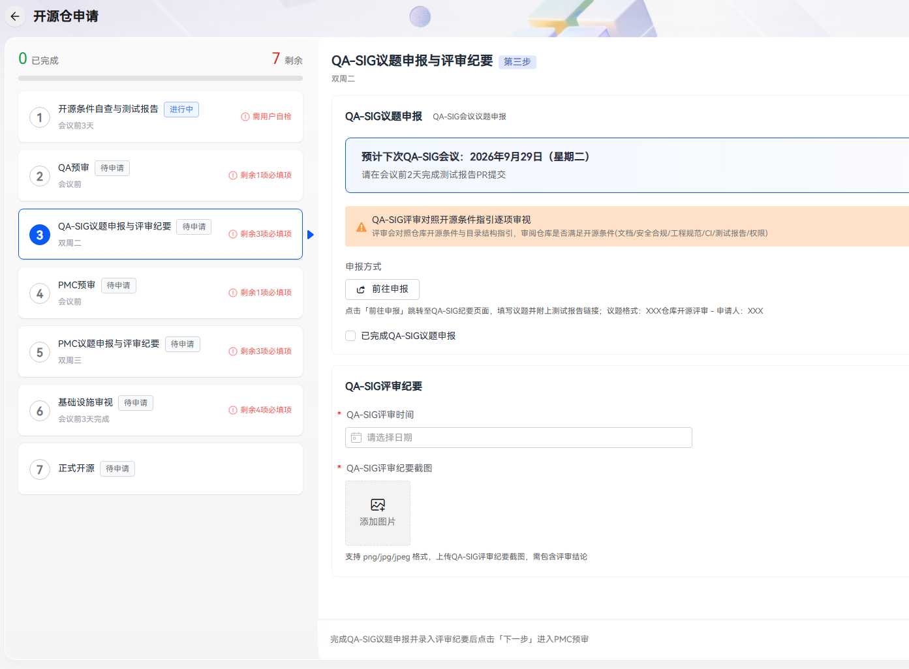
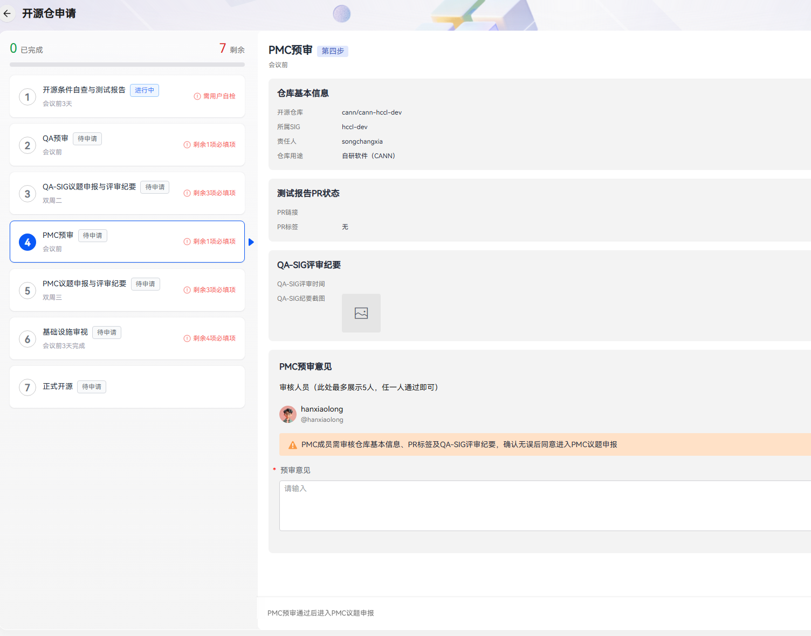
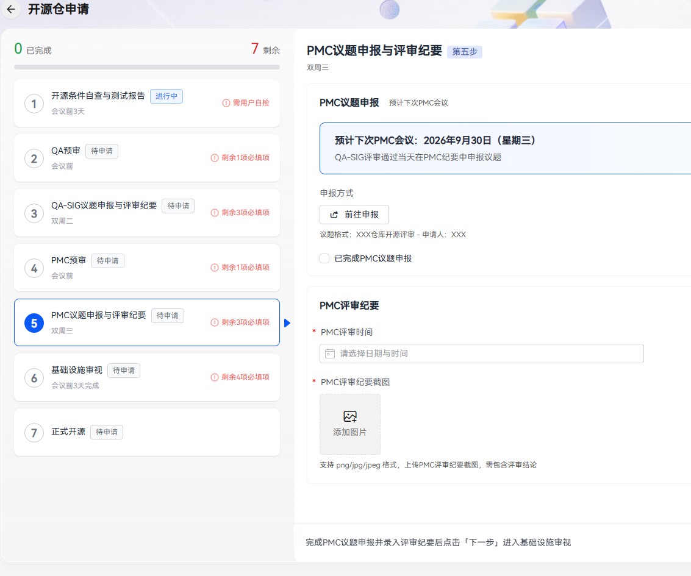
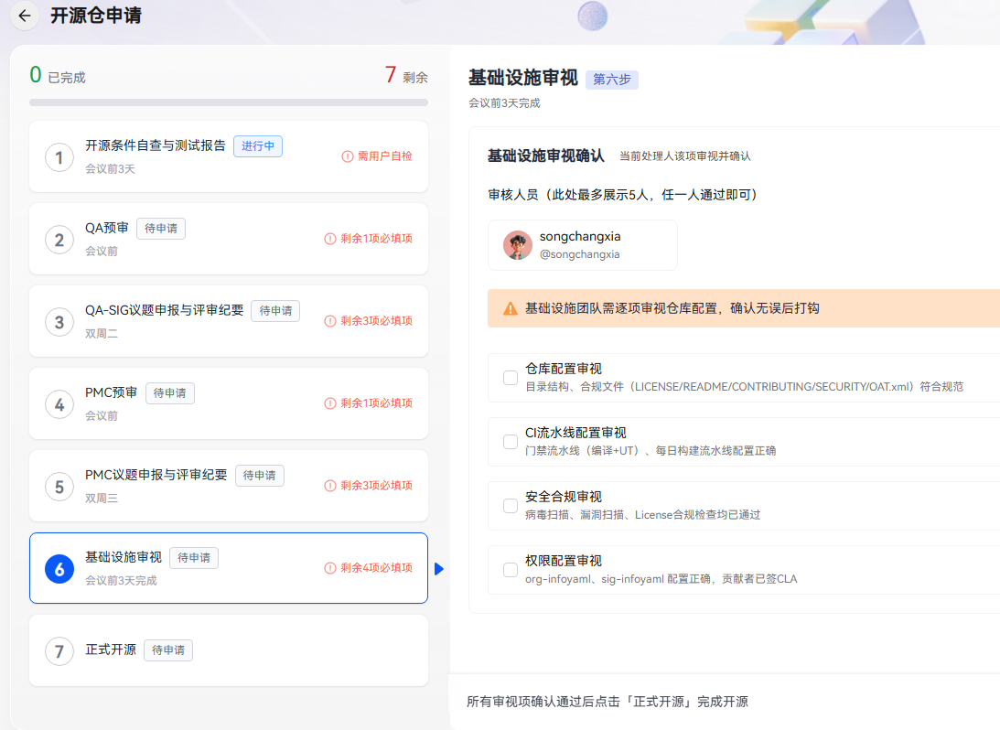
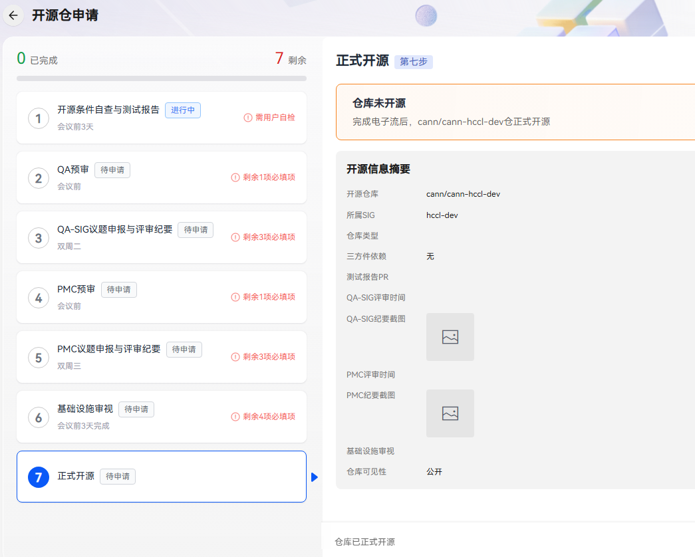

# 仓库开源申请指引

---
## 1. 入口

- **发起申请**：社区开发 → 仓库管理 → 所有仓库 → 开源申请，进入开源申请页（[开源申请](https://digital.hicann.cn/#/repo_manage/open_source_repo_application)）。
- **查看进度**：仓库管理 → 申请与审批（[申请与审批](https://digital.hicann.cn/#/repo_manage/application_approval)）：
  - **我申请的**：自己提交的申请单；
  - **我审批的**：需要自己（作为审批角色）处理的申请单；
  - **与我相关的**：自己提交的 + 自己作为审批人参与的。
- 支持按电子流单号搜索、按状态/类型筛选，勾选「待我处理」可只看当前轮到自己操作的。

## 2. 功能简介

仅仓库**责任人**可以在平台上发起开源申请，经过 QA、PMC、基础设施团队审核后，将仓库转为公开仓。整个申请共 7 个阶段：

| 阶段 | 名称 | 处理人         |
|---|---|-------------|
| 1 | 开源条件自查与测试报告 | 申请人         |
| 2 | QA-SIG预审 | 社区质量审核员（QA） |
| 3 | QA-SIG议题申报与评审 | 申请人         |
| 4 | PMC预审 | PMC 成员      |
| 5 | PMC议题申报与评审 | 申请人         |
| 6 | 基础设施审视 | 基础设施团队      |
| 7 | 正式开源 | 系统自动完成      |

## 3. 申请操作流程
### 第 1 步：开源条件自查与测试报告

填写自查表单并提交，进入 QA 预审。

| 填写项 | 说明 |
|---|---|
| TSC评审时间 | TSC 评审时间 |
| TSC评审截图 | 上传评审截图 |
| 测试报告PR链接 | 测试报告PR的链接（按社区流程于 QA-SIG 会议前 2 天通过 PR 提交至 community 仓 [QA/test-report/](https://gitcode.com/cann/community/blob/master/QA/test-report/README.md)，并完成 Maintainer/Committer 检视闭环） |
| 自查清单 | 见下方说明 |

自查清单规则（不满足无法提交）：

- 根据仓库类型对应完整集进行自查并勾选；
- 自查是否包含三方依赖；
- 自查是否包含可执行逻辑。

> 自查各仓库类型对应的**完整集**以社区《[仓库开源条件与目录结构指引](https://gitcode.com/cann/community/blob/master/contributor/repository/open-source-checklist.md)》为准，建议在申报 QA-SIG 议题前先按该指引自查。

> 备注：提交后支持更新材料。

### 第 2 步：QA-SIG预审

社区质量审核员（QA）预审自查材料。

### 第 3 步：QA-SIG议题申报与评审

QA-SIG预审通过后于该阶段填写评审时间并上传评审纪要截图。

> QA-SIG 例会为**双周二 10:30-12:00**，议题须提前在 [QA 纪要](https://etherpad-cann.meeting.osinfra.cn/p/sig-qa)申报；会议时间速查与申报方式见社区《[新建仓与仓开放操作指引](https://gitcode.com/cann/community/blob/master/contributor/repository/new-repo-operation-guide.md)》。

### 第 4 步：PMC预审

PMC成员审核测试报告PR合入情况以及QA-SIG评审纪要。

### 第 5 步：PMC议题申报与评审

PMC议题申报通过后于该阶段填写评审时间并上传评审纪要截图。

> PMC 例会为**双周三 14:00-16:00**，议题申报见 [PMC 纪要](https://etherpad-cann.meeting.osinfra.cn/p/PMC)。

### 第 6 步：基础设施审视

基础设施团队对仓库做最后审视，勾选四项检查项：

- 仓库检查
- CI 检查
- 安全检查
- 权限检查

### 第 7 步：正式开源

审批通过后系统自动执行仓库开源。

## 4. 撤回申请

在「我申请的」列表中，进行中的申请可点「撤回」。撤回后申请单关闭，流程终止。如仍需开源，须重新发起申请。

## 5. 相关社区流程文档

流程阶段定义以本平台电子流为准；评审与材料的详细要求（自查完整集、测试报告归档、会议时间）由 community 仓维护：

- [新建仓与仓开放操作指引](https://gitcode.com/cann/community/blob/master/contributor/repository/new-repo-operation-guide.md)——会议时间速查、议题申报方式、推荐时间线
- [仓库开源条件与目录结构指引](https://gitcode.com/cann/community/blob/master/contributor/repository/open-source-checklist.md)——自查完整集
- [测试报告归档说明](https://gitcode.com/cann/community/blob/master/QA/test-report/README.md)——测试报告 PR 提交与检视要求

