# CANNWork(全称：CANNLab-WorkAgent)用户使用手册
## 目录

- [CANNWork(全称：CANNLab-WorkAgent)用户使用手册](#cannwork全称cannlab-workagent用户使用手册)
  - [目录](#目录)
  - [1. 产品简介](#1-产品简介)
    - [1.1 概述](#11-概述)
    - [1.2 产品功能](#12-产品功能)
    - [1.3 应用场景](#13-应用场景)
  - [2. 安装配置](#2-安装配置)
    - [2.1 CANNLab 云开发平台安装](#21-cannlab-云开发平台安装)
    - [2.2 VSCode 插件市场安装](#22-vscode-插件市场安装)
  - [3. 核心功能](#3-核心功能)
    - [3.1 模型配置](#31-模型配置)
      - [3.1.1 内置模型](#311-内置模型)
      - [3.1.2 自定义模型](#312-自定义模型)
    - [3.2 Plan和Build模式](#32-plan和build模式)
      - [3.2.1 Plan模式](#321-plan模式)
      - [3.2.2 Build模式](#322-build模式)
    - [3.3 Skill配置](#33-skill配置)
      - [3.3.1 添加全局skill](#331-添加全局skill)
      - [3.3.2 添加项目级skill](#332-添加项目级skill)
    - [3.4 MCP配置](#34-mcp配置)
      - [3.4.1 添加全局MCP](#341-添加全局mcp)
      - [3.4.2 添加项目级MCP](#342-添加项目级mcp)
    - [3.5 权限配置](#35-权限配置)
      - [3.5.1 默认权限](#351-默认权限)
      - [3.5.2 完全访问](#352-完全访问)
    - [3.6 会话Session管理](#36-会话session管理)
      - [3.6.1 新建会话](#361-新建会话)
      - [3.6.2 查看会话](#362-查看会话)
  - [4. 业务Agent功能介绍](#4-业务agent功能介绍)
    - [4.1 算子文档开发](#41-算子文档开发)
      - [4.1.1 功能介绍](#411-功能介绍)
      - [4.1.2 工具配置](#412-工具配置)
      - [4.1.3 质检项介绍](#413-质检项介绍)
      - [4.1.4 功能使用](#414-功能使用)
    - [4.2 算子接口检索](#42-算子接口检索)
      - [4.2.1 功能介绍](#421-功能介绍)
      - [4.2.2 功能使用](#422-功能使用)
    - [4.3 算子编程开发](#43-算子编程开发)
      - [4.3.1 功能介绍](#431-功能介绍)
      - [4.3.2 功能使用](#432-功能使用)

## 1. 产品简介

### 1.1 概述
CANNWork是面向 CANN 生态开发者的 AI 智能编程助手，以 VS Code 扩展形式提供。它采用 Agent Harness（智能体外壳）架构：插件自身负责会话管理、权限控制、技能编排与安全审计，将实际的 AI 推理与工具执行委托给OpenCode智能体运行时，二者协同为开发者提供可视化、可管控、可审计的 AI 编程体验。 

### 1.2 产品功能
| 功能 | 说明 |
|------|------|
| 可视化智能体 | 旅程时间线将消息、工具调用、执行结果分组折叠展示，代码修改以 Diff 呈现并支持一键回退，实时观察智能体每一步工作 |
| 多模型接入 | 内置 CANN 网关模型（Qwen、DeepSeek 等），同时支持添加自定义模型，按需灵活切换 |
| 双模式切换 | Plan 模式（只读分析，安全可控）与 Build 模式（读写执行，完整开发）一键切换，匹配不同研发阶段 |
| 双层扩展配置 | Skill 与 MCP 均支持全局级和项目级两个层级，既有内置昇腾领域技能，也可自定义扩展智能体能力 |
| 精细权限管控 | 默认逐项审批工具调用，敏感操作显式确认；提供完全访问开关供可信场景免打扰，全程审计日志 |
| 会话管理 | 多会话并行，历史会话自动保存，支持查看、搜索、恢复，会话与工作目录绑定隔离 |
| 业务 Agent | 内置算子文档开发、算子接口检索、算子编程开发等 CANN 领域业务 Agent，端到端编排领域研发工作流 |
| 账号体系 | CANN 账号登录，API Key 自动注入，开箱即用 |
 
### 1.3 应用场景
**场景一：算子文档开发**

面向 CANN 算子文档写作场景，提供文档生成与文档质检能力。文档生成基于模型 AI 辅助学习，同步生成与软件实现一致的 aclnn API 文档，提升文档写作效率；文档质检提供静态检查（markdownlint
语法、标签闭合、链接有效性、资源有效性、拼写、命名规范、标点、合规性）、基础语义检查（AICheck）与领域规则检查（aclnn API、Ascend C API），全面提升文档质量。

**场景二：算子接口检索**

面向算子接口查询场景，快速检索 CANN 算子接口的定义、参数与使用说明，帮助开发者在编程与文档写作过程中高效获取准确的接口信息。

**场景三：算子编程开发**

基于内置的 Ascend C 自定义算子、直调算子、PyPTO、TileLang、Catlass 等 Team，完成昇腾算子的端到端开发，覆盖代码生成、编译、精度调试与性能分析；并通过 NPU 推理优化、torch.compile 图模式等 Team 支撑模型推理优化场景。

**场景四：日常研发辅助**

作为通用 AI 编程助手，完成代码编写与重构、问题排查、工程问答等日常任务；通过自定义 Skill 与 MCP 扩展，适配团队个性化的研发工作流。

## 2. 安装配置

### 2.1 CANNLab 云开发平台安装

以下任选一种，在 CANNLab 云开发平台终端中执行即可。
 
方式一：curl（**推荐**）

```bash
curl -fsSL https://raw.gitcode.com/cann/infrastructure/raw/master/docs/CANNBot/scripts/cannbot-update.sh | bash
```

方式二：wget
 	 
```bash
wget -qO- https://raw.gitcode.com/cann/infrastructure/raw/master/docs/CANNBot/scripts/cannbot-update.sh | bash
```


### 2.2 VSCode 插件市场安装

1. 点击左侧扩展
2. 在搜索框中输入 `CANNBot`
3. 点击安装按钮完成安装

  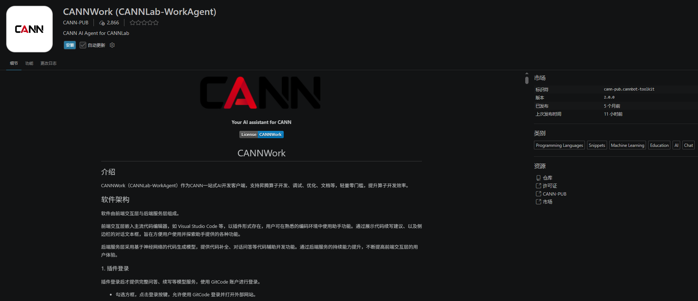


## 3. 核心功能

### 3.1 模型配置
CANNWork 支持两类模型：由 CANN 网关统一接入的内置模型，以及用户自行接入的自定义模型。模型选择器位于聊天界面底部，会话中可随时切换，切换后的选择会被自动记住，下次启动默认恢复。

#### 3.1.1 内置模型
内置模型由 CANN 网关统一管理和接入，无需用户配置任何 API Key。
  - 内置公共模型：平台提供的公共模型（如 Qwen、DeepSeek 系列），所有登录用户可用；
  - api网关模型：与用户账号绑定的专属模型，需要使用公司购买的 Key 才能调用。
  使用前提：需完成 CANN 账号登录。登录后扩展会自动申请模型访问凭证（VK）并注入请求鉴权，首次发放或凭证更新后模型列表会自动刷新。
  使用方式：点击聊天界面底部的模型选择器，从内置模型 /CANNLab-WorkAgent模型分组中选择目标模型即可。切换后的选择会被自动记住，下次启动时恢复。

  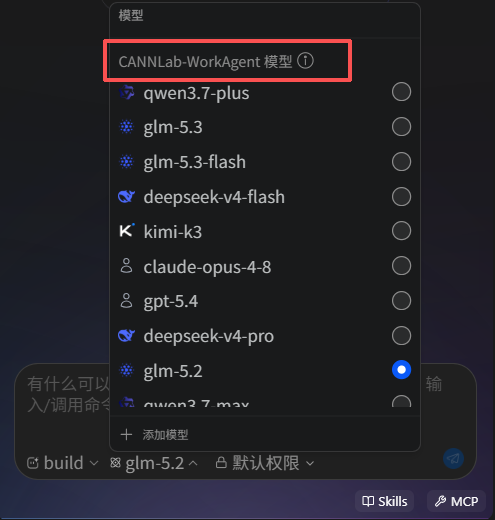

  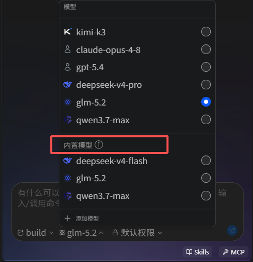


#### 3.1.2 自定义模型
如需使用 CANN 网关之外的第三方模型，可添加自定义模型，请求直连厂商 API，不经过 CANN 网关。
     
**添加步骤**：

1. 点击模型选择器底部的**添加模型**，打开**连接 Provider**对话框；
2. 在厂商列表中选择「自定义」；
3. 填写配置表单：

| 配置项 | 说明 |
|--------|------|
| API Key | 厂商 API 密钥（必填） |
| API Base URL | 厂商 API 地址，OpenAI 兼容格式，如 https://api.openai.com/v1（必填） |
| 模型名称 | 厂商模型 ID，如 gpt-4o（必填） |

4. 提交后工具自动测试连接：向该 API 地址发送一次探测请求，验证地址可达性与密钥有效性；测试通过后模型自动添加，测试失败则提示具体错误（如 HTTP 状态码、连接超时等），不写入配置；
5. 添加成功后，新模型出现在模型选择器的自定义模型分组中，与内置模型 / CANNLab-WorkAgent 模型并列，可像其他模型一样选用。

**管理：**

- 删除：鼠标悬停模型选择器中的自定义模型条目，点击 × 即可删除；
- 更新：重复添加相同 API 地址 + 模型名称的模型视为更新，新配置覆盖旧配置并替换旧密钥。

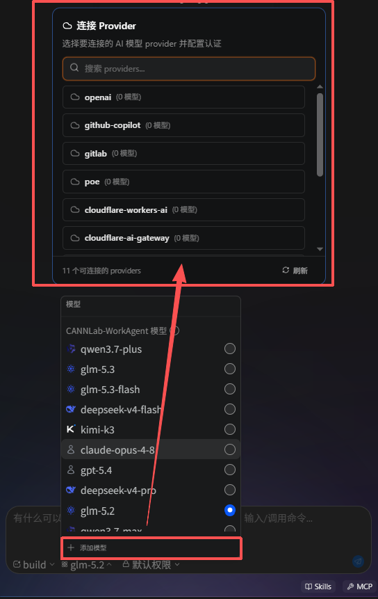


### 3.2 Plan和Build模式
CANNWork 提供 Plan 和 Build 两种工作模式，决定智能体在会话中的行为边界与工具权限。模式可在聊天输入框区域一键切换。
#### 3.2.1 Plan模式
Plan 模式面向方案分析与设计场景，智能体以**只读探索 + 方案输出**的方式工作，不会直接改动代码。
行为特点：

- 只读探索：Read、Glob、Grep、WebSearch、WebFetch 等读操作直接执行，快速理解代码库结构、依赖关系与数据流；
- 先规划后实施：接到任务后，智能体先给出规划方案（例如：确认编程语言、实现版本、交付内容等），并等待用户确认；确认前不会执行任何写操作；
- 逐步确认推进：智能体会与用户一步一步确认关键决策点（如技术选型、实现范围、附加内容），确保方案与预期一致后再进入实施；
- 写操作需确认：所有写操作（Write/Edit/Bash）均不会擅自执行，需经用户在权限弹窗中批准；
- 复杂任务拆解：面对复杂任务会先建立任务清单（Todo），再逐项推进分析。

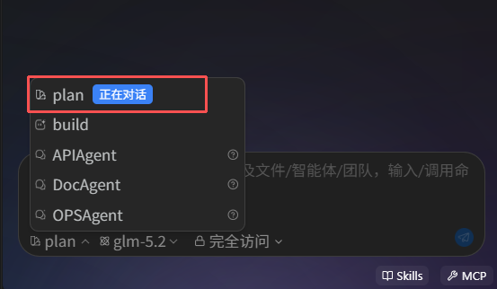


适用场景：接手陌生代码库需要先摸清结构；改动前希望评估方案与风险；只做代码解读、问题定位而不希望 AI 动代码。
#### 3.2.2 Build模式
Build 模式面向实际开发执行场景，智能体在权限规则允许的范围内直接执行改动。
行为特点：

- 直接执行：写操作（Write/Edit/Bash）在读过现有文件后直接执行，无需逐方案确认；
- 改动后自检：每次修改后自动验证改动的正确性，检查既有功能是否被保留、有无引入副作用；
- 任务管理：3 步以上的复杂任务会先创建任务清单再逐步执行，任务进度实时渲染在任务面板中；
- 权限管控仍生效：Build 模式不等于无限制执行，工具调用仍受权限规则约束（详见 3.5 权限配置）。

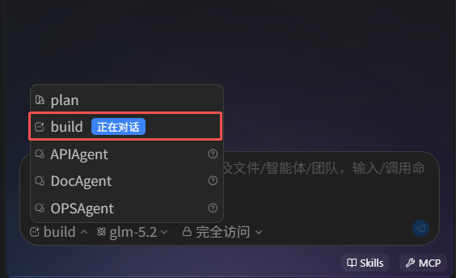


适用场景：方案已确定进入编码实现；Bug 修复与重构；日常脚本编写、工程配置修改等直接动手的开发任务。
### 3.3 Skill配置
Skill 是扩展智能体能力的领域知识包：每个 Skill 是一个包含 SKILL.md 的文件夹，SKILL.md 使用 YAML 前置数据声明名称与描述，正文编写指令、规范或操作流程。会话中智能体可根据任务自动匹配 Skill，也可由用户手动指定。

Skill 按作用域分为全局 Skill 和项目级 Skill 两级，两者同名时项目级优先生效。

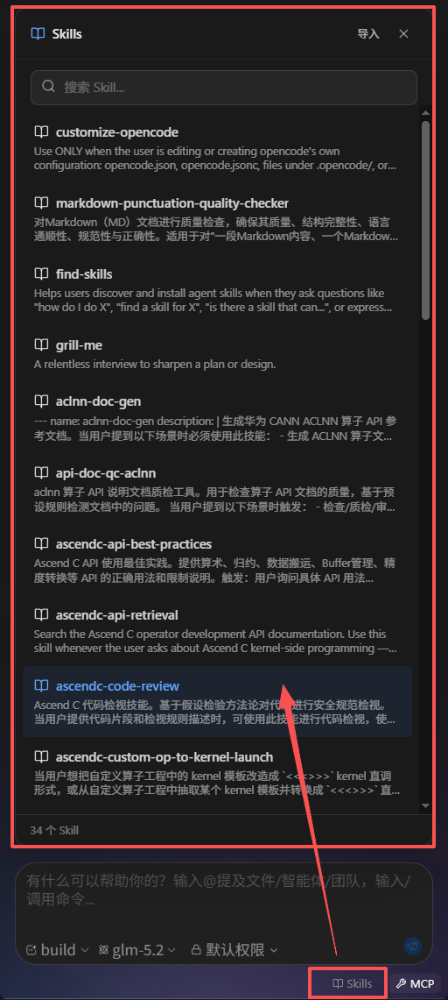


#### 3.3.1 添加全局Skill
全局 Skill 存放在用户主目录下，所有项目、所有会话均可使用，适合放置与具体工程无关的通用能力（如编码规范、通用调试流程）。

  存放目录（按优先级从低到高）：

| 目录 | 说明 |
|------|------|
| ~/.agents/skills/ | 共享目录，与其他 AI 编码工具共用 |
| ~/.config/opencode/skills/ | 全局目录（也是导入 Skill默认的全局安装位置；可通过 OPENCODE_CONFIG_DIR 环境变量重定向） |

  **添加方式**：

  1. 点击输入框区域的Skills按钮（或输入 /skills）打开 Skill 选择器，点击导入；
  2. 安装位置选择全局，导入方式选择ZIP 压缩包或文件夹；
  3. zip 包内 SKILL.md 须位于根目录或唯一一级子目录下，否则提示导入失败；Skill 名称取自包内包含 SKILL.md 的目录名（位于根目录时取 zip 文件名），名称须含字母或数字；
  4. 导入同名 Skill 时直接覆盖旧版本。

  也可将包含 SKILL.md 的 Skill 文件夹直接放入上述任一目录；列表有约 30 秒缓存，稍候或重开选择器即可看到。
#### 3.3.2 添加项目级Skill
项目级 Skill 存放在当前项目目录下，仅该项目、该目录下的会话可用，适合放置与工程强绑定的能力（如该工程的编译命令、算子开发流程、目录结构说明）。

  存放目录：

| 目录 | 说明 |
|------|------|
| <项目>/.opencode/skills/ | 项目级目录（推荐，可随项目仓库提交，团队共享） |

  项目级 Skill 优先级高于全局 Skill——同名时以项目级为准，便于在项目内覆盖通用 Skill 的行为。

  **添加方式**：
  与全局 Skill 相同（导入时安装位置选**项目级**），或直接将文件夹放入 <项目>/.opencode/skills/。Team 模式下，Team 工作区的 .opencode/skills/ 也会作为 Team 级 Skill 加载，且优先级最高。也可将包含 SKILL.md 的 Skill 文件夹直接放入上述任一目录；列表有约 30 秒缓存，稍候或重开选择器即可看到。

  使用：Skill 添加后即可在会话中使用——点击输入框区域的Skills按钮打开选择器（支持模糊搜索），选择后以斜杠命令方式发送；也可直接输入 /skills 唤起选择器。

  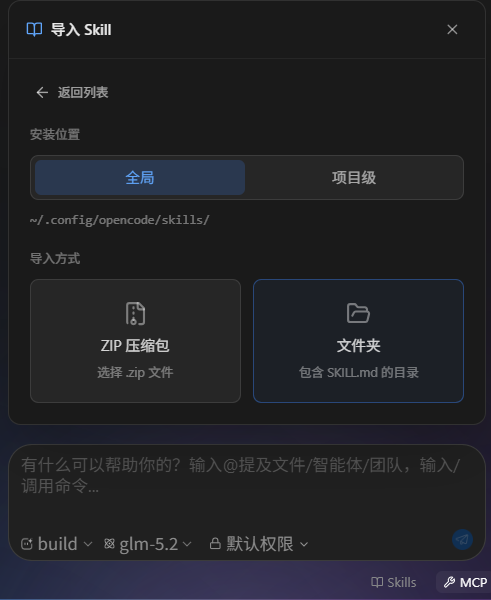


### 3.4 MCP配置
MCP（Model Context Protocol）是扩展智能体工具能力的标准协议。接入 MCP 服务器后，智能体可在对话中调用其提供的工具（如联网搜索、数据库查询等）。MCP 配置同样分为全局和项目级两个层级。

#### 3.4.1 添加全局MCP
全局 MCP 写入全局配置文件 ~/.config/opencode/opencode.json，所有项目均可使用，适合放置通用能力。

**添加步骤**：

1. 点击聊天界面底部状态栏的 MCP 按钮，打开MCP 服务器面板；

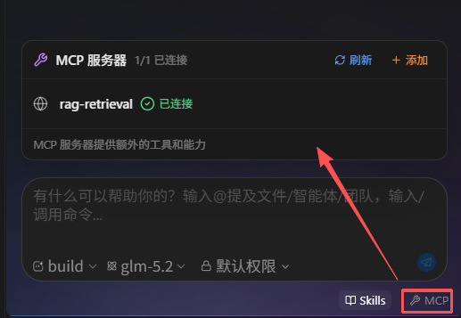


2. 点击添加，在弹出的配置对话框中填写：

| 配置项 | 说明 |
|--------|------|
| 名称 | 服务器名称，必填 |
| 服务器类型 | 本地（stdio 本地进程）或 远程（HTTP/SSE） |
| 命令 / 参数 | 本地类型：启动命令（如 npx，必填，含空格会自动拆分）及参数（空格分隔，支持引号包裹） |
| 环境变量 | 本地类型：KEY=value 格式，每行一条（# 开头行视为注释） |
| 工作目录 | 本地类型：可选 |
| URL / 请求头 | 远程类型：服务地址必填且须为合法 URL（如 https://mcp.example.com/sse）； 请求头支持 JSON 或 KEY=value 格式 |
| 描述 / 图标 | 可选，便于在工具列表中识别（图标支持 emoji 或图片 URL） |
| 启用此服务器 | 开关，控制添加后是否立即连接 |
| 保存位置 | 选择全局配置或项目配置 |

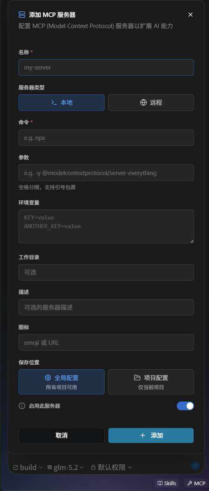


3. 点击添加，配置写入配置文件并自动连接服务器（启用此服务器关闭时仅保存不连接），连接状态实时显示。MCP 配置变更在下次对话时生效，当前进行中的对话不会自动应用。

#### 3.4.2 添加项目级MCP
项目级 MCP 写入项目配置文件 <项目>/.opencode/opencode.json，仅当前项目可用，适合放置与工程绑定的服务（如该项目专属的 API、内部工具）。配置文件可随项目仓库提交，团队成员共享同一套 MCP 配置。

**添加步骤**：
与全局 MCP相同，仅在保存位置中选择项目配置。
注意：编辑已有服务器时保存位置不可更改（界面仅展示配置来源），如需更换存储层级请删除后重新添加。同名服务器同时存在于全局与项目配置时，以项目配置为准；项目配置不完整时按字段与全局配置合并。

#### 3.4.3 连接状态与管理：

MCP 面板实时显示每个服务器的连接状态（已连接 / 连接中 / 连接错误 / 未连接 / 已禁用 / 需要认证 / 需要客户端注册）及可用工具数量，连接失败时同时显示错误信息，并支持：

- 重新连接：非已连接状态下手动重试（先断开再重连）；
- 编辑 / 删除：编辑配置——包括「启用此服务器」开关，可用于临时禁用某服务器而不删除配置；删除会从配置文件中移除服务器，不可撤销，删除前会二次确认；
- 刷新：从配置文件重新加载全部服务器，并自动连接所有已启用的服务器。
 
 
### 3.5 权限配置
智能体在会话中的每一步工具调用（读写文件、执行命令等）都受权限规则约束。CANNWork提供默认权限和完全访问两档权限，可在设置页全局配置（作为所有新会话的默认值），也可在单个会话内通过工具栏开关单独切换；会话内的显式设置优先于全局设置。
#### 3.5.1 默认权限
默认权限是最严格的档位：所有工具调用都需要用户确认，包括只读操作。智能体每次需要执行操作时，会弹出**权限请求**对话框，展示要使用的工具及输入内容，由用户逐项把关；同时存在多个待处理请求时，将按顺序逐个呈现。

审批选项：

| 选项 | 说明 |
|------|------|
| 允许 | 本次执行该操作，下次同类调用仍会询问 |
| 拒绝 | 拒绝本次执行 |
| 始终允许此模式 | 本次执行该操作，并将该工具写入允许规则（保存到项目配置，持久生效）；此后该工具的所有调用自动放行，不再询问。注意：放行范围是该工具的全部操作，而非仅当前这一条命令，请谨慎使用 |

  适用场景：初次使用、不熟悉智能体行为；在重要工程目录中工作；希望对每一步操作保持完全掌控。
#### 3.5.2 完全访问
完全访问是面向效率的档位：开启后，日常操作（文件读写、常规命令执行等）自动放行，无需逐项确认；仅敏感、危险操作仍会弹出审批。
无论从设置页还是会话内工具栏开启，均会弹出风险确认对话框，需勾选确认后方可启用。

危险操作拦截：以下类型的命令即使在完全访问模式下也会要求用户确认，包括但不限于：

- 磁盘/格式化类：mkfs、dd 读写设备、format 等；
- 危险删除类：rm -rf 及针对系统目录（/etc、/usr、/home 等）的删除；
- 提权类：sudo、su、doas；
- 权限修改类：chmod 777、chown root 等；
- 系统与网络类：内核模块加载（insmod/modprobe）、防火墙规则（iptables/ufw）、sysctl 内核参数修改等。


  **会话级完全访问（会话内工具栏开关）**

  - 入口：会话输入框上方工具栏的权限按钮（显示「默认权限」或「完全访问」），点击展开下拉后打开「允许完全访问」开关；
  - 生效范围：仅当前会话，随时切换，互不影响其他会话；
  - 生效时机：立即生效；切换时该会话内已积累的「始终允许」记录一并重置；
  - 优先级：会话级设置优先于全局开关，单独设置后该会话按会话级档位执行，不受全局开关影响；但全局开关每次切换都会清除会话级设置；
  - 持久化：按会话保存，窗口重载后恢复该会话的设置。
  
  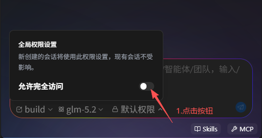
  
  
  

   **全局完全访问（设置页开关）**

  - 入口：设置页的权限开关；
  - 生效范围：作为所有会话的默认权限档位，新建会话默认跟随该开关；
  - 生效时机：切换后立即对所有运行中的会话生效，包括正在问答中的会话；
  - 切换影响：切换全局开关会清除所有会话的单独权限设置（各会话统一重置为全局值），同时清除各会话已积累的「始终允许」记录；此后仍可在单个会话内重新单独设置；
  - 持久化：全局保存，重启后仍然有效。

  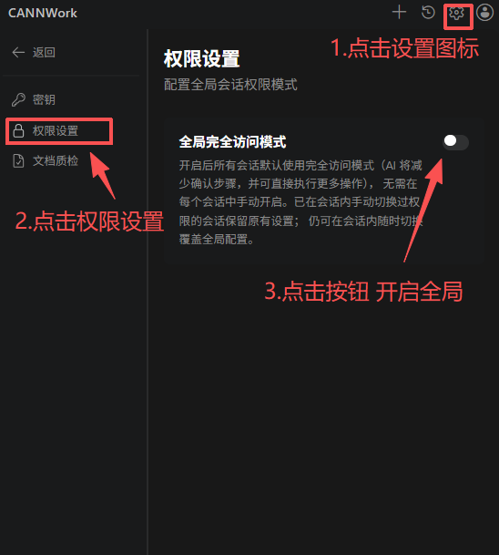


  **开关层级：**

- 设置页全局开关：控制所有新会话的默认权限档位；切换后立即对所有运行中的会话生效（包括正在问答中的会话），并清除各会话的单独设置；
- 会话内工具栏开关：仅影响当前会话，随时切换，互不影响其他会话。

  适用场景：可信任务的全自动执行（如批量重构、长时间运行的构建修复），减少逐项确认的打断；配合危险操作拦截，兼顾效率与安全。

### 3.6 会话Session管理
CANNWork支持多会话并行工作：每个会话拥有独立的对话上下文、模式选择与权限设置，会话与工作目录自动绑定，切换互不干扰。

#### 3.6.1 新建会话
**入口：**

  - 聊天界面顶部的**新建会话**按钮（+）；
  - 命令面板执行**CANNWork: 新建会话**。

  **流程：**

  1. 点击「新建会话」后回到首页，进入全新的空白对话界面；
  2. 会话正式创建并自动保存到历史会话列表中，开始进入回答流程。；
  3. 新会话继承全局权限档位、Plan/Build 模式、模型选择。
  
  会话与目录绑定：每个会话在创建时与当前工作目录（及 Team模式下的团队目录）绑定，后续所有对话、工具调用均在该目录上下文中执行。多会话操作不同目录时互不串扰，即使目录切换，已绑定的会话仍路由到原目录执行。

#### 3.6.2 查看会话
**历史会话列表：**

  点击顶部的**会话历史**按钮（或命令面板执行**CANNWork: 会话历史**）打开列表，所有会话自动持久化保存（重启 VS Code 不丢失），列表分页展示，可点击**加载更多会话**查看更早的记录。每条会话以卡片形式展示：

  - 基本信息：标题、内容预览、最近更新时间、消息数量；
  - 实时状态：会话正在回答时显示**正在回答**徽章（动态闪烁），回答结束后显示**回答结束**；
  - 重命名：点击编辑图标修改会话标题；
  - 删除：点击删除图标移除会话；
  - 刷新：点击刷新按钮手动重新拉取会话列表。


**会话切换：**

点击任意会话卡片即可切换到该会话继续对话。多个会话可并行工作：切换到其他会话后，后台会话仍在继续执行，回答完成时其状态徽章同步更新。

**搜索：**

支持按关键词搜索历史会话，快速定位目标对话。

## 4. 业务Agent功能介绍

### 4.1 算子文档开发

#### 4.1.1 功能介绍

针对文档开发场景，本工具目前提供如下能力：

**文档生成**

  针对CANN领域中可结构化的文档，工具提供基于模型AI的辅助学习能力，能够同步生成与软件实现一致的文档，从而提升文档写作效率。

  注意：目前仅支持生成算子对应的aclnn API文档，其他组件文档生成能力**正在建设中**。

**文档质检**

  针对markdown格式的文档，提供静态检查（StaticCheck）、基础语义检查（AICheck）、领域规则检查（DomainCheck）等能力，希望能提高文档质量。

  |检查项|说明|
  |-----|-----|
  |[StaticCheck_markdownlint](#staticcheck_markdownlint)|Markdown基础语法检查|
  |[StaticCheck_tag_closed](#staticcheck_tag_closed)|HTML标签闭合语法检查|
  |[StaticCheck_link_validity](#staticcheck_link_validity)|链接可访问性检查|
  |[StaticCheck_resource_existence](#staticcheck_resource_existence)|资源有效性检查|
  |[StaticCheck_codespell](#staticcheck_codespell)|单词拼写检查|
  |[StaticCheck_filename](#staticcheck_filename)|Markdown文件命名规范检查|
  |[StaticCheck_punctuation](#staticcheck_punctuation)|标点符号检查|
  |[StaticCheck_compliance](#staticcheck_compliance)|合规性检查|
  |[AICheck](#aicheck)|上下文语义基础检查|
  |[DomainCheck_aclnn_API](#domaincheck_aclnn_api)|aclnn API文档检查|
  |[DomainCheck_AscendC_API](#domaincheck_ascendc_api)|Ascend C API文档检查|
  
#### 4.1.2 工具配置

  工具辅助文档写作或质检过程中，支持自行配置相关能力。以文档质检配置为例，可设置检查模式和对应的检查项：

  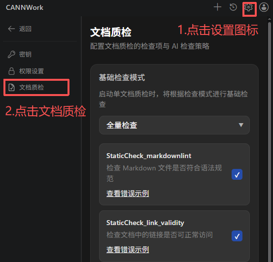

#### 4.1.3 质检项介绍

##### StaticCheck_markdownlint

  针对markdown格式文档进行语法和格式的基础检查，具体的规则介绍和正反例请参考[开源项目README](https://github.com/DavidAnson/markdownlint/blob/main/README.md)。

##### StaticCheck_tag_closed

  检查文档里HTML标签闭合问题。请注意，代码块里的HTML标签将不会扫描。

  - 反例：

    ```text
      <table>
        <tr>
          <th>Header 1
          <th>Header 2</th>   <!-- 错误1：未闭合的<th> -->
        <tr>                  <!-- 错误2：未闭合的<tr> -->
          <td>Data 1<td>      <!-- 错误3：自闭合<td> -->
          <td>Data 2</td>
      </table>                <!-- 错误4：未闭合的<tr>导致结构错乱 -->
    ```
    
  - 正例：

    ```text
      <table>
        <tr>
          <th>Header 1</th>
          <th>Header 2</th>
        </tr>
        <tr>
          <td>Data 1</td>
          <td>Data 2</td>
        </tr>
      </table>
    ```

##### StaticCheck_link_validity

  检查文档里出现的所有链接是否有效。

  - 反例：

      ```text
        <!-- 拼写错误导致 404 -->
      ```

  - 正例：

      ```text
      
      ```

##### StaticCheck_resource_existence

  检查本地资源是否有效，例如图片或链接文件等。

  - 反例：

    ```text
      <!-- 图片相对路径错误 -->
    ```
    
  - 正例：

    ```text
    
    ```

##### StaticCheck_codespell

  检查文档中英文单词拼写错误，详细信息可参考[codespell-project](https://github.com/codespell-project/codespell)。

  如有特殊单词需加入忽略清单，可联系[文档管理员](https://gitcode.com/gitcode-chenjiao)。

##### StaticCheck_filename

  检查开源文件命名是否规范，仅支持纯英文字符（英文字母、数字、中横线-、下划线_），长度不超过100个字符。

  - 反例：

    ```text
    docs/算子_README2%.md  <!-- 文件命名带中文字符、特殊字符 -->
    ```
    
  - 正例：

    ```text
    docs/OP_README2.md
    ```
  
##### StaticCheck_punctuation

  检查文档中标点符号是否规范，包括标点符号重复/缺失/是否配对使用、空格是否多余/缺失、中英文符号混用等。

  - 反例：

    ```text
    例1：本接口为试验特性，后续版本可能存在变更，，暂不支持应用于商用产品中。   <!-- 逗号重复 -->
    例2：本接口为试验特性，后续版本可能存在变更，暂不支持应用于商用产品中      <!-- 句末符号缺失 -->
    例3：本接口为试验特性，后续版本可能存在变更，  暂不支持应用于商用产品中。  <!-- 多余空格 -->
    例4：本接口为试验特性，后续版本可能存在变更,暂不支持应用于商用产品中.     <!-- 中文语句用英文逗号/句号  -->
    ```
    
  - 正例：

    ```text
    本接口为试验特性，后续版本可能存在变更，暂不支持应用于商用产品中。
    ```

##### StaticCheck_compliance

  检查文档中的术语及专有名词是否符合规范或领域常识，同时检查是否存在个人敏感信息或违反法律法规的描述。

  - 反例：

    ```text
    例1：dvpp库提供了视频和图像解码、缩放等预处理功能。                 <!-- dvpp术语不符合领域规范（改为大写） -->
    例2：若算子执行异常，可联系CANN工程师xxx@qq.com或18312312312。    <!-- 个人敏感信息需删除或转换表达方式 -->
    例3：该接口当前暂不支持AtlasA3训练系列产品。                      <!-- 产品型号不符合领域规范 -->
    ```
    
  - 正例：

    ```text
    例1：DVPP库提供了视频和图像解码、缩放等预处理功能。
    例2：若算子执行异常，可联系CANN工程师。
    例3：该接口当前暂不支持Atlas A3 训练系列产品。
    ```

##### AICheck

  检查上下文语义正确性、可读性，主要包括如下几项：

  - 中文错别字
  - 中文重复字/英文重复单词
  - 内容模糊、歧义或语病
  - 内容冗余性
  - 内容一致性

##### DomainCheck_aclnn_API

  检查CANN算子库aclnn API文档的规范性、正确性、完备性、可读性，写作模板详见[aclnn API文档模板](https://gitcode.com/cann/ops-math/wiki/aclnn%20API%E6%96%87%E6%A1%A3%E6%A8%A1%E6%9D%BF)。

##### DomainCheck_AscendC_API

  检查CANN Ascend C API文档的规范性、正确性、完备性、可读性，写作规范请参见[Tanh样例](https://gitcode.com/cann/asc-devkit/blob/master/docs/api/context/Tanh.md)。

#### 4.1.4 功能使用


**1. 进入算子文档生成流程**

  使用步骤：

  1. 在资源管理器中右键算子工程目录
  2. 选择 CANNWork →  Ascend C API 文档生成
  

  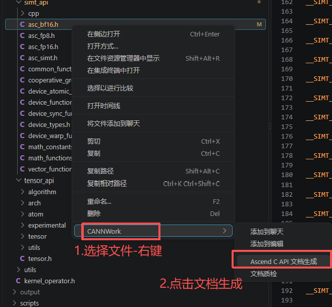

  3. 工具自动打开聊天面板，新建会话并切换到 DocAgent 模式，同时开始扫描目录下的算子与接口
  4. 扫描完成后，输入框上方弹出向导卡片，进入第 1 页（选择生成范围）


**2. 选择生成范围与生成模式（向导）**

  使用步骤：

  1. 在「请选择 xx 中需要生成算子文档的代码文件」页中勾选需要生成文档的接口，扫描结果默认全选，可点击「全选」批量切换，页头显示共 N 篇文档

  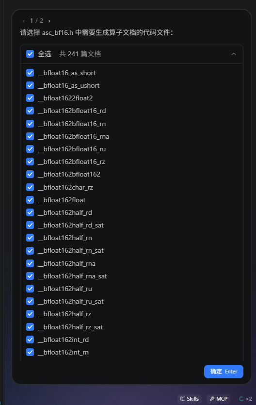

      
  2. 点击「确定」进入第 2 页（生成模式）
  3. 选择生成模式：全量生成（基于完整代码从零开始生成文档）

  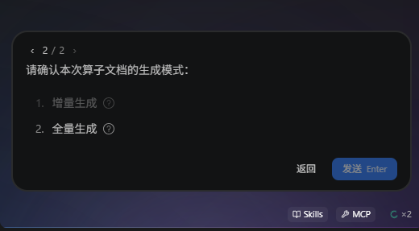

  4. 选择全量生成后点击「确定」，任务立即开始


**3. 增量生成：选择变更范围与对比版本**

  使用步骤：
  1. 在变更范围页选择基线：仅根据本次修改更新算子文档（以本地修改为基线），或使用本地最新代码更新算子文档（以代码仓为基线）

  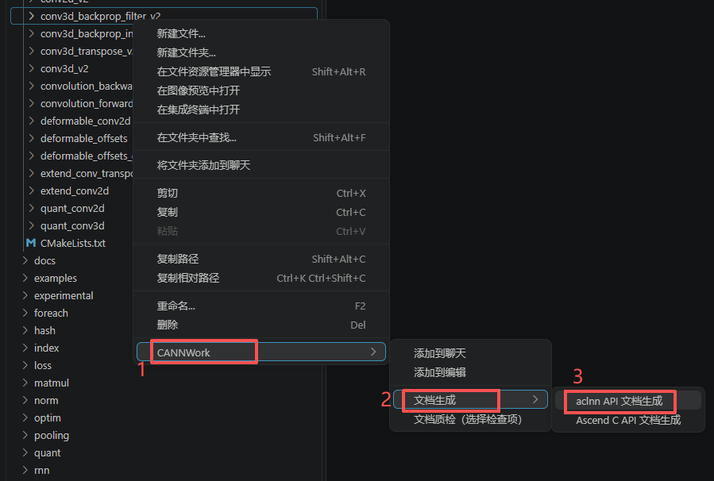

  2. 点击发送，工具新建增量任务会话，自动完成环境准备与基线快照

  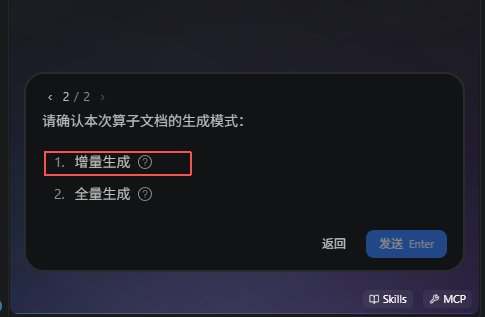

  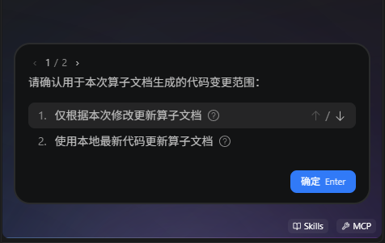

  3. 快照完成后，对话流末尾出现版本选择块，点击版本按钮，或在输入框直接输入版本号

  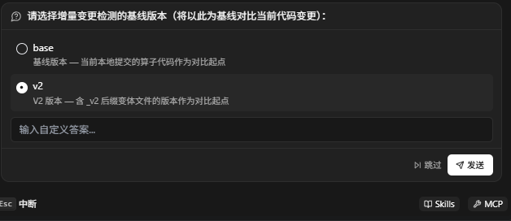

  4. 工具开始变更检测与文档生成，输入框上方的任务面板实时显示逐文件进度
  5. 完成后任务面板显示变更文件清单，每个文件标注新增 / 删除行数
  6. 点击接受全部应用全部变更，或点击「撤销变更」整体回退


**4. 查看全量生成进度与结果**

  使用步骤：

  1. 任务开始后，聊天区顶部显示任务卡片，输入框上方显示任务输出管理器，标题为正在生成算子文档... X / Y，运行中的任务带进度环
  2. 生成过程中可点击输入框的停止按钮中止任务
  3. 全部完成后显示完成文案：算子文档生成任务完成，可在任务输出管理器中进行查看
  4. 在任务输出管理器中点击已完成的文档行，打开生成的 Markdown 文档
  5. 若文档存在需人工处理的内容，完成区会列出各文档的「需用户确认」「需用户补齐」数量，点击数字跳转到文档对应位置

  说明：选择超过 5 个接口时自动分批执行（每批不超过 5
  个），每批在独立会话中运行，会话标题带批次号；任务会话可在会话历史中回溯，重新打开后任务过程与结果卡片自动恢复；悬浮已完成的文档行可点击删除图标删除该文档（移入回收站）。

**5. 文档质检（按配置全量质检）**

  使用步骤：

  1. 在资源管理器中右键待质检的文档文件
  2. 选择 CANNWork → 文档质检

  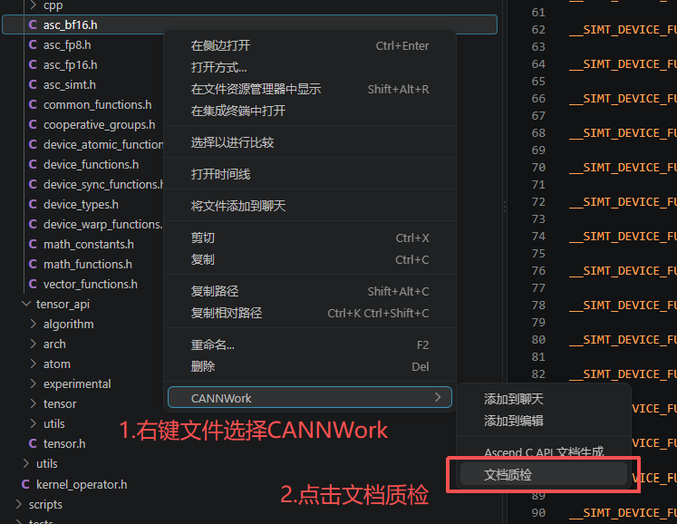

  
  3. 开启确认提醒时，聊天区显示质检配置卡片：设置启用AI质检开关、基础检查模式（全量检查 / 门禁模式（必检项最小集） / 自定义）和领域规则（无 / AscendC 领域 / Aclnn 领域）

  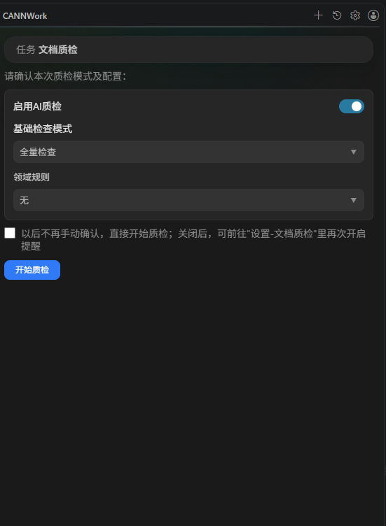

  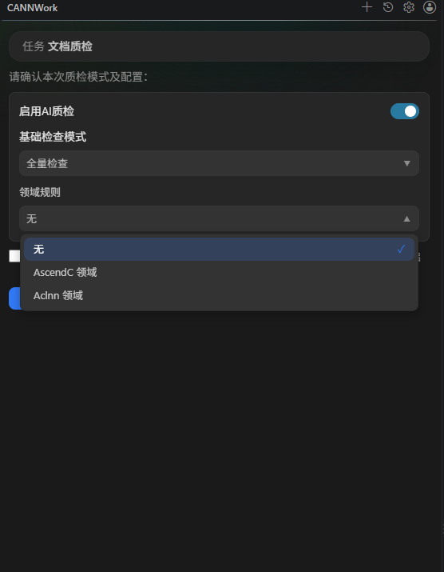

  4. 可勾选「以后不再手动确认，直接开始质检」
  5. 点击「开始质检」，工具新建质检会话并执行检查，各检查项进度实时显示
  6. 完成后显示质检统计（质检策略、开始时间、耗时、检查文件数）与质检报告卡片

  说明：勾选不再提醒后，之后右键质检将跳过配置直接开始；可在设置页的文档质检页签中重新开启提醒。

**6. 文档质检（目录单项检查）**

  使用步骤：
  
  1. 在资源管理器中右键文档目录
  2. 选择 CANNWork → 文档质检（选择检查项）

  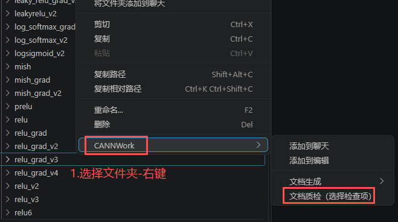

  3. 在弹出的选择框中选择一个检查项，如 markdown语法检查、Link有效性检查、资源有效性检查、单词拼写检查、Html标签闭合检查、合规检查、文件名检查、标点符号检查

  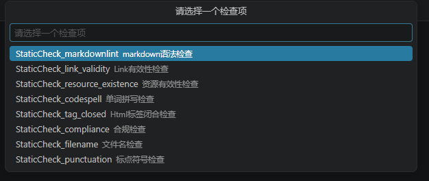

  4. 工具对该目录下的文档批量执行所选检查，批量文件清单与进度实时显示
  5. 得到质检报告

  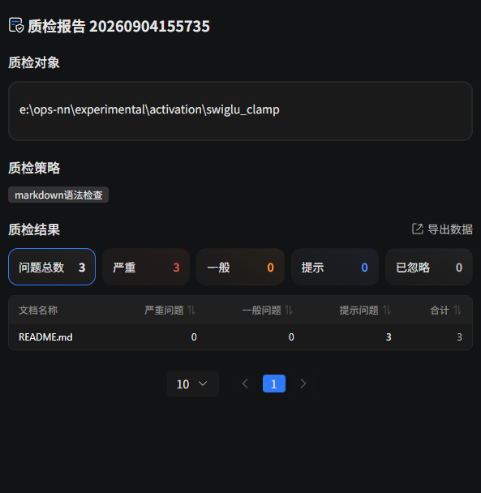

  说明：此入口仅执行所选的单个静态检查项，不包含 AI 质检与领域规则检查。

  7. 查看与处理质检报告

  使用步骤：
  1. 质检完成后，点击完成区的「质检报告」卡片，在编辑器区域打开报告面板
  2. 在报告中点击具体问题条目，自动打开对应文件并定位到该行
  3. 对单条问题可选择处理方式：标记为误报、本次忽略、加入白名单
  4. 需要留存报告时，点击导出并选择 JSON、Markdown 或 CSV 格式与保存位置

  说明：白名单与误报记录会持久保存，后续质检不再重复报告相同问题；每个规则可查看错误示例说明。


### 4.2 算子接口检索

#### 4.2.1 功能介绍
针对算子接口检索场景，本工具提供 APIAgent 问答模式：基于指定版本号的 CANN 官方文档，以自然语言完成 Ascend C、aclnn 等算子接口的查询、行为验证与选型对比，帮助开发者快速获取准确的接口信息。
**版本化检索**

检索基于选定版本的 CANN 官方文档进行。进入 APIAgent 模式后，输入框上方提供**当前检索文档版本**选择器，版本列表从服务端实时拉取，最新版本带**最新**标识；选定版本后，问答将针对该版本文档作答，避免跨版本信息混淆。

**自然语言接口查询**
无需记忆接口名称，直接描述诉求即可定位接口：

| 提问示例 | 能力说明 |
|----------|----------|
| 哪个 Ascend C API 能完成 f(z) = 1/(1 + e^-z) 的计算 | 按计算目标反向查找接口 |
| 有没有做 Pad 或 Slice 的接口 | 查询某类张量操作是否存在对应接口 |
| 多个核之间怎么同步通信，有 API 吗 | 编程范式与配套接口咨询 |

**接口行为与约束咨询**

针对接口的实际行为、数值表现与平台约束进行验证型问答，例如：数据类型转换的取整行为（Cast 接口 bf16 转 fp32 时 RoundMode::CAST_RINT 输出全 0 的原因）、特定芯片上的行为限制（310P 上 printf 缓冲区大小）、多精度类型适配（算子同时支持 half 和 float）等。

**等效方案对比选型**

对完成同一目标的多种接口/指令方案进行对比分析（如 for+muls 与 brcb+mul 的取舍），辅助开发者在性能与实现复杂度之间做出选择。

**免打扰问答**

APIAgent 会话内的工具调用权限请求自动放行，优先级高于普通会话的权限规则，全程无权限弹窗打断。

**快捷提问**

空会话时随机展示常见问题卡片，点击卡片即把问题填入输入框，可直接发送或修改后发送。


#### 4.2.2 功能使用
1. 进入 APIAgent 问答模式

  使用步骤：
  1. 在聊天面板底部找到输入框上方的 Agent 选择器（显示当前 Agent 名称的按钮）
  2. 点击展开 Agent 列表，选择 APIAgent；悬浮选项右侧的 ？ 图标可查看该模式的说明
  3. 若当前处于 Build/Plan 等普通模式，切换后会自动新建一个空白会话进入 APIAgent 模式；若在算子开发 Team会话中切换，会先弹出退出 Team 确认框
  4. 进入后，空会话页面显示 APIAgent 标题与快捷提问卡片

  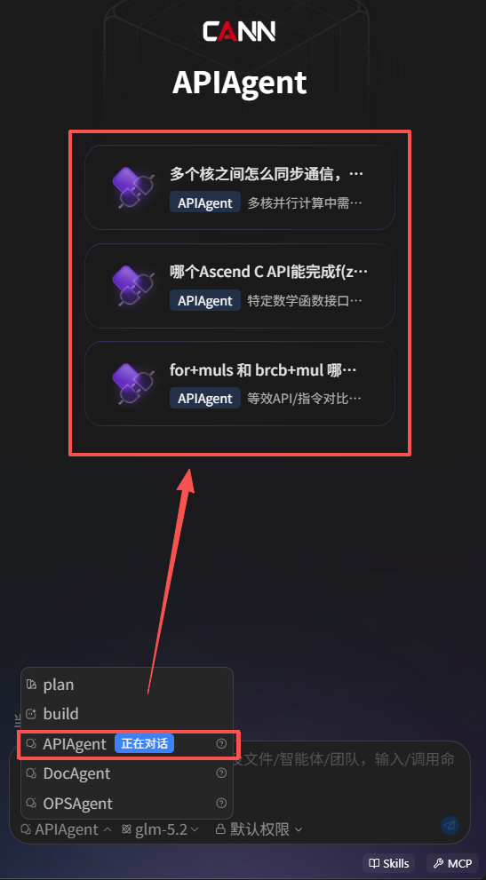

  说明：Agent 选择按会话记忆，切换到其他会话不会影响该会话的模式。

2. 选择检索文档版本

  使用步骤：
  1. 进入 APIAgent 模式后，输入框上方自动显示「当前检索文档版本」栏
  2. 版本列表自动从服务端拉取，拉取期间显示「版本加载中...」
  3. 拉取完成后默认选中商用版最新版本（带「最新」标识）
  4. 点击版本号展开下拉列表，可切换到其他版本

  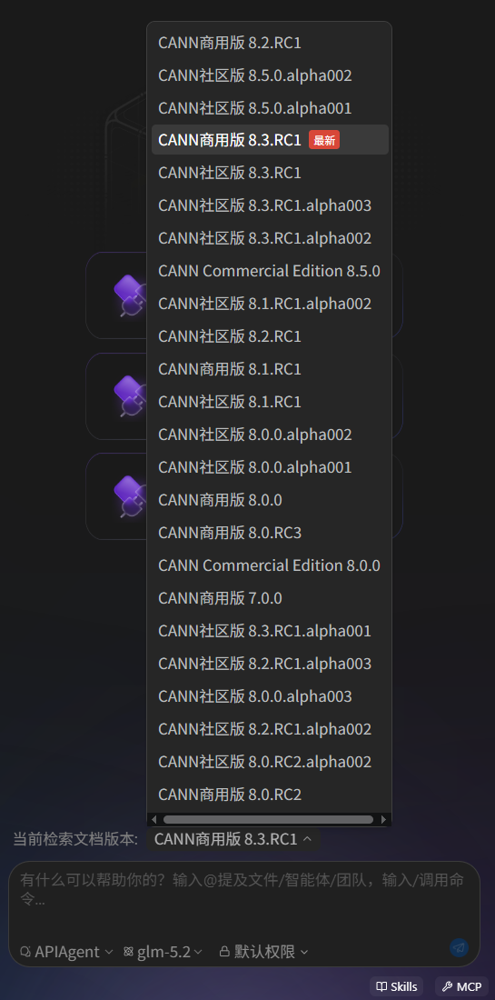


  说明：每次提问都以当前所选版本为检索范围；「最新」标识固定标记商用版最新版本，与当前所选版本无关；版本拉取失败时
  显示「版本获取失败，点击重试」，点击后重新拉取。

3. 使用快捷提问卡片

  使用步骤：
  1. 新建或切换到空白的 APIAgent 会话
  2. 页面展示 3 张常见问题卡片（从 8 条候选中随机抽取）
  3. 点击卡片，问题自动填入输入框并聚焦
  4. 直接发送，或修改后发送

  说明：点击卡片只填入输入框，不会自动发送。

4. 自然语言提问与追问

  使用步骤：
  1. 在输入框用自然语言描述问题，无需记忆接口名称（如：哪个 Ascend C API 能完成 Sigmoid 计算）
  2. 点击发送按钮或按回车提交问题
  3. 等待回答完成，回答基于当前所选版本的官方文档
  4. 需要补充或澄清时，在同一会话中继续追问

  说明：提问类型与示例见 4.2.1 的示例表。

5. 免打扰权限放行

  使用步骤：
  1. 无需任何配置，APIAgent 会话内工具调用的权限请求自动放行，全程不弹出权限确认框

  说明：该机制仅作用于 APIAgent 会话，优先级高于普通会话的权限规则；从会话历史重新打开 APIAgent
  会话并继续提问时，自动放行随提问自动恢复；其他模式会话仍按正常权限流程确认。

### 4.3 算子编程开发

#### 4.3.1 功能介绍
针对算子编程开发场景，本工具内置多个业务 Team。每个 Team 是一组经过编排的智能体（含专属 Agent 人设、领域技能与命令），按端到端工作流完成算子的开发、编译、调试与调优；开发者以自然语言下达任务，Team 自动拆解阶段并逐步执行，过程全程可视化。

算子开发 Team

| Team | 说明 |
|------|------|
| Ascend C 自定义算子开发 Team | Ascend C Kernel 自定义算子端到端开发（含 aclnn 接口层） |
| Ascend C 直调算子开发 Team | Ascend C Kernel 直调算子端到端开发 |
| PyPTO 算子开发 Team | PyPTO 算子端到端开发，7 阶段状态机编排 |
| TileLang 算子开发 Team | TileLang→Ascend 算子端到端开发 |
| Catlass 算子开发 Team | Catlass Kernel 直调算子开发 |

配套研发 Team

| Team | 说明 |
|------|------|
| Ascend C 代码审查 Team | Ascend C 算子代码审查，支持 PR diff 审查 |
| NPU 推理优化 Team | NPU 模型推理端到端优化 |
| torch.compile 图模式 Team | torch.compile 图模式编排，含 npugraph_ex 助手 |

能力说明

- 端到端编排：Team 按「代码生成 → 编译 → 精度调试 → 性能分析」的阶段化工作流推进任务，复杂任务自动建立任务清单，进度实时渲染在任务面板；
- 环境自动准备：进入 Team 时自动拉取团队配置并初始化独立的团队工作目录，团队技能、命令随目录就绪，与本地工程隔离；
- 会话绑定：Team 会话与团队工作目录绑定，多 Team 并行开发互不干扰，切换会话自动路由回对应目录；
- 权限可控：Team 执行中的写操作仍受权限规则管控（见 3.5 权限配置），关键改动由用户把关。

#### 4.3.2 功能使用
1. 进入算子开发 Team

  使用步骤：

  1. 打开 CANNWork 聊天界面，确认已连接服务；
  2. 点击输入框工具栏的智能体选择器，在下拉列表中选择OPSAgent；

  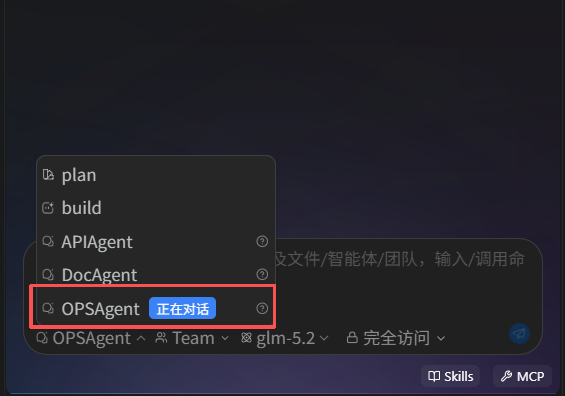


  3. 工具栏出现选择算子类型入口，点击打开 Team 列表；
  4. 选择目标 Team（如「Ascend C 自定义算子开发 Team」）；
  5. 等待团队配置拉取与工作目录初始化，完成后进入 Team 欢迎页。

  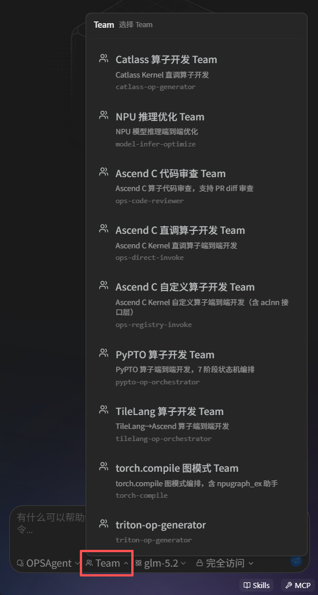

   

说明：首次进入需下载团队资源，Windows 平台首次加载约需2分钟，期间欢迎页显示加载提示，请耐心等待。

2. 下发开发任务

  使用步骤：

  1. 在欢迎页点击预设任务卡片，任务描述自动填入输入框；也可跳过此步，直接输入自然语言任务；
  2. 按需修改任务描述，如补充算子名称、输入输出数据类型、性能要求等；
  3. 按 Enter 发送，Team 自动拆解任务阶段并开始执行。
  

3.跟踪任务执行

  使用步骤：

  1. 观察输入框上方的任务面板：任务清单实时更新，每项显示待处理 /进行中 / 已完成状态；
  2. 在对话流中查看工具卡片：每一步命令执行、文件读写以卡片形式展示，可展开查看命令内容与执行结果；
  3. 如需查看代码改动，点击代码审查按钮打开右侧面板：按文件汇总本次会话的改动（增删行数、差异对比），点击文件可展开查看明细。

4. 审批权限请求

  使用步骤：

  1. Team 执行写文件、执行命令等操作时，对话区弹出权限请求卡片；
  2. 按需选择允许（本次执行）、始终允许（后续该工具自动放行）或拒绝；
  3. 审批通过后任务继续执行。

▎ 详见 3.5 权限配置。

5. 中断任务

  使用步骤：

  1. 任务执行过程中，点击对话区的停止按钮；
  2. Team 停止当前步骤，已完成的阶段与产出保留在会话中。


6. 切换 Team

  使用步骤：

  1. 点击工具栏的算子类型选择器（当前 Team 名称处）；
  2. 在列表中选择另一个 Team；
  3. 系统自动创建新会话并绑定新团队目录，原 Team 会话保留在历史列表中。

7. 切回历史 Team 会话

  使用步骤：

  1. 点击顶部的会话历史按钮（见 3.6.2）；
  2. 点击目标 Team 会话卡片；
  3. 会话自动恢复，并路由回该会话绑定的团队目录继续工作。

8. 退出 Team 模式

  使用步骤（二选一）：

  - 方式一：点击算子类型选择器，选择退出 Team 模式；
  - 方式二：将智能体切换为其他类型，在弹出的确认框中确认退出。

9. 多 Team 并行开发

  使用步骤：

  1. 保持当前 Team 会话任务执行（无需等待完成）；
  2. 点击新建会话（见 3.6.1）；
  3. 在新会话中按第 1 项步骤进入另一个 Team；