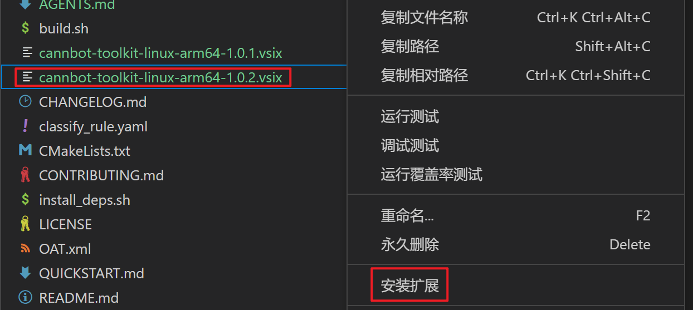
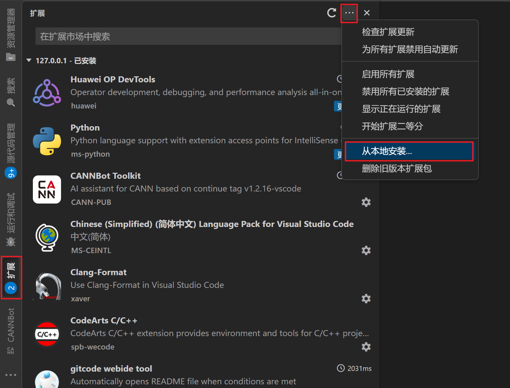
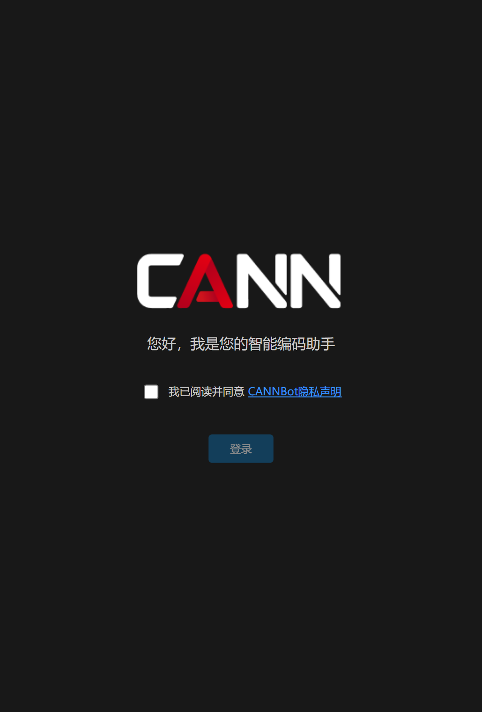
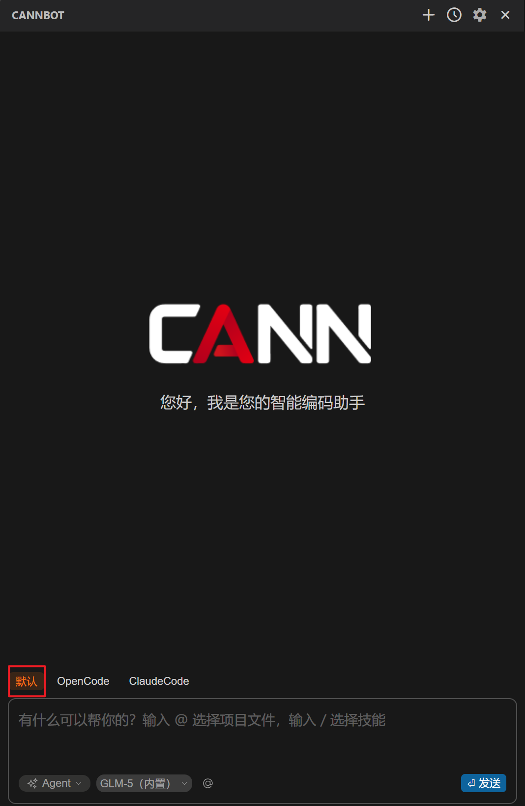
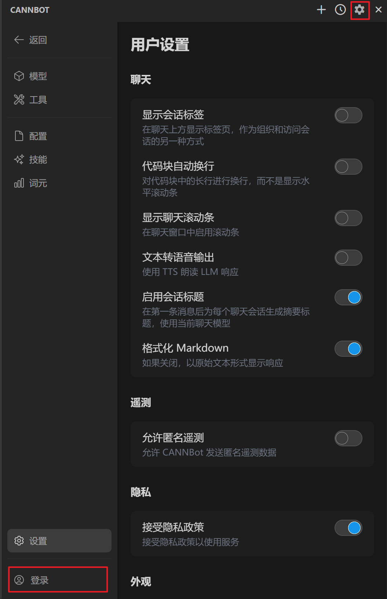
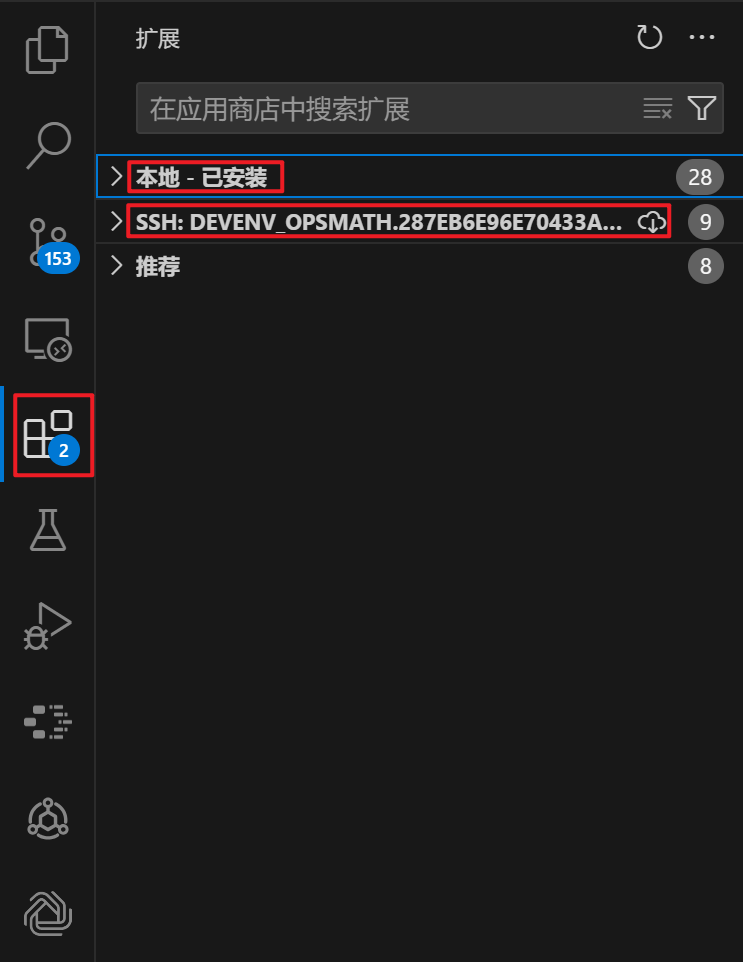

# CANNBot插件安装配置

## 蓝版VSCode & 算力平台WebIDE

### 安装

**离线安装**（适用于WebIDE）
1. 下载离线包到本地

   - [linux-arm64] [packages/1.0.3/linux-arm64/cannbot-toolkit-linux-arm64-1.0.3.vsix](https://cannbot.obs.cn-north-4.myhuaweicloud.com/packages/1.0.3/linux-arm64/cannbot-toolkit-linux-arm64-1.0.3.vsix?Expires=2091087747&AccessKeyId=HPUANYAXOY5QYKEQIMQE&Signature=tLE7FHyfyNLmOp293CXh57oJtUA%3D)

   - [linux-x64] [packages/1.0.3/linux-x64/cannbot-toolkit-linux-x64-1.0.3.vsix](https://cannbot.obs.cn-north-4.myhuaweicloud.com/packages/1.0.3/linux-x64/cannbot-toolkit-linux-x64-1.0.3.vsix?Expires=2091087747&AccessKeyId=HPUANYAXOY5QYKEQIMQE&Signature=Dy60iF%2BQDguPfGQrK2TxIRMrY64%3D)

   - [win32-arm64] [packages/1.0.3/win32-arm64/cannbot-toolkit-win32-arm64-1.0.3.vsix](https://cannbot.obs.cn-north-4.myhuaweicloud.com/packages/1.0.3/win32-arm64/cannbot-toolkit-win32-arm64-1.0.3.vsix?Expires=2091087747&AccessKeyId=HPUANYAXOY5QYKEQIMQE&Signature=gQbqcgx83YN9h0qDCM9/46/MeJY%3D)

   - [win32-x64] [packages/1.0.3/win32-x64/cannbot-toolkit-win32-x64-1.0.3.vsix](https://cannbot.obs.cn-north-4.myhuaweicloud.com/packages/1.0.3/win32-x64/cannbot-toolkit-win32-x64-1.0.3.vsix?Expires=2091087747&AccessKeyId=HPUANYAXOY5QYKEQIMQE&Signature=N%2BOb11jskM81o8OSZ/C/LJuOCv0%3D)

2. 扩展安装方法（二选一即可）

   **方法1：**
   - 将插件安装包拖入WebIDE窗口
   - 右键点击插件包，选择"Install from VSIX"（安装扩展）
     

   **方法2：**
   - 远程搜索本地扩展VSIX包
   - 点击安装按钮完成安装
     

**在线安装**
1. 点击左侧扩展
2. 在搜索框中输入 `CANNBot`
3. 点击安装按钮完成安装


### 登录

1. 点击插件图标，查看并勾选隐私政策
2. 选择"登录"选项
3. 完成gitcode授权登录



**备用登录方式**：依次点击「默认模式」→ 右上角齿轮图标 → 左下角登录按钮




### 配置

#### 1. 默认模式

CANNBot 默认模式是专为华为 CANN 开发生态定制的 AI 助手。

##### 内置支持的模型

| 模型类型 | 模型名称 | 用途 |
|---------|---------|------|
| 对话模型 | DeepSeek-V3、Qwen3-Max、GLM-5、Kimi-K2.5 | 代码对话、问题解答 |
| 补全模型 | Seed-Coder-8B、AIXCoder-7B-Base | Tab 自动补全 |

##### 根据模型提供商添加模型

1. 点击文本输入框中的模型选择下拉框
2. 点击"Add Model"
3. 选择并填写模型信息：
   - **提供商 / Provider**：选择 `openai`、`anthropic`、`deepseek` 等
   - **模型**：模型厂商提供的模型ID
   - **API 地址**：模型服务端点 URL
   - **API 密钥**：认证密钥
   - **模型别名**：自定义显示名称
4. 高级选项（可选）
   - **模型角色**：模型功能应用范围
   - **附加配置**：根据模型真实参数附加配置模型
5. 点击连接，连接成功后可选择使用

##### 配置文件自定义配置个人模型

1. 点击右上角小齿轮图标
2. 选择"配置"选项
3. 点击Local Config右侧的小齿轮图标，打开用户本地配置文件`config.yaml`
4. 在配置文件中添加模型参数（示例）：

```json
{
  "models": [
    {
      "title": "自定义模型名称",
      "provider": "openai",
      "model": "模型ID",
      "apiBase": "https://api.example.com/v1",
      "apiKey": "your-api-key"
    }
  ]
}
```

| 字段 | 说明 |
|-----|------|
| `title` | 模型显示名称 |
| `provider` | 提供商类型：`openai`、`anthropic`、`deepseek` 等 |
| `model` | 模型 ID |
| `apiBase` | API 服务地址 |
| `apiKey` | API 密钥（可通过环境变量引用） |

---

#### 2. OpenCode模式

OpenCode 模式连接到 OpenCode 服务器，插件会自动启动本地服务器。

##### CLI 安装

```bash
# npm 全局安装
npm install -g opencode-ai

# 安装特定版本
npm install -g opencode-ai@<具体版本号>
```

##### 配置文件

OpenCode 支持 JSON 和 JSONC（带注释的 JSON）格式的配置文件，配置会自动合并，后加载的配置覆盖先加载的。

| 配置级别 | 路径 | 说明 |
|---------|------|------|
| 全局配置 | `~/.config/opencode/opencode.json` | 用户偏好，对所有项目生效 |
| 项目配置 | `{项目根目录}/.opencode/opencode.json` | 项目特定设置，覆盖全局配置 |

##### 基础配置示例

```json
{
  "$schema": "https://opencode.ai/config.json",
  "model": "providerID/modelID",
  "provider": {
    "my-provider": {
      "npm": "@ai-sdk/openai-compatible",
      "name": "My Provider",
      "options": {
        "baseURL": "https://api.custom-provider.com/v1",
        "apiKey": "{env:MY_API_KEY}"
      },
      "models": {
        "my-model": {
          "name": "My Model Display Name"
        }
      }
    }
  },
  "permission": {
    "bash": "allow",
    "edit": "allow",
    "read": "ask"
  }
}
```

| 字段 | 说明 |
|-----|------|
| `model` | 默认模型，格式为 `providerID/modelID`（如 `anthropic/claude-sonnet-4-5`） |
| `permission` | 工具、命令调用权限配置 |
| `provider` | 自定义模型提供商配置 |
| `autoupdate` | 自动更新开关，默认值为 `true` |

##### 自定义提供商

添加 OpenAI 兼容的自定义提供商：

```json
{
  "$schema": "https://opencode.ai/config.json",
  "model": "my-provider/my-model",
  "provider": {
    "my-provider": {
      "npm": "@ai-sdk/openai-compatible",
      "name": "My Provider",
      "options": {
        "baseURL": "https://api.custom-provider.com/v1",
        "apiKey": "{env:MY_API_KEY}"
      },
      "models": {
        "my-model": {
          "name": "My Model Display Name"
        }
      }
    }
  }
}
```

| 字段 | 说明 |
|-----|------|
| `npm` | AI SDK 包，OpenAI 兼容 API 使用 `@ai-sdk/openai-compatible` |
| `name` | 提供商显示名称 |
| `options.baseURL` | API 服务地址 |
| `options.apiKey` | API 密钥，使用 `{env:VAR_NAME}` 引用环境变量 |
| `models` | 模型列表及配置 |

##### 权限配置

控制工具的执行权限：

| 权限值 | 说明 |
|-------|------|
| `allow` | 自动允许执行（默认） |
| `deny` | 自动拒绝执行 |
| `ask` | 每次询问用户确认 |

```json
{
  "permission": {
    "bash": "ask",
    "edit": "allow",
    "write": "deny"
  }
}
```

---

#### 3. Claude Code模式

##### CLI 安装

```bash
# npm 全局安装
npm install -g @anthropic-ai/claude-code
```

##### 环境变量配置（Linux/macOS）

1. 打开终端
2. 编辑 `~/.bashrc` 或 `~/.zshrc` 文件
3. 添加以下环境变量：

```bash
# API 地址（必填，本地无法访问 Anthropic 官方 API）
export ANTHROPIC_BASE_URL="https://open.bigmodel.cn/api/anthropic"

# API 密钥（必填）
export ANTHROPIC_AUTH_TOKEN="your-api-key"

# 自定义模型（必填，本地无法使用 claude-sonnet 等官方模型）
export ANTHROPIC_DEFAULT_OPUS_MODEL="your-model-id"
export ANTHROPIC_DEFAULT_SONNET_MODEL="your-model-id"
export ANTHROPIC_DEFAULT_HAIKU_MODEL="your-model-id"
```

4. 保存文件后执行以下命令使配置生效：

```bash
source ~/.bashrc  # 或 source ~/.zshrc
```

##### Windows 环境变量配置

**临时环境变量（当前会话有效）：**

打开 PowerShell 并执行以下命令：

```powershell
$env:ANTHROPIC_BASE_URL = "https://open.bigmodel.cn/api/anthropic"
$env:ANTHROPIC_AUTH_TOKEN = "your-api-key"
$env:ANTHROPIC_DEFAULT_SONNET_MODEL = "your-model-id"
$env:ANTHROPIC_DEFAULT_OPUS_MODEL = "your-model-id"
$env:ANTHROPIC_DEFAULT_HAIKU_MODEL = "your-model-id"
```

**永久环境变量：**

1. 右键点击"此电脑" → 选择"属性"
2. 点击"高级系统设置"
3. 在"高级"选项卡中点击"环境变量"
4. 新建以下变量：

| 变量名 | 变量值 | 说明 |
|-------|--------|------|
| `ANTHROPIC_BASE_URL` | `https://model-url/api/anthropic` | API 地址（必填），需确认是否是anthropic兼容 |
| `ANTHROPIC_AUTH_TOKEN` | `your-api-key` | API 密钥（必填） |
| `ANTHROPIC_DEFAULT_OPUS_MODEL` | `your-model-id` | Opus 级别模型（可选） |
| `ANTHROPIC_DEFAULT_SONNET_MODEL` | `your-model-id` | Sonnet 级别模型（必填） |
| `ANTHROPIC_DEFAULT_HAIKU_MODEL` | `your-model-id` | Haiku 级别模型（可选） |

---

## 蓝区WSL环境 & 本地SSH远程连接算力平台

**注意**：插件安装位置决定了配置文件读取路径

以windows环境远程连接WSL环境或算力平台为例：

1. 查看vscode扩展中的CANNBot插件安装位置
   

2. 如果在本地，则插件会读取windows本地用户根目录下的opencode.json文件
3. 如果在SSH连接的WSL环境或算力平台，则插件会读取WSL环境或算力平台的~/.config/opencode/opencode.json文件
4. 如果同时在本地和SSH远程连接的平台上安装了插件，插件会优先读取本地的opencode.json文件
