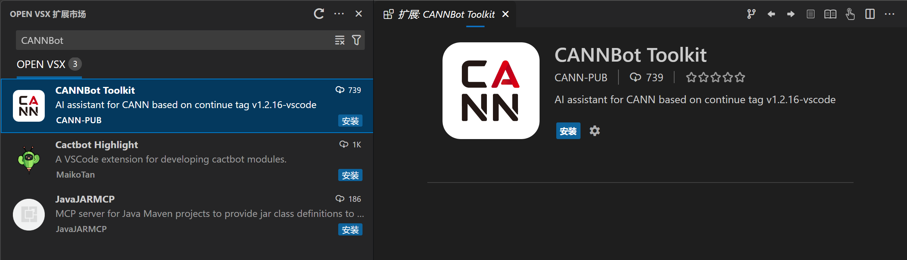
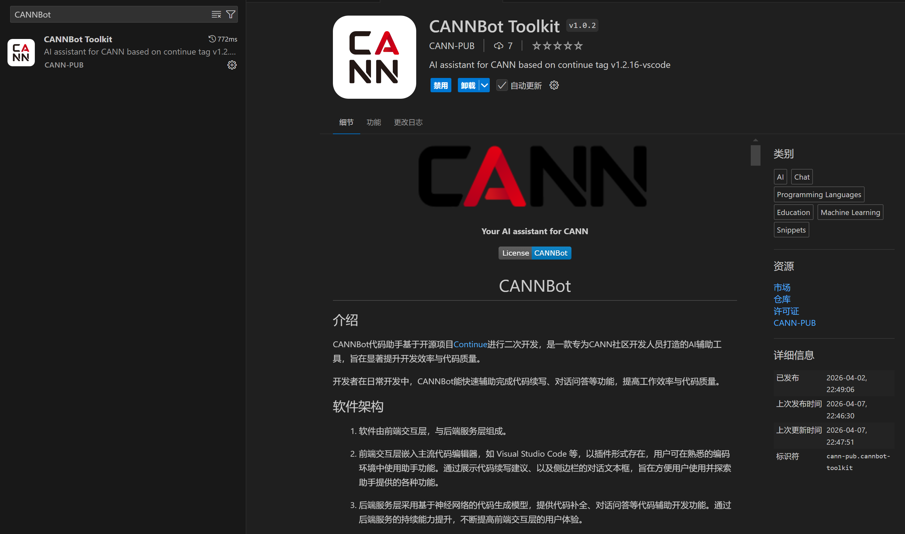

# CANNBot插件配置

## CANNBot插件安装

### WebIDE插件市场安装


### VSCode插件市场安装


## CANNBot 默认模式（推荐）

CANNBot 默认模式是专为华为 CANN 开发生态定制的 AI 助手。

### 模型配置

#### 内置支持的模型

| 模型类型 | 模型名称 | 用途 |
|---------|---------|------|
| 对话模型 | DeepSeek-V3.2、Qwen3-Max、GLM-5、Kimi-K2.5、Qwen3.6-Plus、MiniMax-M2.5 | 代码对话、问题解答 |
| 补全模型 | Seed-Coder-8B、AIXCoder-7B-Base | Tab 自动补全 |

#### UI页面添加模型

1. 点击文本输入框中的模型选择下拉框
2. 点击"Add Model"
3. 选择并填写模型信息：
   - **提供商 / Provider**：选择 `openai`、`anthropic`、`deepseek` 等
   - **模型**：模型厂商提供的模型ID
   - **API 地址**：模型服务端点 URL
   - **API 密钥**：认证密钥
   - **模型别名**：自定义显示名称
4. 高级选项（可选）
   - **模型角色**：模型应用范围
   - **附加配置**：模型的附加配置内容
5. 点击连接并保存后可使用

#### 配置文件自定义配置模型

- 点击右上角小齿轮，点击配置选项，点击Local Config右侧小齿轮，打开用户本地配置文件
- 在配置文件中添加（示例）：

```json
{
"models": [
    {
    "title": "自定义模型名称",
    "provider": "openai",
    "model": "模型ID",
    "apiBase": "https://api.example.com/v1",
    "apiKey": "your-api-key"
    }
]
}
```

| 字段 | 说明 |
|-----|------|
| `title` | 模型显示名称 |
| `provider` | 提供商类型：`openai`、`anthropic`、`deepseek` 等 |
| `model` | 模型 ID |
| `apiBase` | API 服务地址 |
| `apiKey` | API 密钥（可通过环境变量引用） |
---

## Claude Code 模式

Claude Code 模式使用 Anthropic Claude CLI 作为后端。

### CLI 安装

```bash
# npm 全局安装
npm install -g @anthropic-ai/claude-code
```

### 环境变量配置

在 `~/.bashrc`（或 `~/.zshrc`）中添加：

```bash
# API 地址（必填，本地无法访问 Anthropic 官方 API）
export ANTHROPIC_BASE_URL="https://open.bigmodel.cn/api/anthropic"

# API 密钥（必填）
export ANTHROPIC_AUTH_TOKEN="your-api-key"

# 自定义模型（必填，本地无法使用 claude-sonnet 等官方模型）
export ANTHROPIC_DEFAULT_OPUS_MODEL="your-model-id"
export ANTHROPIC_DEFAULT_SONNET_MODEL="your-model-id"
export ANTHROPIC_DEFAULT_HAIKU_MODEL="your-model-id"
```

配置完成后执行：

```bash
source ~/.bashrc
```

**Windows 环境变量配置**
```powershell
$env:ANTHROPIC_BASE_URL = "https://open.bigmodel.cn/api/anthropic"
$env:ANTHROPIC_AUTH_TOKEN = "your-api-key"
$env:ANTHROPIC_DEFAULT_SONNET_MODEL = "your-model-id"
```

**系统环境变量（永久）：**
1. 右键"此电脑" → "属性" → "高级系统设置"
2. 点击"环境变量"
3. 在"用户变量"中点击"新建"
4. 添加以下变量：

| 变量名 | 变量值 | 说明 |
|-------|--------|------|
| `ANTHROPIC_BASE_URL` | `https://open.bigmodel.cn/api/anthropic` | API 地址（必填）|
| `ANTHROPIC_AUTH_TOKEN` | `your-api-key` | API 密钥（必填）|
| `ANTHROPIC_DEFAULT_OPUS_MODEL` | `your-model-id` | Opus 级别模型（可选）|
| `ANTHROPIC_DEFAULT_SONNET_MODEL` | `your-model-id` | Sonnet 级别模型（必填）|
| `ANTHROPIC_DEFAULT_HAIKU_MODEL` | `your-model-id` | Haiku 级别模型（可选）|

---

## OpenCode 模式

OpenCode 模式连接到 OpenCode 服务器，插件会自动启动本地服务器。

### CLI 安装

```bash
# npm 全局安装
npm install -g opencode-ai
```

### 配置文件

OpenCode 支持 JSON 和 JSONC（带注释的 JSON）格式的配置文件，配置会自动合并，后加载的配置覆盖先加载的。

| 配置级别 | 路径 | 说明 |
|---------|------|------|
| 全局配置 | `~/.config/opencode/opencode.json` | 用户偏好，对所有项目生效 |
| 项目配置 | `{项目根目录}/opencode.json` | 项目特定设置，覆盖全局配置 |


### 基础配置示例

```json
{
  "$schema": "https://opencode.ai/config.json",

  "model": "providerID/modelID",

  "permission": {
    "bash": "allow",
    "edit": "allow",
    "read": "ask"
  }
}
```

| 字段 | 说明 |
|-----|------|
| `model` | 默认模型，格式为 `providerID/modelID`（如 `anthropic/claude-sonnet-4-5`） |
| `permission` | 工具、命令调用权限 |
| `small_model` | 小模型（可选），用于标题生成等轻量任务 |
| `autoupdate` | 自动更新，默认 `true` |

### 自定义提供商

添加 OpenAI 兼容的自定义提供商：

```json
{
  "$schema": "https://opencode.ai/config.json",

  "model": "my-provider/my-model",

  "provider": {
    "my-provider": {
      "npm": "@ai-sdk/openai-compatible",
      "name": "My Provider",
      "options": {
        "baseURL": "https://api.custom-provider.com/v1",
        "apiKey": "{env:MY_API_KEY}"
      },
      "models": {
        "my-model": {
          "name": "My Model Display Name"
        }
      }
    }
  }
}
```

| 字段 | 说明 |
|-----|------|
| `npm` | AI SDK 包，OpenAI 兼容 API 使用 `@ai-sdk/openai-compatible` |
| `name` | 提供商显示名称 |
| `options.baseURL` | API 服务地址 |
| `options.apiKey` | API 密钥，使用 `{env:VAR_NAME}` 引用环境变量 |
| `models` | 模型列表及配置 |

### 环境变量引用

在配置文件中使用 `{env:VAR_NAME}` 引用环境变量：

```json
{
  "provider": {
    "anthropic": {
      "options": {
        "apiKey": "{env:ANTHROPIC_API_KEY}"
      }
    }
  }
}
```

设置环境变量：

```bash
# Linux/macOS
export ANTHROPIC_API_KEY="your-api-key"

# Windows PowerShell
$env:ANTHROPIC_API_KEY = "your-api-key"

# Windows CMD
set ANTHROPIC_API_KEY=your-api-key
```

### 权限配置

控制工具的执行权限：

| 权限值 | 说明 |
|-------|------|
| `allow` | 自动允许执行（默认） |
| `deny` | 自动拒绝执行 |
| `ask` | 每次询问用户确认 |

```json
{
  "permission": {
    "bash": "ask",
    "edit": "allow",
    "write": "deny"
  }
}
```

---
