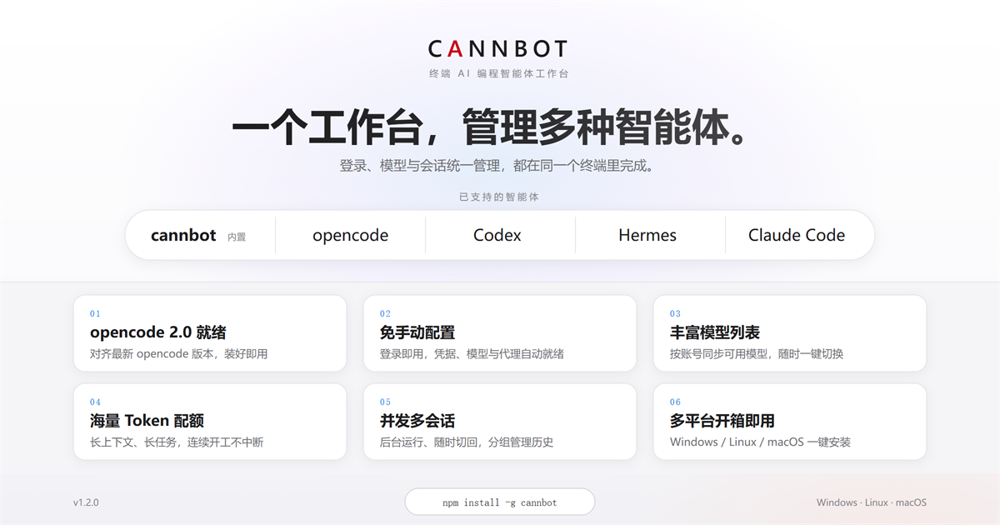

# CANNBot 用户指南

CANNBot 是一个跑在终端里的 AI 编程助手启动器：启动后可以在同一个界面里登录、新建会话、切换智能体（agent）与模型、管理分组和历史记录，并把会话交给真正的编程助手去执行。

## 文档目录

- [快速开始](getting-started.md)：安装、首次启动、登录、新建第一个会话。
- [登录](login.md)：两种登录方式、登录状态、退出登录与凭据保存。
- [智能体与模型](agents-and-models.md)：切换智能体、选择模型与两者关系。
- [会话与分组](sessions-and-groups.md)：新建与切换会话、分组管理、调整工作目录。
- [命令与快捷键](commands-and-shortcuts.md)：全部斜杠命令与按键速查。
- [数据目录与升级](data-and-upgrade.md)：数据存放位置、升级、备份与清理。
- [常见问题与排障](troubleshooting.md)：按症状排查启动、登录与会话问题。

## 先记住三件事

1. 安装包名与命令都是 `cannbot`。这个包是完整的终端应用，自带界面程序和内置智能体 `cannbot-cli`；选择 `cannbot` 智能体时不需要另外安装任何东西。
2. 输入框只用来执行**命令**：以 `/` 开头（例如 `/login`、`/new`），输入 `/` 会弹出联想；非命令文字不会提交。任务名称在 `/new` 之后输入，具体任务内容在进入会话后交给智能体。
3. 会话里的 `Shift+←` 只是回到主页面，会话仍在后台运行；再按 `Enter` 可以回到该会话。
