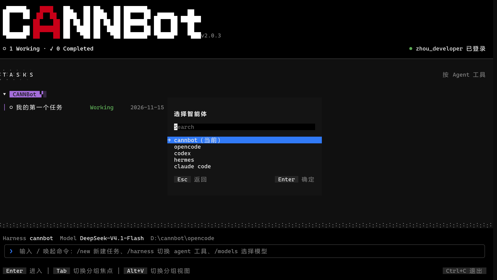
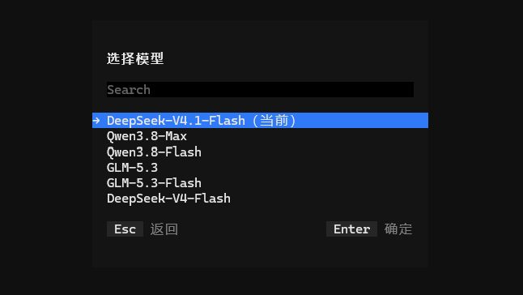

# 智能体与模型

这篇文档讲清楚两件事：用 `/harness` 切换智能体（agent），用 `/models` 选择模型，以及两者之间的关系。

## 切换智能体

在输入框输入 `/harness` 回车，弹窗列出固定五个选项，顺序为：`cannbot`、`opencode`、`codex`、`hermes`、`claude code`。

列表中会标注：

- `（当前）`：当前生效的智能体；
- `（未安装）`：系统里找不到对应命令。

说明：

- `cannbot` 是内置智能体：它的可执行文件是 `cannbot-cli`，和界面程序 `cannbot` 由同一个包一起安装，因此无需另外准备；
- 其它四个需要你自行安装并能在终端里直接运行（`opencode`、`codex`、`hermes`、`claude`）；
- 切换到未安装的智能体后，新建会话时启动会失败并给出提示；内置的 `cannbot-cli` 不可用时会在输入框下方直接说明原因。

切换结果会保存，下次启动沿用。切换后建议再用 `/models` 确认模型是否适用于新智能体。

## 选择模型

在输入框输入 `/models` 回车打开模型列表，↑/↓ 移动高亮，回车确认。列表中来自服务端的模型是当前账号可用的模型。

要点：

- 登录成功后，程序会自动选中列表中的第一个模型；之后可随时用 `/models` 改选。
- 获取模型列表失败时，会退回使用上一次成功获取的缓存列表。
- 未选择模型时，信息栏的 `Model` 显示“默认”，表示不向智能体指定模型，由智能体自身决定。
- 模型与目标是“新建会话”的启动参数，对已经在运行的会话不生效；想用新模型请新建会话。

模型列表依赖当前登录账号，登录方式见[登录](login.md)。

## 智能体与模型的关系

智能体用 `/harness` 切换，模型用 `/models` 选择，两者相互独立：

- `/harness` 决定用哪一个智能体执行任务；
- `/models` 决定启动会话时传给智能体的模型标识。

切换智能体后建议再确认一次模型，不同智能体对模型标识的支持范围可能不同。
