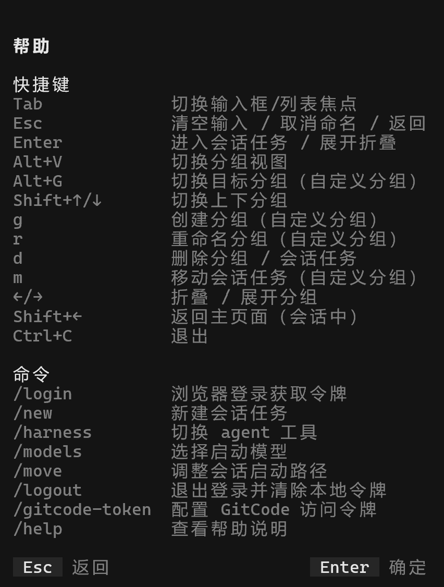

# 命令与快捷键

这篇文档是速查表：全部斜杠命令、全部快捷键，以及输入框对命令输入的规则。

## 斜杠命令

输入框里以 `/` 开头即为命令，回车执行。命令名不区分大小写（`/login` 与 `/LOGIN` 等价），命令名之后的多余文字会被忽略。新建会话需要先执行 `/new` 回车进入任务命名模式，再输入任务名称。

| 命令 | 作用 | 未登录时可见 | 登录后可见 |
| --- | --- | --- | --- |
| `/login` | 打开浏览器完成登录 | 是 | 否（隐藏） |
| `/gitcode-token` | 用 GitCode 访问令牌登录 | 是 | 否（隐藏） |
| `/new` | 新建会话任务 | 否 | 是 |
| `/harness` | 切换智能体（agent） | 否 | 是 |
| `/models` | 选择启动模型 | 否 | 是 |
| `/move` | 调整新会话的启动路径 | 否 | 是 |
| `/logout` | 退出登录并清除本地凭据 | 否 | 是 |
| `/help` | 打开帮助弹窗 | 是 | 是 |

说明：

- 未登录时只有 `/login`、`/gitcode-token`、`/help` 能用；登录后登录类命令从联想中隐藏。
- 即使手工输入已隐藏的命令，程序也会拒绝执行，不会产生半登录状态。
- `/help` 弹窗里同时列出快捷键与命令，内容与本文一致；弹窗受终端宽度限制，说明文字可能更简。
- 在输入框敲 `/` 会弹出联想，`↑`/`↓` 移动高亮，回车执行高亮项。

## 快捷键

“生效范围”一列很重要：同一个按键在不同焦点、不同视图下可能不生效。

| 按键 | 作用 | 生效范围 |
| --- | --- | --- |
| `Tab` | 切换输入框 / 会话列表焦点 | 主页面 |
| `Esc` | 清空输入、取消命名、从列表切回输入框 | 主页面 |
| `Enter` | 进入会话任务、展开/折叠分组、执行分页动作 | 主页面列表 |
| `↑` / `↓` | 在列表内逐行移动光标（跳过组间空行） | 主页面列表 |
| `Shift+↑` / `Shift+↓` | 切换到上/下一个分组 | 主页面列表 |
| `←` / `→` | 折叠 / 展开分组；在分页行上切换“加载更多 / 收起” | 分组行、分页行 |
| `Alt+V` | 在“按智能体分组”与“自定义分组”之间切换 | 主页面 |
| `Alt+G` | 循环切换新会话的目标分组 | 输入框焦点 + 自定义分组视图 |
| `g` | 新建分组 | 自定义分组视图（分组行上，或输入框为空时） |
| `r` | 重命名分组 | 自建分组行（自定义分组视图） |
| `d` | 删除分组 / 删除会话任务 | 分组行（仅自定义视图）/ 会话行（所有视图） |
| `m` | 把会话移动到其它分组 | 会话行（自定义分组视图） |
| `Shift+←` | 从会话返回主页面（会话继续运行） | 会话中 |
| `Ctrl+C` | 退出程序 | 任意（会话中同样退出） |

补充：

- 组间跳转使用 `Shift+↑` / `Shift+↓`；`Ctrl+↑`、`Ctrl+↓`、`Alt+↑`、`Alt+↓` 已废弃，按下不会有任何动作。
- `Shift+←` 只在会话中有效；主页面按下不会产生可见行为。
- 默认分组不能重命名或删除；按智能体分组视图下没有自定义分组，`g`、`r`、`m`、`Alt+G` 不生效。
- 与命令联想同时存在时，`↑`/`↓` 优先在联想列表里移动，`Tab` 与 `Esc` 仍按上表处理。
- 在 `/move` 目录选择弹窗中，`Tab` 用于把当前高亮目录补全到搜索框。
- 登录弹窗里复制授权链接用 `Enter`；`Ctrl+C` 是退出程序，不会复制。

## 输入规则

| 规则 | 行为 |
| --- | --- |
| 以 `/` 开头 | 视为命令，按首个空白符前的部分匹配命令名 |
| 非 `/` 开头 | 不作为命令提交；任务名称需在 `/new` 之后输入，任务内容在会话内交给智能体 |
| 输入框为空时输入全角斜杠 `／` 或顿号 `、` | 自动纠正为 `/`，仍可触发命令联想 |
| `/` 之后允许的字符 | 字母、数字、连字符（非命令字符会被拦截） |

## 界面里的其它入口

- 帮助弹窗：`/help`（其中“快捷键”“命令”两段与本文同源）。
- 空态引导卡：还没有任何会话时，主界面会显示一张快速开始卡片，提示登录、新建会话与常用按键。
- 快捷键提示栏：主界面底部实时显示当前状态下真正可用的按键，随焦点与视图变化。
