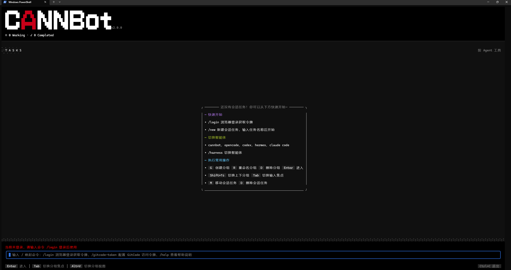
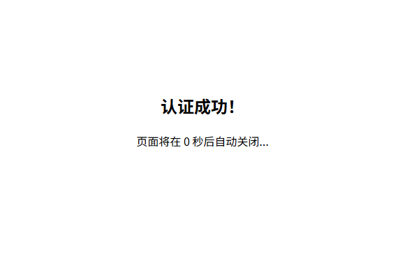
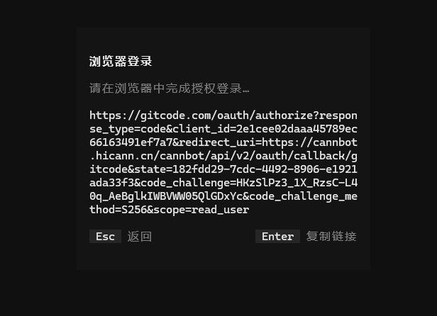
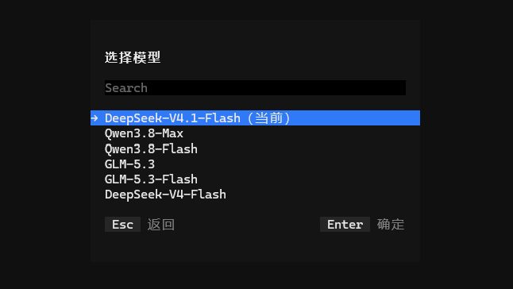
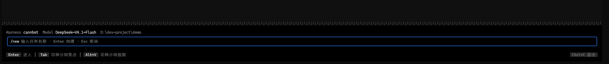
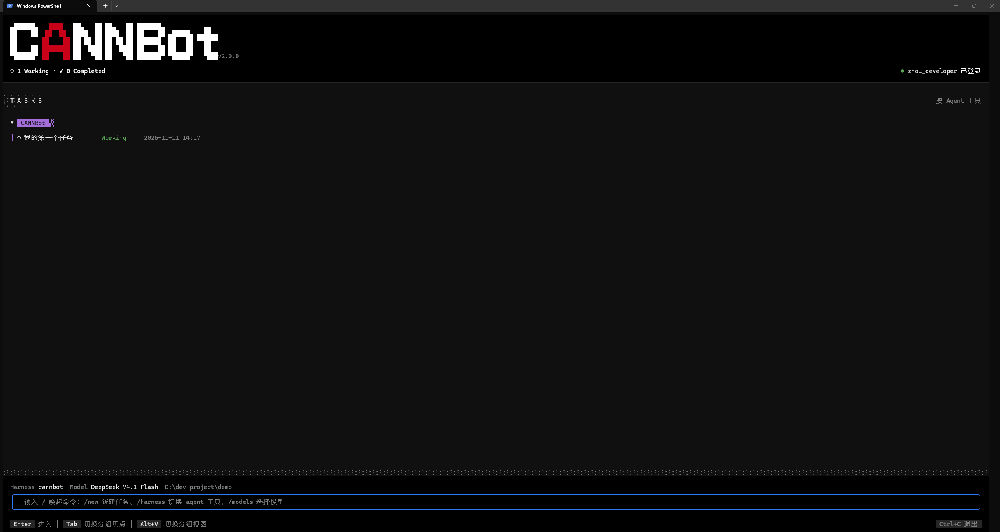

# 快速开始

这篇文档带你完成从安装到跑起第一个会话的最短路径。全程只需要一个终端。

## 环境要求

- 操作系统：Windows、Linux、macOS。
- Node.js 18 或更高版本：仅 npm 安装出来的启动器脚本需要。发布包装好的是独立可执行文件，本身自带运行时，**不需要**另外安装 Bun。
- 磁盘空间：安装后约占用 170 MB（内含界面可执行文件与内置智能体），请预留空间。

安装时**不要**使用 `--omit=optional`，否则平台的运行文件不会被装上，装完会打不开。

## 安装

安装正式包 `cannbot`：

```bash
npm install -g cannbot
```

不想安装也可以临时运行：

```bash
npx cannbot
```

安装完成后直接执行：

```bash
cannbot
```

CANNBot 是一个完整的终端应用，本身就包含两部分：

| 组成 | 说明 |
| --- | --- |
| 界面程序 `cannbot` | 你启动并操作的 TUI，负责登录、会话、分组、历史等 |
| 内置智能体 `cannbot-cli` | 随包一起安装的智能体，也就是 `/harness` 列表里的 `cannbot` 选项 |

两者随同一个安装包一起提供，无需你分别安装。因此在 CANNBot 里选择 `cannbot` 作为智能体时可以直接使用；其它智能体（`opencode`、`codex`、`hermes`、`claude code`）才需要你自行准备。

## 启动

```bash
cannbot
```

启动后会看到主界面，主要分为四块：

- 顶部：标题与版本，下面一行是运行中/已完成的任务统计；
- 中间：分组与会话列表；还没有任何会话时展示空态旅程卡，提示登录、新建会话与常用按键；
- 信息栏：当前智能体、模型与工作目录（自定义分组视图下还会显示目标分组）；
- 底部：命令输入框与随状态变化的快捷键提示。

首次启动还没有登录，信息栏会显示一条未登录提示；按下一步完成登录后，登录状态会显示在标题行右上角。



## 第一次使用

### 1. 登录

在输入框输入 `/login` 回车，程序会打开浏览器完成授权；完成授权后，弹框会自动关闭。


授权成功后，浏览器页面会提示认证成功，随后自动关闭。



如果浏览器没有自动打开，弹窗里会给出链接，按 `Enter` 复制后到浏览器手动打开。注意不要按 `Ctrl+C`——它在 CANNBot 里是退出程序。



无法走浏览器授权时，也可以用 GitCode 访问令牌登录：在输入框输入 `/gitcode-token` 回车，在弹出的输入框里粘贴令牌并确认。令牌只用于换取登录态，不会明文写进配置文件。

### 2. 选择模型

在输入框输入 `/models` 回车，从列表中选择本次要使用的模型。没有选择时，状态栏的 `Model` 会显示“默认”，表示不指定模型，交给智能体自己决定。

登录成功后，程序通常会自动选中模型列表中的第一个，你也可以随时用 `/models` 改选。



### 3. 新建第一个会话

先在输入框输入 `/new` 回车进入任务命名模式，再输入任务名称并回车，例如“我的第一个任务”。任务名称不能为空，也不能和已有任务重名（不区分大小写）。输入框会提示当前处于任务命名模式：



回车后：

1. 界面显示“正在启动 <智能体> …”；
2. 智能体画出第一屏内容后，自动进入该会话的终端界面；
3. 在会话里正常与智能体交互，`Esc` 等按键行为由你所选的智能体决定。

### 4. 回到主页面与回到会话

| 按键 | 作用 |
| --- | --- |
| `Shift+←` | 在会话中返回主页面，会话继续在后台运行 |
| `Enter` | 在会话任务行上进入/回到该会话 |
| `Tab` | 在输入框与会话列表之间切换焦点 |

返回主页面后，运行中的会话会在列表里展示，顶部统计行会显示运行中与已完成的会话数量。



### 5. 退出

在主页面按 `Ctrl+C` 退出程序。会话随程序退出而结束；需要保留的对话请先在会话内完成。

## 下一步

- 登录方式与凭据：[登录](login.md)
- 切换智能体与选择模型：[智能体与模型](agents-and-models.md)
- 新建会话、分组管理、工作目录：[会话与分组](sessions-and-groups.md)
- 全部命令与快捷键：[命令与快捷键](commands-and-shortcuts.md)
- 自动更新提示、数据目录与清理：[数据目录与升级](data-and-upgrade.md)
