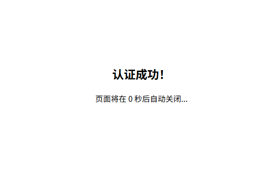
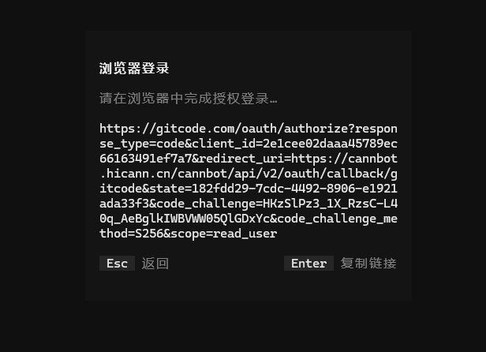
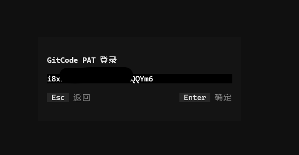
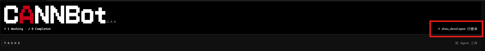

# 登录

这篇文档讲清楚怎么登录、登录状态在哪看、怎么退出登录，以及登录凭据保存在哪里。

## 两种登录方式

### 方式一：浏览器授权

在输入框输入 `/login` 回车，程序会自动打开浏览器，请在浏览器里完成授权。弹窗状态含义：

| 弹窗提示 | 含义与操作 |
| --- | --- |
| 请在浏览器中完成授权登录 | 正常等待，去浏览器完成授权即可 |
| 无法自动打开浏览器，请手动复制以下链接到浏览器打开完成授权 | 按 `Enter` 复制弹窗里的链接，手动在浏览器打开 |
| 登录失败，请重试或改用 `/gitcode-token` | 授权未完成或已失效，可关闭弹窗后重新执行 `/login` |

授权成功后，浏览器页面会提示认证成功，随后自动关闭。

弹窗里拿到授权链接后会一直显示，可随时复制；复制成功会给出提示。浏览器没有自动打开时，界面里会显示可复制的授权链接：

> **复制请按 `Enter`**：登录弹窗底部显示“Enter 复制链接”。不要习惯性地按 `Ctrl+C` 复制——在 CANNBot 里它是**退出程序**，可能直接结束正在运行的会话。

### 方式二：GitCode 访问令牌

没有浏览器、或浏览器授权反复失败时，在输入框输入 `/gitcode-token` 回车，在弹出的输入框里粘贴 GitCode 访问令牌并确认。输入不能为空。这个令牌只用于本次换取登录态，不会被明文保存。

## 登录状态在哪看

- 未登录时：界面上方的信息栏会被替换成一行红色提示，告诉你当前未登录、需要先登录。
- 已登录时：标题行右上角显示当前登录用户；信息栏显示当前智能体、模型与工作目录，自定义分组视图下还会显示目标分组。
- 命令可见性：未登录时只有 `/login`、`/gitcode-token`、`/help` 可用；登录后这两个登录类命令会从联想里隐藏，其余命令可用。

## 退出登录

在输入框输入 `/logout` 回车，退出登录会清除本机保存的登录凭据。之后需要重新执行 `/login` 或 `/gitcode-token`。

建议先结束正在进行的会话再退出登录，避免登录态变化影响正在使用的会话。

## 登录凭据保存在哪

- 访问令牌只在程序运行期间使用，不会写入本地文件。
- 登录凭据在本机加密保存，并与当前设备绑定；换机器、重装系统或更换系统用户后需要重新登录。
- 本地不会保存明文访问令牌，各智能体也不会拿到真实访问令牌。

更完整的数据目录说明见[数据目录与升级](data-and-upgrade.md)。登录之后要切换智能体或选择模型，见[智能体与模型](agents-and-models.md)。
