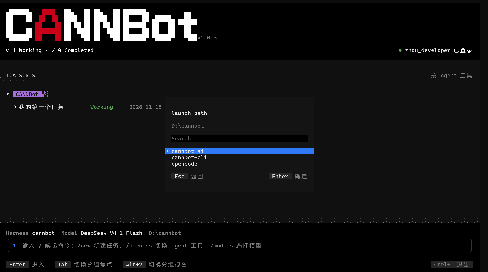
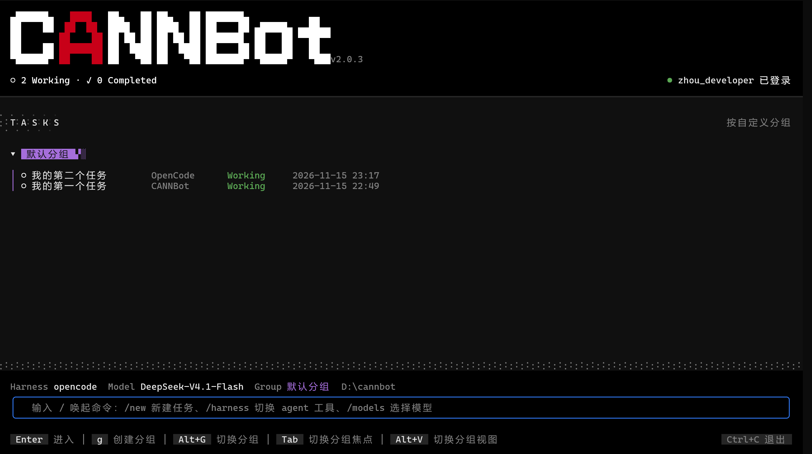
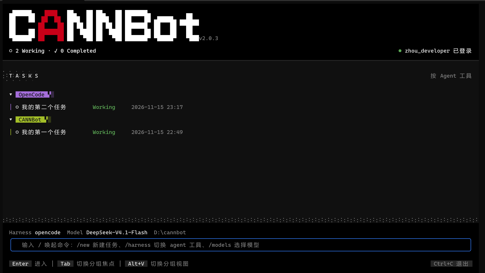

# 会话与分组

这篇文档讲日常使用的主线：怎么新建会话、怎么在会话与主页面之间来回、怎么组织历史记录、怎么调整新会话的工作目录。切换智能体与选择模型见[智能体与模型](agents-and-models.md)。

## 输入框的两种状态

输入框有两种模式，快捷键提示栏会随状态变化：

| 模式 | 触发方式 | 输入内容 |
| --- | --- | --- |
| 命令模式 | 默认状态 | 以 `/` 开头，输入命令；输入 `/` 后会弹出命令联想 |
| 任务名模式 | 输入 `/new` 并回车后 | 输入新会话的任务名称 |

小技巧：

- 全角斜杠 `／` 和顿号 `、` 在输入框为空时会被当成 `/` 处理，中文输入法下不用切回英文。
- 命令联想按前缀过滤，不区分大小写；`↑`/`↓` 移动高亮，回车执行高亮项（不必把命令名敲完）。
- `Esc` 在任务名模式下取消命名并清空输入；在命令模式下清空输入；焦点在列表时先切回输入框。

## 新建会话

### 步骤

1. 输入 `/new` 回车，进入任务名模式；
2. 输入任务名称后回车（任务名模式下即使带上 `/new ` 前缀也会被自动去掉）；
3. 界面显示“正在启动 <智能体> …”，等智能体画出第一屏内容后自动进入会话终端。

任务名称规则：

- 不能为空；
- 不能与已有任务重名（比较时忽略首尾空格，不区分大小写）；
- 重名时输入框下方会提示任务名称已存在。

### 新会话的目标分组

在自定义分组视图下，可以用 `Alt+G` 在输入框位置循环切换“新会话将进入哪个分组”；信息栏的 `Group` 会显示当前目标分组。按智能体分组视图下没有这个设置，新会话直接进入当前智能体对应的分组。

### 会话的工作目录

默认使用启动 CANNBot 时所在的目录。需要换目录时用 `/move`：

1. 执行 `/move` 打开目录选择弹窗；
2. 输入路径片段搜索子目录，或直接浏览；按 `Tab` 可用高亮结果补全路径；
3. 选中目录后回车，路径立即生效。

`/move` 设置的是**本次运行**的启动路径，不会写进配置文件；重新启动 CANNBot 后回到启动时所在目录。目录在你确认前被删除或不可用时，弹窗会提示且不生效。

## 在会话与主页面之间切换

| 操作 | 效果 |
| --- | --- |
| 会话中按 `Shift+←` | 返回主页面，会话继续在后台运行 |
| 会话任务行上按 `Enter` | 附着到该会话；会话已在运行则直接切回去 |
| `Tab` | 在输入框与会话列表之间切换焦点 |

要点：

- 返回主页面**不会**结束会话，运行中的会话继续工作；
- 可以同时运行多个会话，顶部统计行显示“○ n Working · ✓ m Completed”；
- 已结束的会话仍保留在历史里，回车会用原任务信息重新打开智能体页面；任务仍在运行时会直接切回原会话。

## 两种分组视图

用 `Alt+V` 在两种视图之间切换，选择会保存下来，下次启动沿用：

| 视图 | 说明 |
| --- | --- |
| 按智能体分组（默认） | 每个智能体一个分组，分组按组内最早会话时间排序；不需要手工维护分组 |
| 自定义分组 | 自己创建分组并把会话归类；默认分组用于未归类的任务 |

**自定义分组视图**

**按智能体分组视图**

分组视图下还可以组间快速跳转：`Shift+↑` / `Shift+↓` 切到上/下一个分组。

## 自定义分组操作

以下按键只在**自定义分组视图**下生效：

| 按键 | 场景 | 作用 |
| --- | --- | --- |
| `g` | 分组行上，或输入框为空时 | 新建分组 |
| `r` | 自建分组行上 | 重命名分组 |
| `d` | 分组行或会话行上 | 删除分组 / 删除会话 |
| `m` | 会话行上 | 把会话移动到其它分组 |
| `←` / `→` | 分组行上 | 折叠 / 展开分组 |

限制与注意：

- 默认分组不能重命名、不能删除；
- 删除分组会连同该分组内的会话记录一起删除，删除前会弹出确认并提示影响范围；
- 删除会话只删除历史记录；如果该会话正在运行，程序会先结束对应进程；
- `m` 的候选列表会排除会话当前所在分组；
- 每组默认只显示 5 条，超出时出现“加载更多”；展开后可“收起”，`←`/`→` 可在分页行的两个动作间切换。

按智能体分组视图下没有自定义分组，`g`、`r`、`m` 与 `Alt+G` 均不生效，分组也不能删除；会话的 `d` 删除在所有视图都可用。

## 删除与退出的区别

| 操作 | 影响 |
| --- | --- |
| 删除会话记录 | 删除一条历史记录（运行中的会话会被结束） |
| `/logout` | 清除本机登录凭据，会话与历史不受影响 |
| `Ctrl+C`（主页面） | 退出程序，运行中的会话随程序结束 |

需要保留对话内容时，请先在会话里完成再退出。
