# CANNLab 用户手册

## 文档版本记录

| 版本 | 日期 | 作者 | 说明 |
|:---|:---|:---|:---|
| V1.0 | 2026-05-28 | maoyuanxing | 初始版本 |

---

## 目录

- [CANNLab 用户手册](#cannlab-用户手册)
  - [文档版本记录](#文档版本记录)
  - [目录](#目录)
  - [1. 产品简介](#1-产品简介)
    - [1.1 产品概述](#11-产品概述)
    - [1.2 产品优势](#12-产品优势)
    - [1.3 应用场景](#13-应用场景)
    - [1.4 基本概念](#14-基本概念)
  - [2. 快速入门（首次使用）](#2-快速入门首次使用)
    - [2.1 前提条件](#21-前提条件)
    - [2.2 操作步骤](#22-操作步骤)
      - [步骤一：进入 CANN 开源仓库](#步骤一进入-cann-开源仓库)
      - [步骤二：点击 CANNLab 选择云开发](#步骤二点击-cannlab-选择云开发)
      - [步骤三：绑定华为云账号（首次使用）](#步骤三绑定华为云账号首次使用)
      - [步骤四：完成实名认证（首次使用）](#步骤四完成实名认证首次使用)
      - [步骤五：GitCode 授权开发者空间（首次使用）](#步骤五gitcode-授权开发者空间首次使用)
      - [步骤六：连接开发环境](#步骤六连接开发环境)
    - [2.3 验证结果](#23-验证结果)
  - [3. 用户指南](#3-用户指南)
    - [3.1 环境申请](#31-环境申请)
      - [环境提供的算力规格](#环境提供的算力规格)
      - [使用规则](#使用规则)
      - [环境申请限制](#环境申请限制)
    - [3.2 环境管理](#32-环境管理)
    - [3.3 CANN 软件栈管理](#33-cann-软件栈管理)
      - [查询 CANN 版本](#查询-cann-版本)
      - [查询驱动版本](#查询驱动版本)
      - [升级 CANN 版本](#升级-cann-版本)
      - [驱动版本升级](#驱动版本升级)
    - [3.4 数据管理](#34-数据管理)
      - [持久化存储](#持久化存储)
      - [文件上传与下载](#文件上传与下载)
      - [代码自动拉取](#代码自动拉取)
    - [3.5 代码工程管理](#35-代码工程管理)
      - [切换工程目录](#切换工程目录)
      - [分支管理](#分支管理)
      - [Git 免密操作](#git-免密操作)
    - [3.6 内置开发工具](#36-内置开发工具)
      - [Huawei OP DevTools（算子开发插件）](#huawei-op-devtools算子开发插件)
      - [PyPTO Toolkit（融合算子开发插件）](#pypto-toolkit融合算子开发插件)
      - [OpenCode AI 助手](#opencode-ai-助手)
    - [3.7 镜像管理](#37-镜像管理)
      - [查看当前镜像版本](#查看当前镜像版本)
      - [镜像版本更新](#镜像版本更新)
  - [4. 故障排查](#4-故障排查)
    - [4.1 账号与登录类问题](#41-账号与登录类问题)
      - [Q1：IAM会话超时策略设置](#q1iam会话超时策略设置)
      - [Q2：账号绑定常见问题](#q2账号绑定常见问题)
    - [4.2 WebIDE 连接类问题](#42-webide-连接类问题)
      - [Q1："网络不稳定，webide恢复中，请稍后（28秒）"](#q1-页面隔一段时间提示网络不稳定webide恢复中请稍后28秒)
      - [Q2："WebIDE环境准备中，大约需要1-2分钟，请您耐心等待"](#q2-使用过程中页面突然提示webide环境准备中大约需要1-2分钟请您耐心等待)
      - [Q3："连接被抢占，您可能打开了多个窗口连接"](#q3-页面弹窗报连接错误报错连接被抢占您可能打开了多个窗口连接可尝试重新连接)
      - [Q4："云开发环境网络连接不稳定"](#q4-页面弹窗报连接错误报错云开发环境网络连接不稳定您可以再次尝试连接或者重启以恢复连接)
    - [4.3 VSCode 连接类问题](#43-vscode-连接类问题)
      - [Q1：WebSocket connection failed](#q1-vscode右下角报错websocket-connection-failed)
      - [Q2：端口转发已禁用](#q2-vscode窗口弹窗无法与xxx建立连接端口转发已禁用port-forwarding-is-disabled)
      - [Q3：VSCode隔一段时间断连](#q3-vscode隔一段时间不操作会断连且需要再次登录华为云)
    - [4.4 其它问题](#44-其它问题)
      - [Q1：编译算子时提示找不到头文件](#q1编译算子时提示找不到头文件)
      - [Q2：创建环境时提示资源不足](#q2创建环境时提示资源不足)
      - [Q3：找不到代码工程目录](#q3找不到代码工程目录)
  - [5. 附录](#5-附录)
    - [5.1 问题反馈渠道](#51-问题反馈渠道)
  - [6. 约束与限制](#6-约束与限制)
  - [7. 更多资源](#7-更多资源)

---

## 1. 产品简介

### 1.1 产品概述

CANNLab 是CANN社区推出的一站式云开发平台，提供NPU算力资源。平台面向CANN生态的算子开发、模型训练与推理、AI 应用构建等场景，为开发者提供**开箱即用**的云端开发环境。

开发者无需在本地安装 CANN 工具链，通过 [GitCode](https://gitcode.com/cann) 上的 CANN 开源仓库入口即可进入平台，按需申请算力，使用 WebIDE 或本地 IDE 远程连接进行开发。

### 1.2 产品优势

| 优势 | 说明 |
|:---|:---|
| **零配置开发环境** | 预装 WebIDE、Git、CANN 基础包（当前为 9.0.0 正式版本）及算子开发插件，开箱即用 |
| **多种算力规格** | 支持A2、A3 昇腾算力环境以及 950 CPU仿真环境 |
| **双端连接** | WebIDE（浏览器直接使用）与本地 VSCode Remote-SSH 远程连接 |
| **数据持久化** | `/mnt/workspace` 目录在环境关机后数据保留，保障代码安全 |
| **免费算力** | 开发者享有初始 100 卡时免费额度；后续可以通过积分兑换卡时 |
| **工具链集成** | 内置 Huawei OP DevTools 算子开发插件、PyPTO Toolkit、OpenCode工具 |

### 1.3 应用场景

**场景一：昇腾算子开发**

基于预置的 CANN 环境和 Huawei OP DevTools 插件，在云端完成 Ascend C 自定义算子的开发、编译、调试与性能调优。支持标准自定义算子和 pyasc 算子的新建、编译、异常检测与性能分析。

**场景二：模型训练与推理**

利用 A2/A3 NPU 算力，进行轻量级大模型的 SFT 微调、推理部署及模型评估。支持1卡和8卡多种规格。

**场景三：AI 应用开发**（规划中）

基于 CANNLab 云端环境，构建 RAG 检索增强生成、AI Agent 智能体编排、多模态应用等 AI 应用场景。

### 1.4 基本概念

| 术语 | 说明 |
|:---|:---|
| **环境（Instance）** | CANNLab 提供的云端计算单元，包含 CANN 软件栈及开发工具 |
| **镜像（Image）** | 预装好开发环境的模板，包含 CANN 版本、Python 版本及内置工具。如 `master-py3.11-20260401` |
| **卡时（Card-Hours）** | 算力资源的计量单位。 |
| **工作空间** | 挂载在 `/mnt/workspace` 的持久化存储目录，环境关机后数据保留 |
| **NPU 环境** | 搭载昇腾 NPU 卡的计算环境，支持 A2 和 A3 |
| **CPU 仿真环境** | 搭载 ARM CPU 的计算环境，用于无 NPU 依赖的算子逻辑验证与 UT 测试 |

---

## 2. 快速入门（首次使用）

### 2.1 前提条件

**注册 GitCode 账号：**

1. 访问 [GitCode 官网](https://gitcode.com)
2. 点击页面右上角 **"注册"** 按钮
3. 选择注册方式：支持手机号、邮箱或微信注册
4. 按提示完成注册流程

**访问环境：**

- 建议使用Chrome浏览器连接WebIDE。
- 建议使用VSCode进行远程连接。

### 2.2 操作步骤

#### 步骤一：进入 CANN 开源仓库

进入 CANN 开源组织 https://gitcode.com/cann ，选择任意一个开源仓库进入。

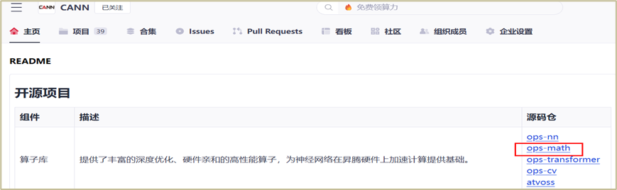

#### 步骤二：点击 CANNLab 选择云开发

点击 **"CANNLab"** -> **"云开发"** 进入平台。

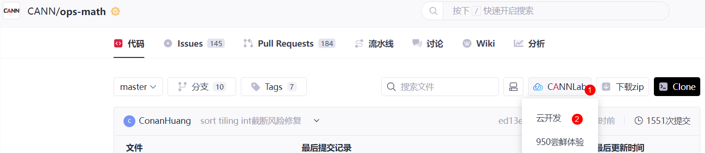

#### 步骤三：绑定华为云账号（首次使用）

首次使用会进入绑定华为云账号页面，输入手机号/验证码，等待"最近登录"栏关联出华为云账号后，点击"绑定"。

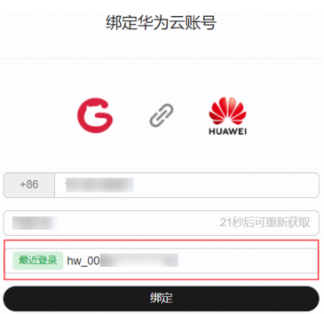

> **注意**： 如绑定过程中遇到问题，请参考 [4.1 Q3：华为（云）账号绑定常见问题](#q3华为云账号绑定常见问题) 进行排查

#### 步骤四：完成实名认证（首次使用）

绑定账号后进入 CANNLab 列表页面，如华为云账号未完成实名认证，系统会弹出提示框要求完成认证。请点击"前往认证"按钮完成个人实名认证后，再返回创建开发环境。


1. 选择"个人认证"

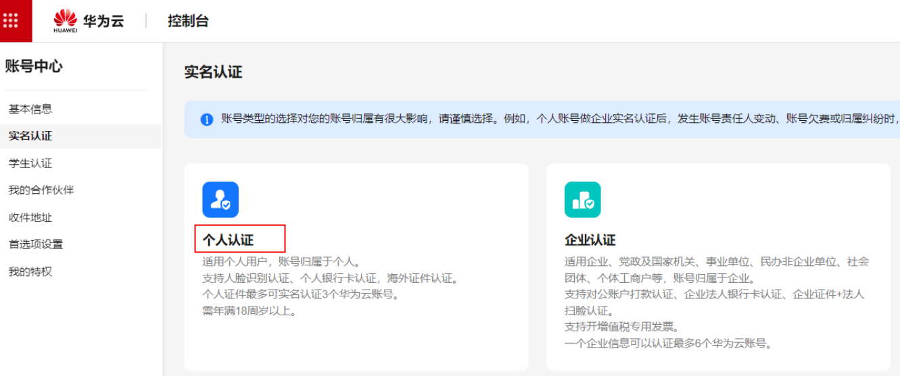

2. 选择"人脸识别认证"

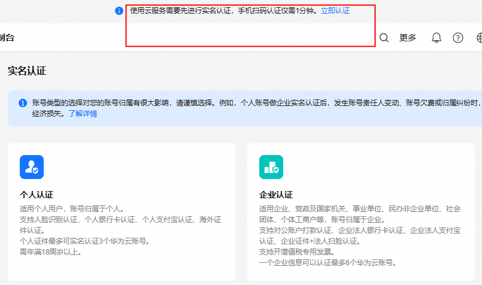

#### 步骤五：GitCode 授权开发者空间（首次使用）

首次创建环境时，系统会要求 GitCode 向华为云进行授权。请点击"授权"按钮完成授权。

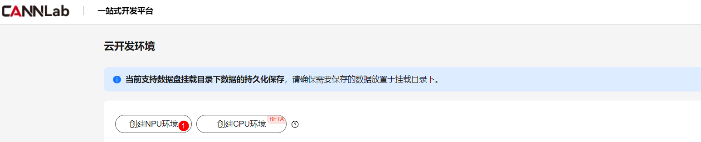

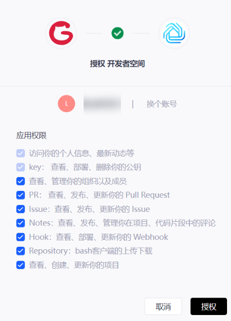

#### 步骤六： 点击"创建NPU环境"

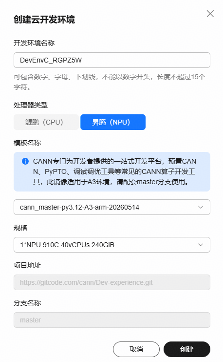


#### 步骤七：连接开发环境

环境创建成功后，点击 **"连接"**，选择一种连接方式：

| 方式 | 适用场景 | 说明 |
|:---|:---|:---|
| **WebIDE** | 轻量开发、跨设备使用 | 浏览器直接打开，无需安装任何软件 |
| **VSCode** | 重度开发、习惯本地编辑器 | 需安装社区版 VSCode 和 Huawei Developer Space 插件 |

**方式一：WebIDE 连接**

1. 点击 **"连接"** -> 选择 **"WebIDE"**
2. 等待页面加载完成，即可进入浏览器内 IDE
3. WebIDE 支持同时开启最多 **3 个**独立工作窗口，但不推荐开启多个工作窗口
4. 连接成功后，展示如下：

   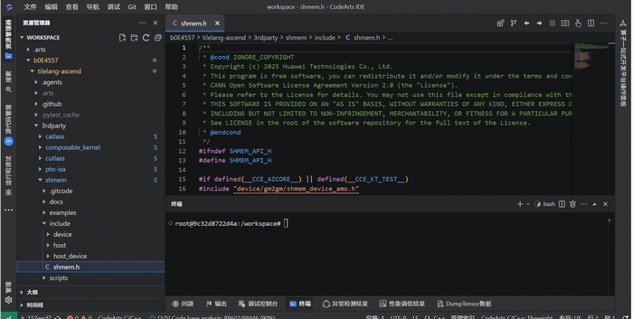

> **说明**
> - 目前支持 Chrome 浏览器
> - 如遇到页面卡住或连接断开，可尝试关机再开机恢复环境

**方式二：本地 VSCode 连接**

1. 点击 **"连接"** -> 选择 **"Visual Studio Code"**
2. 首次使用需安装 Huawei Developer Space 和 Remote SSH 插件，根据提示允许即可
3. 点击插件图标 -> "登录"，在浏览器中选择已实名的华为云账号并确认授权

   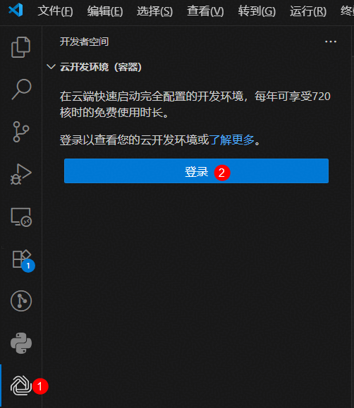

4. 登录成功后，可以点击此处进行远程连接

   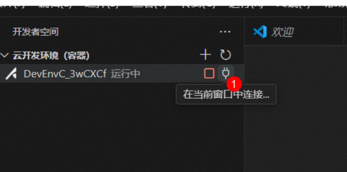

5. 点击插件图标 -> "安装" -> 选择 **"Linux"** -> "信任文件夹并继续"

6. 连接成功后，即可看到如下窗口：

   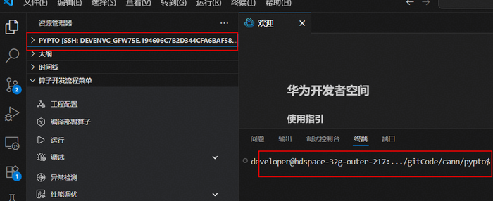

> **说明**
> - 插件闲时未操作自动退出时间为 24 小时，24 小时内有操作不会断连

### 2.3 验证结果

连接成功后（无论使用 WebIDE 还是 VSCode），可在终端中执行以下命令验证环境：

```bash
# 查看 NPU 信息
npu-smi info

# 查看 CANN 版本
env | grep ASCEND

# 查看镜像版本
cat /home/developer/image-version.txt
```

---

## 3. 用户指南

### 3.1 环境申请

#### 环境提供的算力规格

| 资源类型 | 芯片型号 | 规格选项 | 使用时长 | 说明 |
|:---|:---|:---|:---|:---|
| **NPU (A2)** | 昇腾 A2 | 1卡：16vCPUs/32GiB | 100卡时 | 通用 NPU 算力 |
| | | 1卡：32vCPUs/32GiB | | |
| | | 8卡：192vCPUs/1536GiB | | |
| **NPU (A3)** | 昇腾 A3 | 1卡：40vCPUs/240GiB | 100卡时 | 高配 NPU 算力 |
| | | 8卡：320vCPUs/1920GiB | | |
| **CPU (ARM)** | 鲲鹏 | 16vCPUs/32GiB | 720核时 | 仅支持 ARM，不支持 x86 |

#### 使用规则

**NPU 环境：**
- 总计 100 卡时，卡时消耗完将**自动关机**并释放资源
- 算力消耗以"卡时"为单位，如创建 1 卡环境，最多可用 100 小时
- 卡时不足时，可通过参与 CANN 社区任务赚取积分兑换算力（100 积分 = 1 卡时）
- **环境开机即消耗算力，建议不用时及时关机或删除**

**CPU 环境：**
- 总计 720 核时，核时消耗完将**自动关机**并释放资源
- 算力消耗以"核时"为单位，如创建 16vCPUs 环境，最多可用 45 小时
- **环境开机即消耗算力，建议不用时及时关机或删除**

#### 环境申请限制

- NPU 和 CPU 资源**各可申请一个**
- NPU 资源类型（A2/A3）不支持直接切换，需关机、删除后重新创建
- **注意：环境删除时，`/mnt/workspace` 数据不会保存**


### 3.2 环境管理

CANNLab 环境存在以下状态：

| 状态 | 说明 | 是否消耗卡时 |
|:---|:---|:---|
| **运行中** | 环境正在运行，可进行开发操作 | 是 |
| **关机** | 环境已停止，`/mnt/workspace` 数据保留 | 否 |
| **休眠** | 长时间无操作自动挂起，数据保留 | 否 |
| **异常** | 环境本身存在异常，或者算力资源已分配完。建议稍后关机再开机重试 | 否 |
| **已删除** | 环境已销毁，数据不可恢复 | - |

**操作说明：**

- **关机**：停止环境运行，释放算力资源。`/mnt/workspace` 下的数据持久化保留，其他目录数据丢失。
- **开机**：重新启动已关机或休眠的环境。
- **删除**：彻底销毁环境。**删除后所有数据不可恢复**，请提前备份或 Push 代码至 Git 仓库。


### 3.3 环境数据

#### 数据持久化存储

| 目录 | 持久化 | 说明 |
|:---|:---|:---|
| `/mnt/workspace` | ✅ 持久化 | 环境关机后数据保留，环境**删除**后数据清除 |
| `/home/developer` | ❌ 非持久化 | 环境删除后数据丢失 |
| 其他系统目录 | ❌ 非持久化 | 环境删除后数据丢失 |

> **重要提示**
> - 请将所有代码工程、数据集、模型文件存放于 `/mnt/workspace` 下
> - `/home` 目录持久化功能正在开发中
> - 环境删除操作不可逆，请提前备份

#### 文件上传与下载

支持通过 WebIDE 界面或 VSCode 插件直接上传/下载文件。

#### 代码自动拉取

从 CANN 开源仓库入口创建的环境，会**自动 clone 该仓库的代码**至 `/mnt/workspace`，无需手动拉取。


### 3.4 代码工程管理

#### Git 免密操作

平台基于 GitCode 账号绑定自动完成 SSH 公私钥配置，`git clone` / `git push` 全程免密。

#### 切换工程目录

在 WebIDE 中：文件（File）-> 打开项目（Open Project）-> 选择对应仓库目录

#### 分支管理

当前自动 clone 代码时支持选择一个分支，如后续需其他分支请手动切换。


### 3.5 镜像管理

镜像中内置了 CANN 软件包、Huawei OP DevTools 算子开发插件、PyPTO Toolkit、OpenCode 编码辅助等开发工具。

#### 查看当前镜像版本

**方式一：** 在 CANNLab 环境列表页，鼠标移至"模板名称"查看详情

**方式二：** 在环境内执行命令：

```bash
cat /home/developer/image-version.txt
```

#### 镜像版本更新

| 场景 | 操作方式 |
|:---|:---|
| 需要全新环境 | 关机 -> 删除环境 -> 重新创建（注意备份数据） |
| 仅升级 CANN 包 | 使用"CANN包升级"按钮 |
| 仅升级算子插件 | WebIDE "扩展"中搜索更新 |
| 仅升级 OpenCode | WebIDE "扩展"中搜索 "CANNBot Toolkit" 更新 |

> **注意：** 暂不支持直接镜像升级。

---


#### 内置CANN软件包查看与升级

**查询 CANN 版本**

CANN 包已预装，安装路径为 `/home/developer/Ascend`（注意：区别于自行安装的默认路径 `/usr/local/Ascend`）。

**方式一：查询环境变量**
```bash
env | grep ASCEND
```

**方式二：查看版本文件**
```bash
cat /home/developer/Ascend/ascend-toolkit/latest/opp/version.info
```

**升级 CANN 版本**

**方式一：控制台一键升级（推荐）**

1. 在 CANNLab 环境列表，点击 **"CANN包升级"** 按钮
2. 选择可升级的 CANN 包版本（如 9.0.0 正式版、master 分支构建版本）
3. 确认升级结果：

```bash
cd /home/developer/.cann
./manage_cann_pkg.sh --version
```

返回 `task.status = 1` 且 `process = 100%` 表示升级成功。

**方式二：手动安装**

通过WebIDE或者VSCode连接后，在终端中可手动下载安装


### 3.6 环境驱动版本查看与升级

#### 查询驱动版本

当前驱动版本为 **25.5.1**，安装路径为 `/usr/local/Ascend/driver`。

```bash
cat /usr/local/Ascend/driver/version.info | grep Version
```

#### 驱动版本升级

暂不支持个人对环境的驱动版本升级，由平台统一规划。


#### 内置开发工具

**Huawei OP DevTools（算子开发插件）**

预装于云开发环境中，提供：

| 功能 | 说明 |
|:---|:---|
| **工程创建** | 支持 pyasc 算子和标准自定义算子一键新建 |
| **编译与执行** | 可视化编译运行，支持芯片类型配置（A3/A5） |
| **调试** | 支持 DumpTensor 调试，数据落盘与可视化 |
| **异常检测** | 检测代码异常，支持错误定位与跳转 |
| **性能调优** | 性能泳道分析与结果拼图 |
| **精度对比** | DumpTensor 数据可视化精度对比 |
| **UT 测试** | 标准自定义算子单元测试 |

**升级方式：** WebIDE 连接后，左侧栏"扩展"中搜索 "Huawei OP DevTools" 进行版本选择。

**PyPTO Toolkit**

预装于云开发环境中，面向 AI 加速器的高性能编程框架，简化复杂融合算子及模型网络的开发流程。

| 功能 | 说明 |
|:---|:---|
| **Tile 编程模型** | 基于硬件感知数据块（Tile）的编程范式，充分利用 NPU 并行能力 |
| **多层级 IR 编译** | Tensor Graph → Tile Graph → Block Graph → Execution Graph 自动编译优化 |
| **自动代码生成** | 编译生成 PTO 虚拟指令，再编译为目标平台可执行代码 |
| **分层抽象** | 算法开发者用 Tensor 层，性能专家用 Tile 层，系统开发者用 Block 层 |
| **精度验证** | Golden 参考生成、精度对比与定位、二分对比 |
| **性能调优** | 实测性能数据分析、瓶颈定位、迭代优化 |

**适用场景：**
- 复杂融合算子开发（如 FlashAttention、MLA 等）
- 大模型算子级实现与优化
- 需要极致性能调优的算子开发

**OpenCode**

终端内置 OpenCode 工具，支持自然语言交互式编码辅助。

**配置方法：**

1. 验证环境是否已内置 opencode：

```bash
opencode --version
```

2. 打开配置文件：

```
/home/developer/.config/opencode/opencode.json
```

3. 在配置文件中添加 provider 配置（以 GLM-4-7 为例）：

```json
"provider": {
    "myprovider": {
      "npm": "@ai-sdk/openai-compatible",
      "name": "volcengine",
      "options": {
        "baseURL": "https://ark.cn-beijing.volces.com/api/v3",
        "apiKey": "***"
      },
      "models": {
        "<END_POINT_ID>": {
          "name": "GLM-4-7-<END_POINT_ID>"
        }
      }
    }
}
```

4. 终端执行 `opencode`，输入 `/models` 选择模型即可开始使用。

**升级方式：** WebIDE 连接后，"扩展"中搜索 "CANNBot Toolkit"，或通过命令行更新。


## 4. 常见问题

### 4.1 华为云账号登录与绑定类问题

#### Q1：账号频繁登录

**解决：** 登录华为云后访问 IAM 服务，修改"安全设置" -> "登录验证策略" -> "会话超时策略"，将默认 1 小时修改为最大 24 小时。

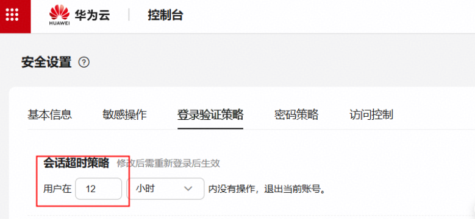


#### Q2：账号绑定常见问题

##### 一、特性说明

2026/5/15，CANNLab平台支持GitCode账号和华为云账号绑定功能。首次使用CANNLab时，会弹出以下提示信息，根据个人需要进行选择。


###### 1. 绑定已有账号并授权（推荐）
适用场景：已有华为云账号且后续长期使用CANNLab平台。一次绑定后，后续可自动登录华为云。

- 如果有华为云账号，"最近登录"栏会自动关联出最近登录过的华为云账号；如果您有多个账号，可以点击 **"切换"** 进行选择；

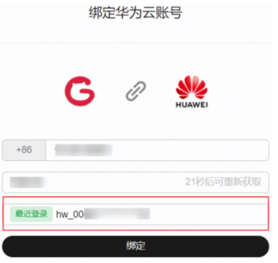

- 如果没有华为云账号，需要勾选协议/声明，点击"注册账号并绑定"，**会自动开通一个全新的华为云账号**。

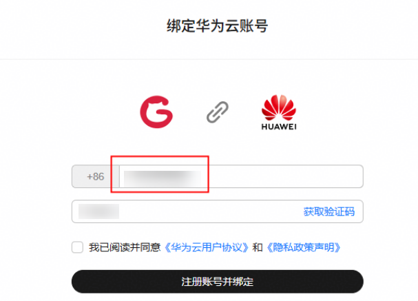

###### 2. 暂不绑定，使用已有华为云账号登录
适用场景：针对已经有绑定关系的账号，无法支持再次绑定（如GT账号/联邦账号等）；或者是使用他人的账号登录，请不要绑定，直接登录。

###### 3. 查看已绑定的账号/解绑功能

支持查看/解绑/绑定账号功能，入口在GitCode页面个人设置-账号设置增加了"云开发环境绑定"功能；

- 点击：GitCode页面->右上角的"个人设置"
- 点击："账号设置"->"云开发环境绑定"


##### 二、常见问题

###### 问题一：使用云开发环境的时候一直自动登录的不是之前绑定的华为云账号怎么处理？

**【处理建议】** 支持账号解绑功能！入口在GitCode页面个人设置-账号设置的"云开发环境绑定"。具体如上图所示。


###### 问题二：绑定账号时，账号展示不全，原来使用的华为云的账号没有显示。

**【原因】** 已经有绑定关系的账号不支持重新绑定，如GT账号、联邦账号等，因此没有展示出来。
如果仍需使用此账号，可以不绑定，直接登录。具体操作：
- Ctrl+Shift+Delete 清除缓存
- 从GitCode重新进入CANNLab时，选择不绑定，使用已有账号登录


###### 问题三：账号绑定之后，之前申请的环境不见了，该如何处理？

**【处理建议】** ①请确认账号绑定错误的原因是什么，如果原账号是GT账号（如下图所示），请参考问题二处理；②如果原华为云账号不是"GT"账号，请参考问题一。

为避免多个华为云账号登录的干扰，建议账号绑定时先清除浏览器缓存。

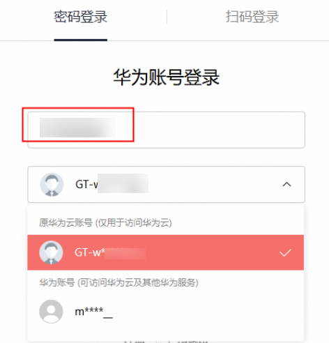

### 4.2 WebIDE 连接类问题

#### Q1: 页面隔一段时间，提示："网络不稳定，webide恢复中，请稍后（28秒）"

进入WebIDE时隔几秒钟就会出现以下错误：


【问题原因】
网络不稳定，导致webide客户端与服务端的连接断开。

【解决思路】 确认网络环境是否正常？请从以下几个方面进行排查：
- 是否使用科学上网软件？**请关闭代理**，确认连接是否恢复正常
- 尝试更换网络环境（如从 Wi-Fi 切换到有线网络，或切换到手机热点测试）
- 尝试使用不同浏览器（推荐 Chrome）打开 WebIDE
- 如果以上方法均无法解决，请反馈当前页面的 URL 和报错截图，联系技术支持

#### Q2: 使用过程中，页面突然提示："WebIDE环境准备中，大约需要1-2分钟，请您耐心等待"

进入WebIDE时页面卡住，提示以下信息：


【问题排查】
- 请使用浏览器F12打开，点击"Network"页签，F5刷新页面，确认：shim接口是否为pending状态，无法调用。

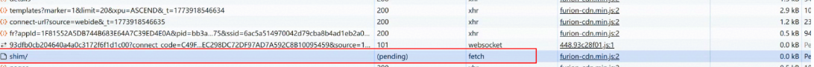

- 确认是否是：WebIDE无法进入页面，VSCode可以正常连接；
- 若是，则说明是该环境后台codeArts-server进程被kill，请使用以下方式恢复。
- 若不是，请您反馈当前页面的URL和报错截图，联系运维人员从后台排查具体原因。

【codearts-server进程被kill的恢复手段】
- 【可能原因】
  - ①执行高负载任务导致CPU或者内存被打满，该进程被kill；
  - ②codearts-server进程启动时默认的max-memory是4G，单进程超过4G，导致进程退出。
- 【恢复手段】
  - 方法一：若使用VSCode可以正常连接，可以通过SSH终端手动拉起该进程，环境无需关机（适用于环境中有重要数据，无法直接关机）
  - 方法二：环境关机、再开机后可自动拉起该进程，自动恢复（适用于环境中无重要数据的场景。因为关机时，/mnt/workspace目录会数据持久化保存，其它目录数据会丢失）
  - 【平台建议】建议重新创建环境，使用最新版本的镜像，该镜像已将该进程的max-memory启动参数调大至6G或者8G，后续使用该进程被kill的几率会降低

#### Q3: 页面弹窗报"连接错误"，报错："连接被抢占，您可能打开了多个窗口连接，可尝试重新连接。"

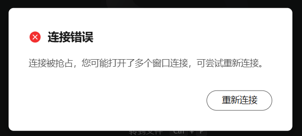

【解决思路】
- 同一个环境最多支持开3个WebIDE窗口，如果超过3个将出现以上提示。请关闭窗口再重试。

#### Q4: 页面弹窗报"连接错误"，报错："云开发环境网络连接不稳定，您可以再次尝试连接（或者重启）以恢复连接。"


【解决思路】
1. 点击重新连接
2. 如无法连接，请参考 **Q1** 的排查步骤


### 4.3 VSCode 连接类问题

#### Q1: VSCode右下角报错："WebSocket connection failed"

VSCode右下角报错："WebSocket连接失败"

错误提示一：


错误提示二：

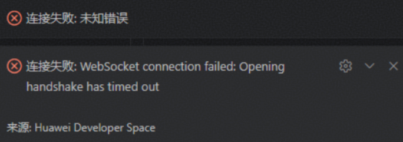

【解决思路】
- 确认是否为首次使用VSCode方式连接开发环境；
- 若是，请参考[本地VSCode连接指导](https://gitcode.com/cann/infrastructure/blob/main/docs/CANNLab/CANNLab用户手册.md)中的"3.2 VSCode 连接"章节依次操作，需重点检查proxy和remote-ssh的配置是否正确。

#### Q2: VSCode窗口弹窗：无法与"xxx"建立连接：端口转发已禁用（Port forwarding is disabled）

错误提示一：
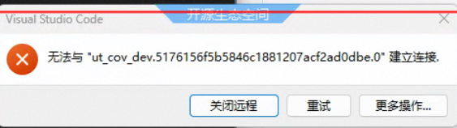

错误提示二：
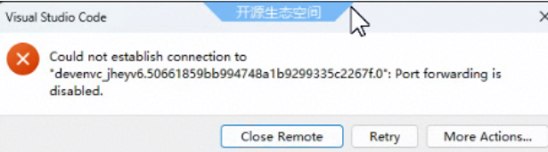

【解决思路】
当前版本已知问题，问题详情：https://gitcode.com/cann/infrastructure/issues/487

如果是1.2.1及以前的版本可以尝试使用以下方式解决：
1. 升级插件版本到1.3.1版本及以上。升级完，打开文件`C:\Users\账号目录\.devenv\.ssh\config`，确认配置：`UserKnownHostsFile /dev/null`
2. 如果配置是：`UserKnownHostsFile NUL`，请尝试在该目录创建known_hosts目录后，再次升级。
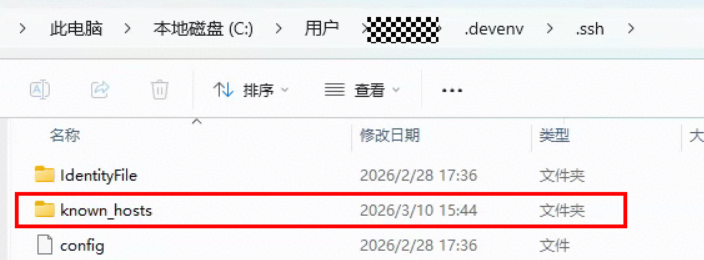

#### Q3: VSCode隔一段时间不操作会断连，且需要再次登录华为云

【功能说明】
VSCode连接服务器通过remote-ssh连接，如果出现网络断开，可能会导致再次回到VSCode窗口时需要重新连接远程服务器。

开发者插件有闲时不操作的自动退出开发者账号功能，当前闲时时间为24小时，因此只要24小时内有操作，原则上不会断开。

【解决思路】
- 如果VSCode频繁断连，需要排查是否存在网络抖动。可能原因有：电脑休眠、电脑设置国外代理网络不稳定等诸多因素；
- 如果VSCode断连后，重新连接还需要跳转华为云进行登录，需要确认：
   - 插件版本是否为最新版本，旧版本的闲时时间为2小时；


### 4.4 其它问题

#### Q1：编译算子时提示找不到头文件

**解决：** 加载 CANN 环境变量：
```bash
source /home/developer/Ascend/ascend-toolkit/set_env.sh
```

#### Q2：创建环境时提示资源不足

**解决：** 当前资源池已无可用资源，请更换算力规格重试。

#### Q3：找不到代码工程目录

**排查：** 执行 `ls /mnt/workspace` 查看是否存在代码目录。如未自动拉取，请参考[问题反馈](#问题反馈)进行反馈。

---

## 5. 附录

### 5.1 问题反馈渠道

| 用户类型 | 反馈方式 |
|:---|:---|
| **社区用户** | 请参考[问题反馈](#问题反馈)进行反馈 |

> **注意：** 如为各 CANN 开源仓自身的问题（如 ops-math、mindspore 等），请提至对应仓库。

---

## 6. 约束与限制

| 约束项 | 说明 |
|:---|:---|
| **浏览器** | 推荐使用 Chrome 最新版，不支持 Firefox |
| **用户权限** | 操作用户为 `developer`，不支持直接使用 root 登录。可通过 `sudo` 命令切换到 root |
| **NPU 资源** | NPU 和 CPU 资源各可申请一个，不支持直接切换资源类型 |
| **镜像升级** | 暂不支持直接镜像升级，需关机、删除环境后重新创建 |
| **驱动升级** | 暂不支持个人环境的驱动版本升级，由平台统一规划 |

> **说明：** 以上约束可能随平台版本更新而调整，请关注 CANN 社区动态获取最新信息。

---

## 7. 更多资源

- **CANN 开源仓库**：https://gitcode.com/cann
- **infrastructure 仓库**（社区基础设施与会议信息）：https://gitcode.com/cann/infrastructure

> 如有本文档未覆盖的问题，欢迎通过上述渠道反馈，我们将持续完善文档内容。