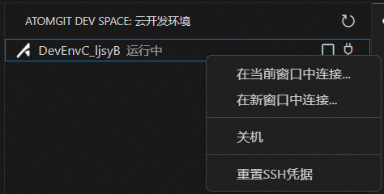
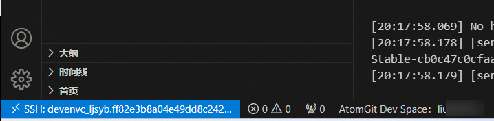
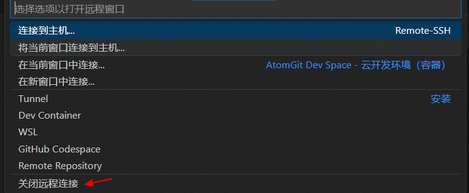
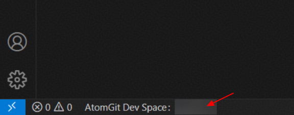
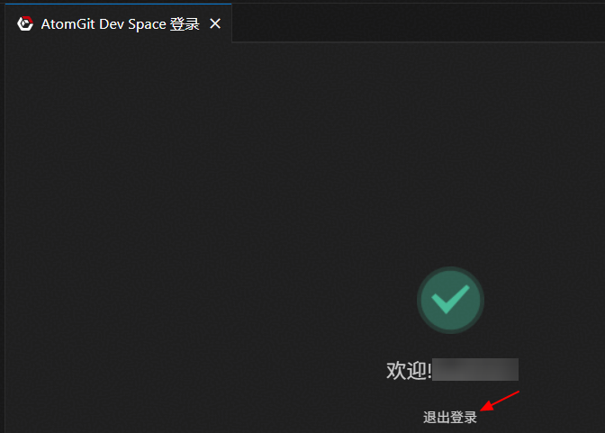
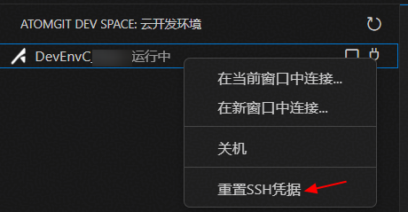

# CANNLab 用户手册

## 文档版本记录

| 版本 | 日期 | 作者 | 说明 |
|:---|:---|:---|:---|
| V1.0 | 2026-05-28 | maoyuanxing | 初始版本 |
| V2.0 | 2026-07-03 | miaoxuedan | 修订版本 |
| V3.0 | 2026-08-17 | liudi5525 | 章节重构与优化 |

---

## 目录

- [CANNLab 用户手册](#cannlab-用户手册)
  - [文档版本记录](#文档版本记录)
  - [目录](#目录)
  - [1. 产品简介](#1-产品简介)
    - [1.1 概述](#11-概述)
    - [1.2 产品特点](#12-产品特点)
    - [1.3 应用场景](#13-应用场景)
    - [1.4 基本概念](#14-基本概念)
  - [2. 快速入门](#2-快速入门)
    - [2.1 前提条件](#21-前提条件)
    - [2.2 操作步骤](#22-操作步骤)
      - [2.2.1 创建环境](#221-创建环境)
      - [2.2.2 使用环境](#222-使用环境)
        - [2.2.2.1 WebIDE 连接](#2221-webide-连接)
        - [2.2.2.2 本地 VSCode 连接](#2222-本地-vscode-连接)
    - [2.3 验证结果](#23-验证结果)
  - [3. 用户指南](#3-用户指南)
    - [3.1 环境申请](#31-环境申请)
      - [3.1.1 环境提供的算力规格](#311-环境提供的算力规格)
      - [3.1.2 使用规则](#312-使用规则)
      - [3.1.3 环境申请限制](#313-环境申请限制)
    - [3.2 环境管理](#32-环境管理)
    - [3.3 环境数据](#33-环境数据)
      - [3.3.1 数据持久化存储](#331-数据持久化存储)
      - [3.3.2 文件上传与下载](#332-文件上传与下载)
    - [3.4 代码工程管理](#34-代码工程管理)
      - [3.4.1 代码自动拉取](#341-代码自动拉取)
      - [3.4.2 Git 免密操作](#342-git-免密操作)
      - [3.4.3 切换工程目录](#343-切换工程目录)
      - [3.4.4 分支管理](#344-分支管理)
    - [3.5 镜像管理](#35-镜像管理)
      - [3.5.1 查看当前镜像版本](#351-查看当前镜像版本)
      - [3.5.2 镜像版本更新](#352-镜像版本更新)
      - [3.5.3 内置CANN软件包查看与升级](#353-内置cann软件包查看与升级)
      - [3.5.4 内置开发工具](#354-内置开发工具)
    - [3.6 环境驱动版本查看与升级](#36-环境驱动版本查看与升级)
      - [3.6.1 查询驱动版本](#361-查询驱动版本)
      - [3.6.2 驱动版本升级](#362-驱动版本升级)
  - [4. 常见问题](#4-常见问题)
    - [4.1 WebIDE 连接类问题](#41-webide-连接类问题)
      - [Q1：页面隔一段时间，提示："网络不稳定，webide恢复中，请稍后（28秒）"](#q1页面隔一段时间提示网络不稳定webide恢复中请稍后28秒)
      - [Q2：使用过程中，页面突然提示："WebIDE环境准备中，大约需要1-2分钟，请您耐心等待"](#q2使用过程中页面突然提示webide环境准备中大约需要1-2分钟请您耐心等待)
      - [Q3：页面弹窗报"连接错误"，报错："连接被抢占，您可能打开了多个窗口连接，可尝试重新连接。"](#q3页面弹窗报连接错误报错连接被抢占您可能打开了多个窗口连接可尝试重新连接)
      - [Q4：页面弹窗报"连接错误"，报错："云开发环境网络连接不稳定，您可以再次尝试连接（或者重启）以恢复连接。"](#q4页面弹窗报连接错误报错云开发环境网络连接不稳定您可以再次尝试连接或者重启以恢复连接)
    - [4.2 VSCode 连接类问题](#42-vscode-连接类问题)
      - [Q1：VSCode右下角报错："WebSocket connection failed"](#q1vscode右下角报错websocket-connection-failed)
      - [Q2：VSCode 隔一段时间不操作会断连，且需要再次进行 AtomGit 授权](#q2vscode-隔一段时间不操作会断连且需要再次进行-atomgit-授权)
    - [4.3 其它问题](#43-其它问题)
      - [Q1：编译算子时提示找不到头文件](#q1编译算子时提示找不到头文件)
      - [Q2：创建环境时提示资源不足](#q2创建环境时提示资源不足)
      - [Q3：找不到代码工程目录](#q3找不到代码工程目录)
  - [5. 问题反馈](#5-问题反馈)
    - [5.1 问题反馈](#51-问题反馈)
  - [6. 约束与限制](#6-约束与限制)
    - [6.1 约束与限制](#61-约束与限制)
  - [7. 附录](#7-附录)
    - [7.1 附录](#71-附录)
  - [8. 版本历程](#8-版本历程)
    - [8.1 版本历程](#81-版本历程)

---

## 1. 产品简介

### 1.1 概述

CANNLab 是 CANN 社区推出的提供 NPU 算力资源的一站式云开发平台。平台面向 CANN 生态的算子开发、模型训练与推理、AI 应用开发等场景，为开发者提供**开箱即用**的云端开发环境。

开发者无需在本地安装 CANN 工具链，通过 [AtomGit](https://gitcode.com/cann) 上的 CANN 开源仓库入口即可进入平台，按需申请算力，使用 WebIDE 或本地 VSCode 远程连接进行开发。

### 1.2 产品特点

| 特点 | 说明 |
|:---|:---|
| **零配置开发环境** | 预装 WebIDE、Git、CANN 基础包（当前为 9.0.0 正式版本）及算子开发插件，开箱即用 |
| **多种算力规格** | 支持 A2、A3 昇腾算力环境以及 950 CPU 仿真环境 |
| **双端连接** | 支持 WebIDE（浏览器直接使用）与本地 VSCode Remote-SSH 远程连接 |
| **数据持久化** | 持久化目录 `/mnt/workspace` 和 `/home` 在环境关机后数据保留，保障代码安全 |
| **免费算力** | 开发者享有初始 100 卡时免费额度，后续可以通过积分兑换卡时 |
| **工具链集成** | 内置 Ascend C Toolkit 算子开发插件，PyPTO Toolkit、CANNBot Toolkit 等辅助工具 |

### 1.3 应用场景

**场景一：昇腾算子开发**

基于预置的 CANN 环境和 Ascend C Toolkit 插件，在云端完成 Ascend C 自定义算子的开发、编译、调试与性能调优。支持标准自定义算子和 pyasc 算子的新建、编译、异常检测与性能分析。

**场景二：模型训练与推理**

利用 A2/A3 NPU 算力，进行轻量级大模型的 SFT 微调、推理部署及模型评估。支持 1 卡和 8 卡两种规格。

**场景三：AI 应用开发（规划中）**

基于 CANNLab 云端环境，构建 RAG 检索增强生成、AI Agent 智能体编排、多模态应用等 AI 应用场景。

### 1.4 基本概念

| 术语 | 说明 |
|:---|:---|
| **环境** | CANNLab 提供的云端计算单元，包含 CANN 软件栈及开发工具 |
| **镜像** | 预装好开发环境的模板，包含 CANN 基础包、Python 环境及其他内置工具 |
| **卡时** | NPU算力资源的计量单位，1 卡时 = NPU 卡数量 × 使用时长（小时） |
| **核时** | CPU 算力资源的计量单位，1 核时 = vCPU 数量 × 使用时长（小时） |
| **工作空间** | 挂载在 `/mnt/workspace` 和 `/home` 的持久化存储目录，环境关机后数据保留 |
| **NPU 环境** | 搭载昇腾 NPU 卡的计算环境，支持 A2 和 A3 |
| **CPU 仿真环境** | 搭载 ARM CPU 的计算环境，用于无 NPU 依赖的算子逻辑验证与 UT 测试 |

## 2. 快速入门

### 2.1 前提条件

**注册 AtomGit 账号**

1. 访问 [AtomGit 官网](https://gitcode.com)
2. 点击页面右上角 **"注册"** 按钮
3. 选择注册方式：支持手机号、邮箱或微信注册
4. 按提示完成注册流程

**访问环境**

- 如果您的开发习惯是在浏览器 IDE 中在线开发（如 Code Server），建议提前安装Chrome 浏览器。
- 如果您的开发习惯是在本地 IDE 中进行开发（如 VSCode、Jetbrains），建议提前安装 VSCode。

### 2.2 操作步骤

#### 2.2.1 创建环境

1. 进入 CANN 开源组织：https://gitcode.com/cann
2. 点击导航栏中的 **CANNLab** 页签后，正式进入 CANNLab 主页


3. 左侧导航栏切换到**我的环境**，点击**新建环境**可创建 NPU 环境


根据需要选择 A2 或者 A3 环境，选择模板和 NPU 规格


环境创建完成后，NPU 环境会自动启动，可以在**我的环境**页面进行开机/关机/连接/CANN包升级/删除操作


4. 通过以上方式可以创建 CPU 环境

#### 2.2.2 使用环境

环境创建完成后，点击 **"连接"**，选择一种连接方式：

| 方式 | 适用场景 | 说明 |
|:---|:---|:---|
| **WebIDE** | 轻量开发、跨设备使用 | 浏览器直接打开，无需安装任何软件 |
| **Visual Studio Code** | 重度开发、习惯本地编辑器 | 需安装连接云端开发环境的插件 |


##### 2.2.2.1 WebIDE 连接

1. 点击 **"连接"**，选择 **"WebIDE"**，等待页面加载完成即可进入浏览器内 IDE。
2. 连接成功后，展示如下：

   

> **说明**
> - 推荐使用 Chrome 浏览器
> - WebIDE 支持同时开启最多 **3 个**独立工作窗口，但不推荐开启多个工作窗口
> - 如遇到页面卡住或连接断开，可尝试关机再开机恢复环境

##### 2.2.2.2 本地 VSCode 连接

1. 点击 **"连接"** -> 选择 **"Visual Studio Code"**
2. 首次使用需安装 CANNLab Dev Space 和 Remote SSH 插件，根据提示依次操作
3. 点击插件图标 -> "登录"，在浏览器中选择 AtomGit 账号授权

   

4. 登录成功后，可以点击此处进行远程连接

   

5. 点击插件图标 -> "安装" -> 选择 **"Linux"** -> "信任文件夹并继续"

6. 连接成功后，即可看到如下窗口：

   

> **说明**
> - 插件闲时未操作自动退出时间为 24 小时，24 小时内有操作不会断连

### 2.3 验证结果

连接成功后（无论使用 WebIDE 还是 VSCode），可在终端中执行以下命令验证环境：

```bash
# 查看 NPU 信息
npu-smi info

# 查看 CANN 版本
env | grep ASCEND

# 查看镜像版本
cat /home/developer/image-version.txt
```

## 3. 用户指南

### 3.1 环境申请

#### 3.1.1 环境提供的算力规格

| 资源类型 | 芯片型号 | 规格选项 | 使用时长 | 说明 |
|:---|:---|:---|:---|:---|
| **NPU (A2)** | 昇腾 A2 | 1卡：16vCPUs/32GiB | 100卡时 | 通用 NPU 算力 |
| | | 1卡：32vCPUs/32GiB | | |
| | | 8卡：192vCPUs/1536GiB | | |
| **NPU (A3)** | 昇腾 A3 | 1卡：40vCPUs/240GiB | 100卡时 | 高配 NPU 算力 |
| | | 8卡：320vCPUs/1920GiB | | |
| **CPU (ARM)** | 鲲鹏 | 16vCPUs/32GiB | 720核时 | 仅支持 ARM，不支持 x86 |

#### 3.1.2 使用规则

**NPU 环境：**
- 总计 100 算力时长，消耗完将**自动关机**并释放资源
- 算力消耗以"卡时"为单位，如创建 1 卡环境，最多可用 100 小时
- 卡时不足时，可参与 CANN 社区任务赚积分兑换算力（100 积分 = 1 卡时）
- **环境开机即消耗算力，建议不用时及时关机**

**CPU 环境：**
- 总计 720 算力时长，消耗完将**自动关机**并释放资源
- 算力消耗以"核时"为单位，如创建 16vCPUs 环境，最多可用 45 小时
- **环境开机即消耗算力，建议不用时及时关机**

#### 3.1.3 环境申请限制

- NPU 和 CPU 资源**可各申请一个**
- NPU 资源类型（A2/A3）不支持直接切换，需关机、删除后重新创建
- **注意：环境删除时，`/mnt/workspace` 和 `/home` 数据不会保存**

### 3.2 环境管理

CANNLab 环境存在以下状态：

| 状态 | 说明 | 是否消耗卡时 |
|:---|:---|:---|
| **运行中** | 环境正在运行，可进行开发操作 | 是 |
| **关机** | 环境已停止，`/mnt/workspace` 和 `/home` 数据保留 | 否 |
| **休眠** | 长时间无操作自动挂起，数据保留 | 否 |
| **已删除** | 环境已销毁，数据不可恢复 | - |

**操作说明：**

- **关机**：停止环境运行，释放算力资源。`/mnt/workspace` 和 `/home` 下的数据持久化保留，其他目录数据丢失。
- **开机**：重新启动已关机或休眠的环境。
- **删除**：彻底销毁环境。**删除后所有数据不可恢复**，请提前备份或 Push 代码至 Git 仓库。


### 3.3 环境数据

#### 3.3.1 数据持久化存储

| 目录 | 持久化 | 说明 |
|:---|:---|:---|
| `/mnt/workspace` | ✅ 持久化 | 环境关机后数据保留，环境**删除**后数据清除 |
| `/home` | ✅ 持久化 | 环境关机后数据保留，环境**删除**后数据清除 |
| 其他系统目录 | ❌ 非持久化 | 环境**删除**后数据丢失 |

> **重要提示**
> - 请将所有代码工程、数据集、模型文件等重要文件存放于 `/mnt/workspace` 或 `/home` 目录下
> - 环境删除操作不可逆，请提前备份重要数据

#### 3.3.2 文件上传与下载

支持通过 WebIDE 界面或 VSCode 插件直接上传/下载文件。

**WebIDE 上传和下载：**


**VSCode 下载：**


**VSCode 上传：** 直接把文件拖动到对应目录即可。

> **注意：** 建议上传/下载的文件不要太大，过大的文件可能无法直接传输成功，需要通过分片或压缩解压等方式处理。


### 3.4 代码工程管理

#### 3.4.1 代码自动拉取

在新建环境时，可以**添加预加载代码仓**，在环境创建时，会**自动 clone 该仓库的代码**至 `/mnt/workspace`，无需手动拉取。如果在新建环境时没有添加预加载代码仓，环境创建将不会 clone 任何代码仓。

#### 3.4.2 Git 免密操作

平台基于 AtomGit 账号绑定自动完成 SSH 公私钥配置，`git clone` / `git push` 全程免密。

#### 3.4.3 切换工程目录

- WebIDE：文件（File）-> 打开项目（Open Project）-> 选择对应仓库目录
- VSCode：文件（File）-> 打开文件夹（Open Folder）-> 选择对应仓库目录


#### 3.4.4 分支管理

当前自动 clone 代码时支持选择一个分支，如后续需其他分支请手动切换。

### 3.5 镜像管理

CANNLab 环境基于预配置的镜像创建，镜像中内置了 CANN 软件包、Ascend C Toolkit 算子开发插件、PyPTO Toolkit、CANNBot 编码辅助等开发工具。本节介绍如何查看和更新镜像中的组件。

#### 3.5.1 查看当前镜像版本

**方式一：** 在 CANNLab 环境列表页，鼠标移至"镜像/规格"查看详情

**方式二：** 在环境内执行命令

```bash
cat /home/developer/image-version.txt
```

#### 3.5.2 镜像版本更新

根据需求选择合适的更新方式：

| 场景 | 操作方式 |
|:---|:---|
| 需要全新环境 | 关机 -> 删除环境 -> 重新创建（注意备份数据） |
| 仅升级 CANN 包 | 使用"CANN包升级"按钮 |
| 仅升级算子插件 | 在"扩展"中搜索插件名称更新 |

> **注意：** 暂不支持直接升级镜像。

#### 3.5.3 内置CANN软件包查看与升级

CANN 软件包是昇腾 AI 处理器的核心软件栈，已预装在环境中。

##### 3.5.3.1 查询 CANN 版本

CANN 包安装路径为 `/home/developer/Ascend`（注意：区别于自行安装的默认路径 `/usr/local/Ascend`）。

**方式一：查询环境变量**
```bash
env | grep ASCEND
```

**方式二：查看版本文件**
```bash
cat /home/developer/Ascend/ascend-toolkit/latest/opp/version.info
```

##### 3.5.3.2 升级 CANN 版本

**方式一：控制台一键升级（推荐）**

1. 在 CANNLab 环境列表，点击 **"CANN包升级"** 按钮
2. 选择可升级的 CANN 包版本（如 9.0.0 正式版、master 分支构建版本）
3. 确认升级结果：

```bash
cd /home/developer/.cann
./manage_cann_pkg.sh --version
```

返回 `task.status = 1` 且 `process = 100%` 表示升级成功。

**方式二：手动安装**

通过WebIDE或者VSCode连接后，在终端中可手动下载安装。

除了 CANN 软件包，镜像中还预装了多种开发辅助工具，用于提升算子开发、性能调优等场景的效率。

#### 3.5.4 内置开发工具

环境中预装了多种开发辅助工具，提升开发效率。

##### 3.5.4.1 Ascend C Toolkit（算子开发插件）

预装于云开发环境中，提供：

| 功能 | 说明 |
|:---|:---|
| **工程创建** | 支持 pyasc 算子和标准自定义算子一键新建 |
| **编译与执行** | 可视化编译运行，支持芯片类型配置（A3/A5） |
| **调试** | 支持 DumpTensor 调试，数据落盘与可视化 |
| **异常检测** | 检测代码异常，支持错误定位与跳转 |
| **性能调优** | 性能泳道分析与结果拼图 |
| **精度对比** | DumpTensor 数据可视化精度对比 |
| **UT 测试** | 标准自定义算子单元测试 |

**升级方式**

连接到环境后，左侧栏"扩展"中搜索 "Ascend C Toolkit"，在搜索到的 "Ascend C Toolkit" 插件上如果有"更新"图标，说明发布了新版本，在插件详情页面更新版本。为了简化操作，建议在插件详情页面勾选"自动更新"选项，后续插件将静默升级。

##### 3.5.4.2 PyPTO Toolkit

预装于云开发环境中，面向 AI 加速器的高性能编程框架，简化复杂融合算子及模型网络的开发流程。

| 功能 | 说明 |
|:---|:---|
| **Tile 编程模型** | 基于硬件感知数据块（Tile）的编程范式，充分利用 NPU 并行能力 |
| **多层级 IR 编译** | Tensor Graph → Tile Graph → Block Graph → Execution Graph 自动编译优化 |
| **自动代码生成** | 编译生成 PTO 虚拟指令，再编译为目标平台可执行代码 |
| **分层抽象** | 算法开发者用 Tensor 层，性能专家用 Tile 层，系统开发者用 Block 层 |
| **精度验证** | Golden 参考生成、精度对比与定位、二分对比 |
| **性能调优** | 实测性能数据分析、瓶颈定位、迭代优化 |

**适用场景**

- 复杂融合算子开发（如 FlashAttention、MLA 等）
- 大模型算子级实现与优化
- 需要极致性能调优的算子开发

**升级方式**

连接到环境后，左侧栏"扩展"中搜索 "PyPTO Toolkit"，在搜索到的 "PyPTO Toolkit" 插件上如果有"更新"图标，说明发布了新版本，在插件详情页面更新版本。为了简化操作，建议在插件详情页面勾选"自动更新"选项，后续插件将静默升级。

##### 3.5.4.3 CANNBot 插件

终端内置 CANNBot 工具，支持自然语言交互式编码辅助，提供免费token使用，具体可参考 [CANNBot用户手册](https://gitcode.com/cann/infrastructure/blob/master/docs/CANNBot/CANNBot-User-Guide.md) 。

**升级方式**

连接到环境后，左侧栏"扩展"中搜索 "CANNBot Toolkit"，在搜索到的 "CANNBot Toolkit" 插件上如果有"更新"图标，说明发布了新版本，在插件详情页面更新版本。为了简化操作，建议在插件详情页面勾选"自动更新"选项，后续插件将静默升级。


### 3.6 环境驱动版本查看与升级

#### 3.6.1 查询驱动版本

当前驱动版本为 **25.5.0（A2）、25.5.5（A3）**，路径为 `/usr/local/Ascend/driver`。

```bash
cat /usr/local/Ascend/driver/version.info | grep Version
```

#### 3.6.2 驱动版本升级

暂不支持个人对环境的驱动版本升级，由平台统一规划。


### 3.7 VSCode连接基本使用

CANNLab 支持通过本地 VSCode 远程连接云开发环境，需要安装 **CANNLab Dev Space** 和 **Remote-SSH** 插件。

#### 3.7.1 登录 GitCode 账号

连接环境前，需先登录 GitCode 账号进行授权。

#### 3.7.2 连接算力环境

点击 CANNLab Dev Space 插件中的环境选项，进行连接。



#### 3.7.3 主动断开SSH连接

点击 VSCode 左下角蓝色光标，选择"关闭远程连接"（Close Remote SSH）。





#### 3.7.4 退出 GitCode 账号登录

在 CANNLab Dev Space 插件中选择退出登录。





#### 3.7.5 重置云环境的SSH凭据

如遇 SSH 连接异常，可在 CANNLab 平台重置 SSH 凭据。




## 4. 常见问题

### 4.1 创建环境类问题

#### Q1：创建环境时提示资源不足

**【解决思路】** 当前资源池已无可用资源，请更换算力规格重试。

### 4.2 WebIDE 连接类问题

#### Q1：页面隔一段时间，提示："网络不稳定，webide恢复中，请稍后（28秒）"

进入WebIDE时隔几秒钟就会出现以下错误：


**【问题原因】**
网络不稳定，导致webide客户端与服务端的连接断开。

**【解决思路】** 确认网络环境是否正常？请从以下几个方面进行排查：
- 是否使用科学上网软件？**请关闭代理**，确认连接是否恢复正常
- 尝试更换网络环境（如从 Wi-Fi 切换到有线网络，或切换到手机热点测试）
- 如果以上方法均无法解决，请反馈当前页面的 URL 和报错截图，请参考"问题反馈"咨询

#### Q2：使用过程中，页面突然提示："WebIDE环境准备中，大约需要1-2分钟，请您耐心等待"


**【问题原因】**
执行高负载任务导致 CPU 或内存被打满，codearts-server 进程被 kill，WebIDE 无法正常连接。

**【问题排查】**
- 请使用浏览器 F12 打开，点击 "Network" 页签，F5 刷新页面，确认：shim 接口是否为 pending 状态，无法调用。


- 尝试使用 VSCode 进行连接，若连接成功，说明是 codearts-server 进程被 kill，可通过以下方式恢复。

**【恢复手段】**
- 方法一：通过 VSCode 的 SSH 终端手动拉起该进程
  ```bash
  ~/codearts/bin/codearts-server --without-connection-token --locale zh-cn --port 8888 --host 127.0.0.1 >~/code-server.log 2>&1 &
  ```
  确认进程启动成功：
  ```bash
  ps -ef | grep codearts-server
  ```
  确认进程启动成功后，刷新页面即可恢复。
- 方法二：环境关机、再开机后可自动拉起该进程


#### Q3：页面弹窗报"连接错误"，报错："云开发环境网络连接不稳定，您可以再次尝试连接（或者重启）以恢复连接。"


**【解决思路】**
1. 检查网络访问环境，确认满足平台的网络访问要求
2. 点击"重新连接"，尝试恢复连接
3. 可能是 GitCode 缓存失效或缓存被误清理，可尝试退出 GitCode 账号并重新登录，重新进入 CANNLab 平台
4. 如以上方式仍无法解决，请参考"问题反馈"咨询

### 4.3 VSCode 连接类问题

#### Q1：VSCode 隔一段时间不操作会断连，且需要再次进行 AtomGit 授权

**【问题现象】**
VSCode 断连后重新连接时需要跳转 AtomGit 进行登录授权。

**【问题原因】**
VSCode 通过 remote-ssh 连接服务器，网络断开会导致需要重新连接。开发者插件有闲时自动退出登录功能，当前闲时时间为 24 小时，只要 24 小时内有操作，原则上不会断开。

**【解决思路】**
- 如果 VSCode 频繁断连，排查是否存在网络抖动，如电脑休眠、代理网络不稳定等
- 如果断连后重新连接还需跳转 AtomGit 登录，确认插件是否为最新版本，旧版本闲时时间为 2 小时

#### Q2: VSCode无法连接排查思路
**【问题现象】** VSCode 无法连接到 CANNLab 环境


**【解决思路】**
1. 确认是否为首次使用，首次使用需检查 CANNLab Dev Space 插件和 Remote-SSH 配置
2. 若非首次使用：
   - 尝试主动断开 SSH 并重新连接（参考 3.7.3）
   - 使用 WebIDE 连接，若 WebIDE 也无法连接，尝试环境关机再开机
   - 若 WebIDE 可以连接，说明环境正常，请提供 VSCode 连接报错的具体日志，参考[问题反馈](#51-问题反馈)进行反馈
3. 若以上方式均无效，尝试卸载 Remote-SSH 插件后重新连接

#### Q3: Could not establish connection（多台电脑同时连接）

**【问题现象】** 环境连接成功后 SSH 主动断开，频繁重连。


日志报错：`ssh: connect to host 127.0.0.1 port 20022: Connection refused`


**【问题原因】** VSCode 不支持多台电脑同时连接同一环境。

**【解决思路】** 关闭其中一台电脑的连接即可。

#### Q4: Could not establish connection（Bad permissions）

**【问题现象】**
日志报错：`Bad permissions. Try removing permissions for user: \Everyone (S-1-1-0) on file C:/Users/xxxxx/.ssh/config`

**【解决思路】**
1. 点击 VSCode 左下角齿轮设置按钮，进入设置
2. 搜索 `remote ssh`，添加 config 文件路径，如 `C:\Users\xxx\.atomgitdevenv\.ssh\config`


### 4.4 其它问题

#### Q1：编译算子时提示找不到头文件

**【解决思路】** 加载 CANN 环境变量

```bash
source /home/developer/Ascend/ascend-toolkit/set_env.sh
```

#### Q2：找不到代码工程目录

**排查：** 执行 `ls /mnt/workspace` 查看是否存在代码目录。如未自动拉取，请参考[问题反馈](#51-问题反馈)进行反馈。

## 5. 问题反馈

### 5.1 问题反馈

| 用户类型 | 反馈方式 |
|:---|:---|
| **社区用户** | 欢迎向 [cann/infrastructure](https://gitcode.com/cann/infrastructure/issues) 仓库提交 Issue |

> **注意：** CANN 开源仓自身的问题（如 ops-math、mindspore 等），请提至对应仓库。

## 6. 约束与限制

### 6.1 约束与限制

| 约束项 | 说明 |
|:---|:---|
| **浏览器** | 推荐使用 Chrome 最新版，不支持 Firefox |
| **用户权限** | 操作用户为 `developer`，不支持直接使用 `root` 登录。可通过 `sudo` 命令切换到 `root` 权限 |
| **NPU 资源** | NPU 和 CPU 资源可各申请一个，不支持直接切换资源类型 |
| **镜像升级** | 暂不支持直接升级镜像，需关机、删除环境后重新创建 |
| **驱动升级** | 暂不支持个人环境的驱动版本升级，由平台统一规划 |

> **说明：** 以上约束可能随平台版本更新而调整，请关注 CANN 社区动态获取最新信息。

## 7. 附录

### 7.1 附录

- **CANN 开源仓库**：https://gitcode.com/cann
- **infrastructure 仓库**（社区基础设施与会议信息）：https://gitcode.com/cann/infrastructure

> 如有本文档未覆盖的问题，欢迎通过上述渠道反馈，我们将持续完善文档内容。

## 8. 版本历程

### 8.1 版本历程

### 2026年8月

- **[2026/08/31]** 830版本发布，主要特性有：
  - 新增分设镜像：一个CPU+一个NPU环境，数据互通共享，CPU开发，NPU验证
  - WebIDE环境内置[cann-learning-hub](https://gitcode.com/cann/cann-learning-hub)和[cann-judge](https://gitcode.com/cann/cann-judge)入口，支持在本平台运行教程和一键到cann-judge练习算子开发
  - 单卡NPU环境：持续空闲超过30分钟时，自动关机
  - A5仿真（CPU）环境默认用户更改为 developer（830前为root用户）
  - 镜像能力增强：①新增内置triton-ascend和tilelang的whl包；②内置开发插件升级；③ Git免配置优化：~/.gitconfig内置user.name，user.email信息
- **[2026/08/03]** CANNLab新版本全面上线开放：
  - 一账到底：免华为云账号登录，直接通过GitCode账号使用CANNLab
  - 全新体验优化：CANN首页增加"CANNLab"入口进入环境，上线"帮助文档"
  - VSCode连接：升级至CANNLab Dev Space插件

### 2026年7月

- **[2026/07/22]** NPU单卡和CPU镜像能力增强：①新增内置Jupyter功能，支持notebook运行
- **[2026/07/04]** A3 NPU 环境驱动 HDK25.5.5 升级，主要修复A3图模式掉卡问题，修复dvpp文件访问导致的容器重启问题

### 2026年6月

- **[2026/06/24]** NPU和CPU镜像包更新，支持 `/mnt/workspace`、`/home` 目录持久化，挂盘大小 200G；支持"CANN包升级"功能
- **[2026/06/12]** 5月版本发布：
  - 新增特性：支持 `/mnt/workspace`、`/home` 目录持久化，挂盘大小都是 200G
  - 问题修复：修复 codearts-server 进程被 kill 导致 WebIDE 页面无法进入的问题
  - 其它：内置 pre-commit 用于支持代码规范检查诉求；升级 torch_npu 版本修复问题

### 2026年5月

- **[2026/05/15]** 支持 GitCode 账号和华为云账号绑定，一次绑定后续可以免登录华为云账号

### 2026年4月

- **[2026/04/30]** 4月版本发布，主要特性有：
  - 镜像包升级，支持 CANN 9.0.0 正式版本
  - 镜像内置 nnal 包，新增安装 gcc-13 版本
- **[2026/04/21]** 支持 A3 环境和 A5 仿真环境（CPU），内置算子开发插件 huawei-op-devtools-vscode-plugin 更新到 1.2.9 版本
- **[2026/04/14]** CANNLab 3月版本发布，主要特性有：
  - 镜像包升级，内置 npm、tmux 工具
  - 新增"CANN包升级"功能
  - 新增 Gitcode 仓权限授权机制：基于 gitcode 账号绑定自动完成环境的 git ssh 公私钥配置，实现 git 拉仓/提交的免密操作
  - 【本地 VSCode 使用场景】Huawei Developer Space 插件发布 1.3.0 版本，已知问题修复
  - 【算子开发插件】huawei-op-devtools-vscode-plugin 插件发布 1.2.7 版本

### 2026年3月

- **[2026/03/23]** 2月版本发布，主要特性有：
  - 镜像包升级，并修复 git 配置、新增 liblzma-dev 系统包、升级 pip 等问题
  - 【算子开发插件】内置算子开发插件（Huawei OP DevTools）发布 1.2.5 版本
  - 【本地 VSCode 使用场景】Huawei Developer Space 插件发布 1.2.1 版本，优化本地 VSCode 连接算力平台时，闲时未操作时长从 2 小时延长至 24 小时

### 2026年2月

- **[2026/02/14]** 支持不同镜像版本选择、镜像包内置 opencode
- **[2026/02/09]** 正式版本上线，面向 CANN 社区全面放开，使用无需再添加白名单

### 2026年1月

- **[2026/01/30]** 1月公测版本上线，具备数据持久化能力、限时总计 100 卡时、支持本地 VsCode（仅限蓝区便携使用），同时优化：
  - 登录验证时询问"是否开启双重验证"，可设置 30 天内免提醒
  - 支持 WebIDE 多窗口作业（支持最多 3 个）

### 2025年12月

- **[2025/12/15]** 内测版本上线，GitCode 开放"云开发"入口，白名单开放内测
- [2025/12/15] 内测版本上线，GitCode开放"云开发"入口，白名单开放内测。
