# CodeArts Check使用说明

## 1、Visual Studio Code下载安装

地址：<https://code.visualstudio.com/Download>

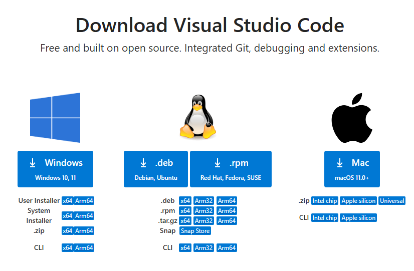

软件下载完成后，双击完成安装。

## 2、CodeArts Check插件安装

打开Visual Studio Code软件，点击"扩展"，输入"codearts check"进行搜索，找到插件后，点击"install"，等待插件安装完成。

**注意：** 安装插件时，确保只有一个Visual Studio Code实例处于打开状态

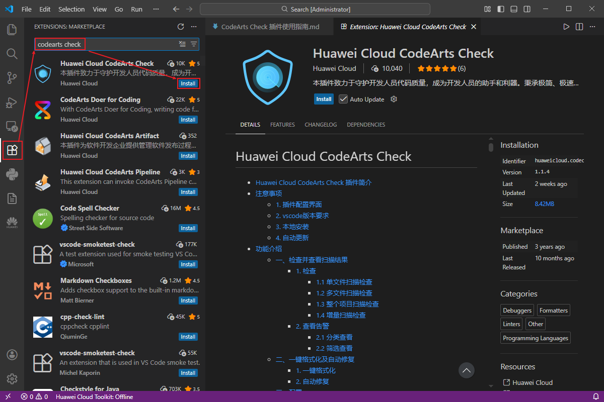

## 3、 CodeArts Check插件使用

在文件上或在代码编辑区右键，找到Check的选项，执行扫描：

- Project Check with CodeArts Check: 扫描整个项目

- File Check with CodeArts Check: 扫描单文件

- Auto Format with CodeArts Check: 一键格式化

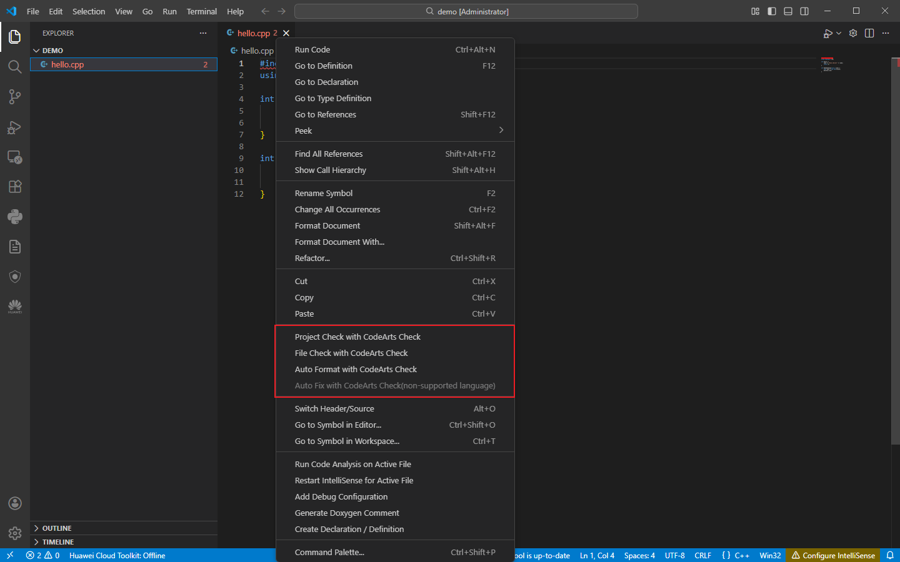

查看扫描结果：

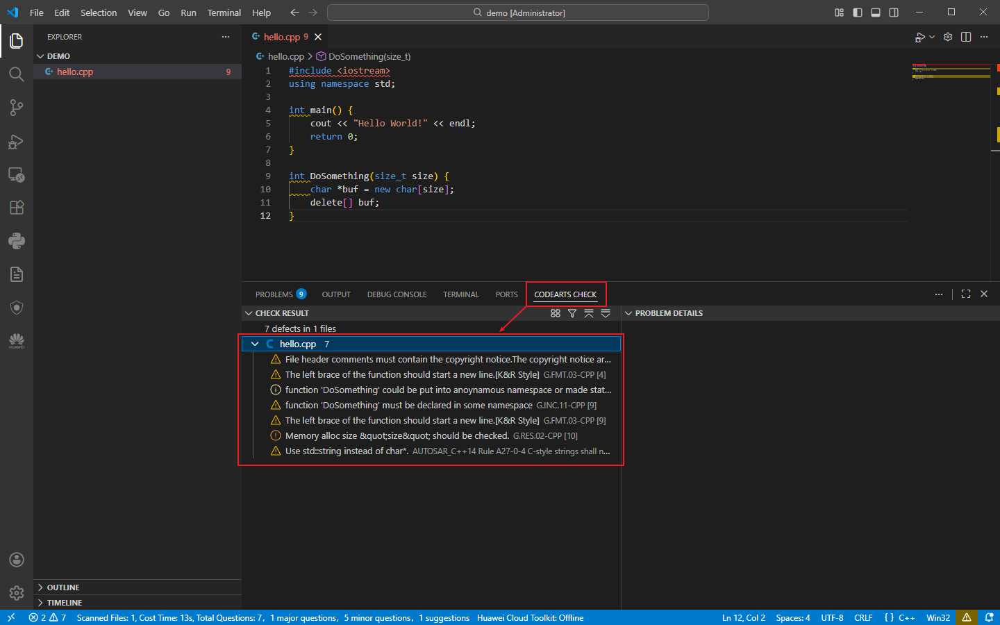

## 4、插件登录

### 离线模式

插件支持离线模式，初次使用时，可按照下图步骤进行设置：

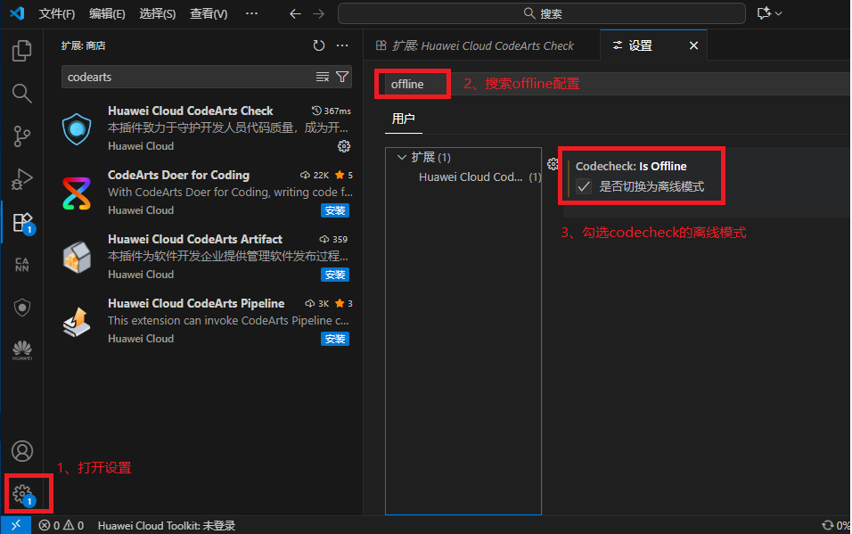

### 登录模式

初次登录，点击"CodeArts Check"——"CONFIGURATION"——"You are not logged in, please log in first"，弹出登陆界面

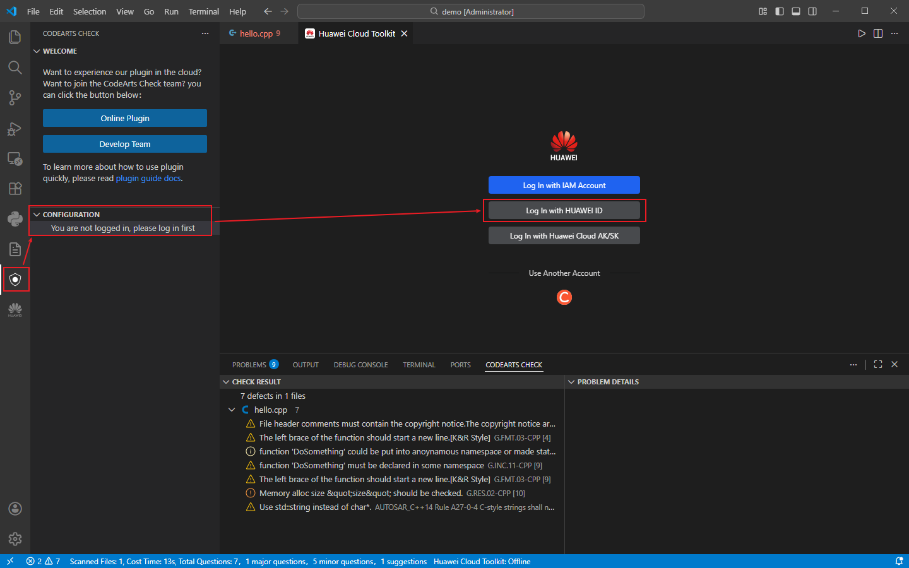

或者点击屏幕底部的"Huawei Cloud Toolkit: Offline"，

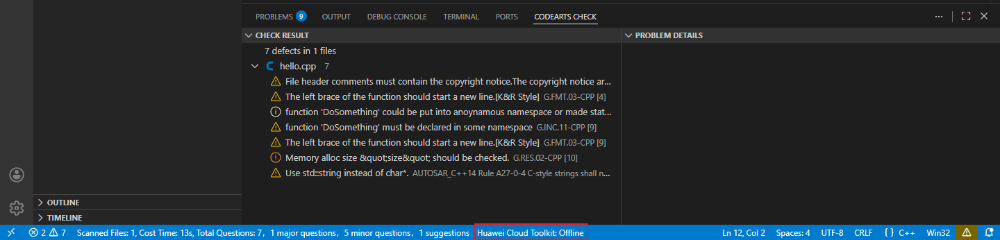

进入登录界面，选择"Log In with HUAWEI ID"

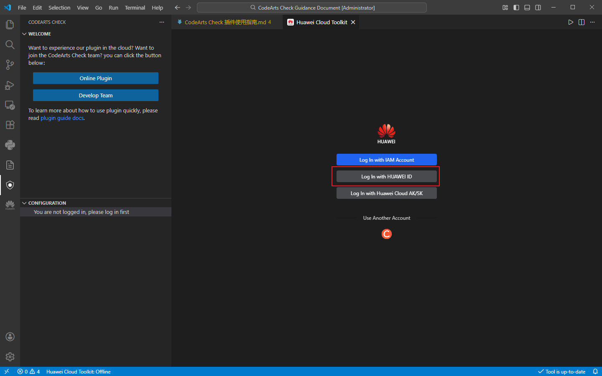

点击"Open"，登录华为云账号即可

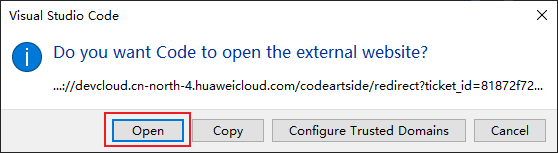

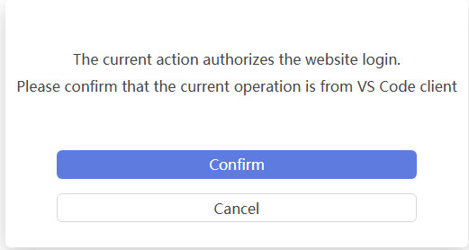

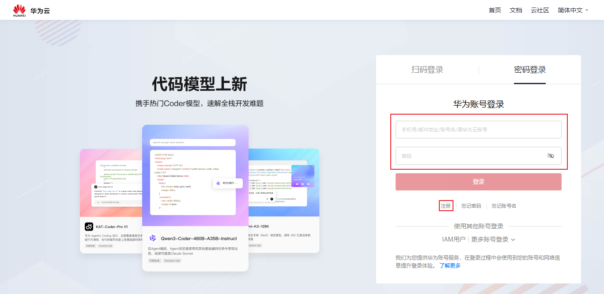

登录成功，关闭浏览器页面，重新回到vscode即可

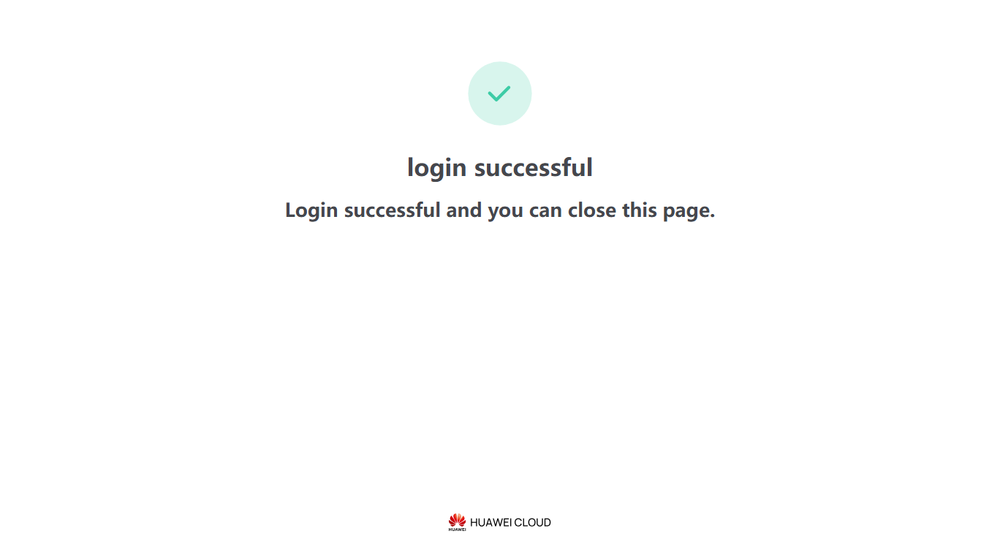

## 5、CodeArts Check规则配置

登陆完成后，才可以解锁插件配置界面。点击"CodeArts Check"——"CodeArts Check Configuration"，看到右侧配置框，按需勾选要扫描的规则，并点击"Apply
"应用规则即可。

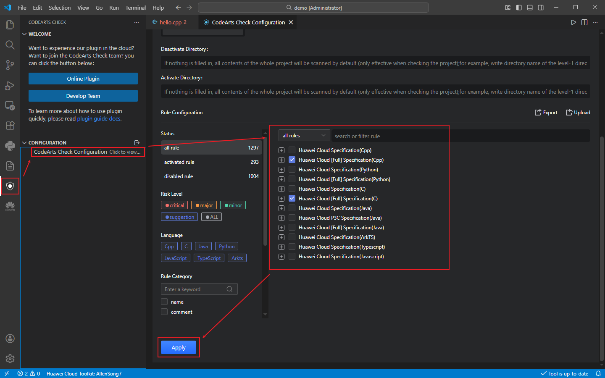

规则导出：勾选目标规则后，点击"Rule Configuration"——"Export"，保存.xlsx规则文件至本地，即可导出激活规则。

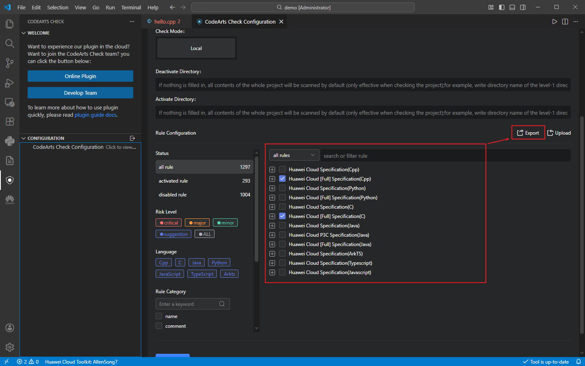

规则导入：基于导出模板的格式规范，根据实际需求修改规则内容，点击"Rule Configuration"——"Upload"，选择待导入的.xlsx规则文件，即可完成规则导入。

当前开源项目使用的规则集文件请参看当前目录下的“rule_en.xlsx”和“rule_ch.xlsx”

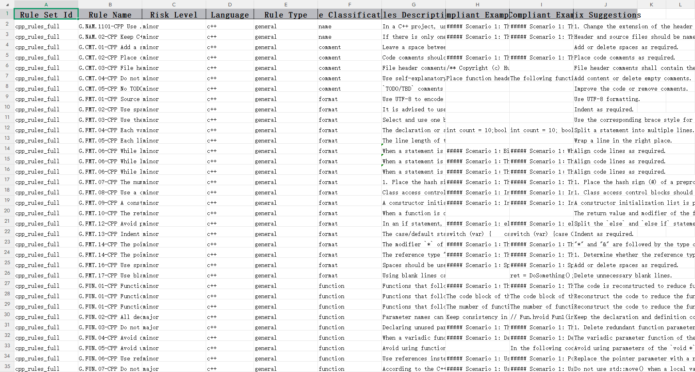

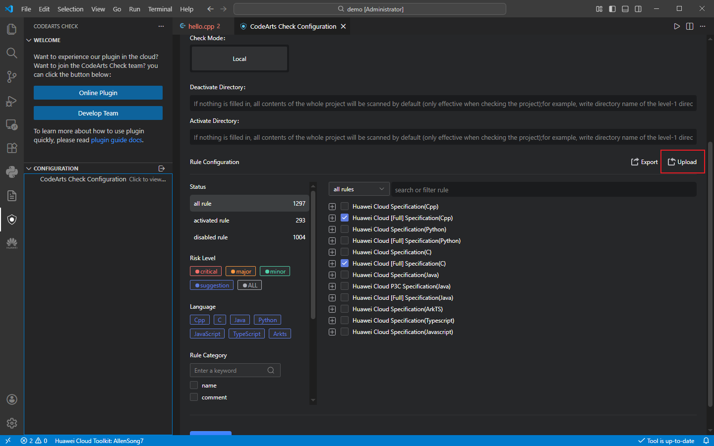

## 6、CodeArts Check插件官网介绍

地址：<https://marketplace.visualstudio.com/items?itemName=HuaweiCloud.codecheck>
