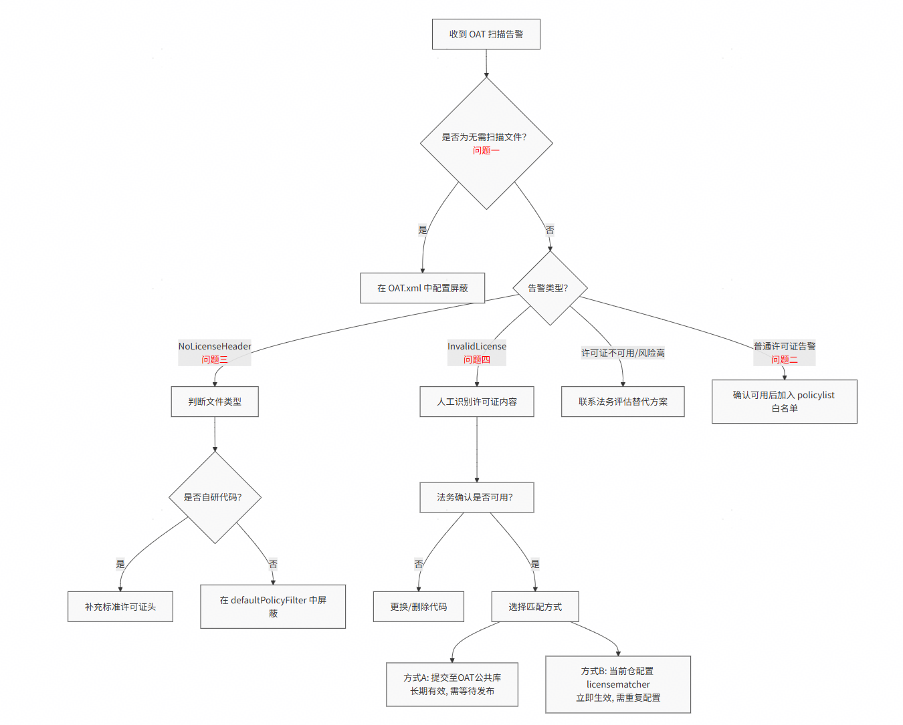
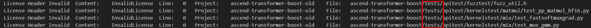
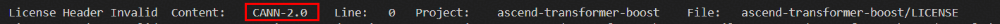
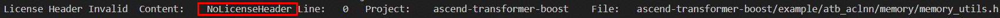
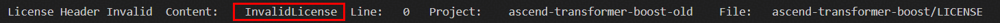

# OAT开源审查工具（Python版）

## 目的

本文档旨在为开发者提供明确的指引，当社区门禁系统中**code_check**扫描任务检测到由 OAT（OSS Audit Tool）Python 版发出的开源合规告警时，应如何理解、分析并采取正确的操作步骤进行处理。

OAT Python 版是原版 Java OAT 的 Python 重写版本，**无需 Java/JDK 环境**，仅依赖 Python 3.9+，与原版完全兼容同一套 `OAT.xml` 配置格式。

---

## 范围

本指导适用于所有参与CANN社区的贡献者，项目适用范围包含：[CANN](https://gitcode.com/cann)下代码仓。

---

## 工具安装与使用

### 安装

**方式一：开发模式安装（推荐）**

```bash
pip install -e /path/to/oat_python
```

安装后可直接使用 `oat` 命令。

**方式二：直接运行（无需安装）**

```bash
cd /path/to/oat_python
PYTHONPATH=src python -m oat [参数]
```

**依赖包：**

```bash
pip install lxml chardet
```

### 命令行参数

| 参数 | 必填 | 说明 |
|------|------|------|
| `-mode s` | 是 | 运行模式，当前支持 `s`（单项目模式） |
| `-s SOURCE_DIR` | 是 | 被扫描的源码根目录 |
| `-r REPORT_DIR` | 是 | 报告输出目录（不存在时自动创建） |
| `-n REPO_NAME` | 是 | 项目名称，用于报告文件命名 |
| `-w 0\|1` | 否 | 扫描模式：`0`=全量（默认），`1`=增量 |
| `-f FILE_LIST` | 否 | 增量扫描文件列表，逗号分隔（`-w 1` 时使用） |
| `-oatconfig PATH[,PATH2,...]` | 否 | 指定全局 OAT 配置路径，支持逗号分隔多个路径按序叠加合并 |
| `-ignorePrjOAT` | 否 | 忽略项目根目录下的 `OAT.xml` |
| `-policy STRING` | 否 | 命令行直接覆盖 policy 规则 |
| `-filter STRING` | 否 | 命令行直接覆盖 filter 规则 |
| `-v` | 否 | 打印版本号并退出 |

### 典型用法

**全量扫描：**

```bash
oat -mode s -s /path/to/repo -r /path/to/reports -n YourRepoName
```

**增量扫描（仅扫描变更文件）：**

```bash
oat -mode s -s /path/to/repo -r /path/to/reports -n YourRepoName \
    -w 1 -f "src/foo.cpp,include/bar.h"
```

**使用 CANN 通用配置叠加扫描：**

```bash
oat -mode s -s /path/to/repo -r /path/to/reports -n YourRepoName \
    -oatconfig /path/to/OAT-Default.xml,/path/to/OAT-Common.xml
```

### 配置优先级

工具会按以下顺序依次合并配置，后者优先级更高：

```
内置 OAT-Default.xml（全局默认规则）
         ↓ 合并（若 -oatconfig 指定多路径则按序叠加）
OAT-Common.xml 等通用配置（可选，通过 -oatconfig 或 <import> 引入）
         ↓ 合并
{-s 目录}/OAT.xml（项目自定义规则，可选）
         ↓ 合并
命令行 -policy / -filter（最高优先级）
```

### 查看扫描报告

报告输出到 `-r` 指定目录，文件名为 `PlainReport_{-n}.txt`：

```
OAT Scan Report
===============
Project : YourRepoName
ScanDate: 2026-04-09 10:00:00
ScanDir : /path/to/your/repo
Files   : 120
Issues  : 3

[License Header Invalid]
File: src/foo.cpp
License: InvalidLicense
...
```

扫描发现问题时退出码为 `1`，无问题时退出码为 `0`。

---

## OAT问题确认

开源仓代码扫描时候会根据 OAT 默认规则进行分析，不满足则会在 OAT 扫描报告中呈现出问题。

具体处理流程如下：



---

具体分析操作如下：

### 问题一：为什么测试文件/配置文件也被报出许可证问题？

#### 告警示例：




#### 问题原因：

OAT 工具默认会对仓库中所有文件进行扫描。但某些文件（如 `tests/` 目录下的单元测试脚本、`pyproject.toml` 等构建配置文件）本身不涉及核心功能或不具备版权敏感性，无需纳入许可证合规检查。

这类文件若被扫描，容易误报为"无许可证头"或"未知许可证"，增加无效告警负担。

#### 正确做法：

将这些**非源码类或无需审计的文件/目录**加入屏蔽列表，在项目根目录的 `OAT.xml` 中配置过滤规则。

##### 操作示例：

1. **屏蔽整个测试目录**

```xml
<filefilter name="defaultFilter" desc="Files not to check">
    <filteritem type="filepath" name="tests/.*" desc="Test files do not require license check"/>
</filefilter>
```

2. **屏蔽特定配置文件（如 toml 文件）**

```xml
<filefilter name="defaultFilter" desc="Files not to check">
    <filteritem type="filename" name="pyproject.toml" desc="Configuration file, no license required"/>
</filefilter>
```

> ⚠️ 注意：
>
> * 使用 `filepath` 可匹配路径正则；
> * 使用 `filename` 匹配具体文件名，支持 `*` 通配符，多个用 `|` 分隔；
> * 修改后需提交至主干并同步到 CI 环境才生效。

---

### 问题二：告警说用了某个许可证（如 CANN-2.0），但确认是可以用的，怎么办？

#### 告警示例：



#### 问题原因：

OAT 扫描发现代码中声明使用了某个许可证（例如 `CANN-2.0`），但由于该许可证未在当前项目的白名单中注册，系统无法识别其合法性，因此标记为风险项。
这并不意味着许可证不能用，而是工具"不认识它"。

#### 正确做法：

明确告知 OAT：这个许可证是允许使用的。你需要在项目根目录的 `OAT.xml` 中将其添加到许可策略中。

##### 操作示例：

```xml
<policylist>
    <policy name="projectPolicy" desc="Project allowed licenses">
        <policyitem type="license" name="CANN-2.0" path=".*" desc="Approved CANN license"/>
    </policy>
</policylist>
```

> ✅ 要求：
>
> * `name` 字段必须与扫描报告中的许可证名称​**完全一致**​；
> * `path=".*"` 表示适用于全仓文件，也可按需限定路径。<br>
>   ✅ 完成后，下次扫描将不再提示该许可证为非法

---

### 问题三：为什么提示"NoLicenseHeader"？

#### 告警示例：



#### 问题原因：

"NoLicenseHeader" 表示该文件缺少标准的许可证声明头部注释。常见于以下两类情况：

| 类型                                           | 是否需要补头      |
| -----------------------------------------------|-------------------|
| 自研代码文件（`.c`,`.h`,`.py`等）              | ✅ 建议补充       |
| 上游引入的第三方开源文件                       | ❌ 不应修改原内容 |

如果你的文件属于第二种（比如从上游社区 copy 的代码），原始就没有许可证头，此时报错是合理的误报。

#### 正确做法：

根据文件性质选择处理方式：

##### ✅ 场景 A：这是自研代码 → 补充许可证头

在文件顶部添加如下标准声明（以 CANN-2.0 为例）：

```c++
/*
* This program is free software, you can redistribute it and/or modify it under the terms and conditions of
* CANN Open Software License Agreement Version 2.0 (the "License").
* Please refer to the License for details. You may not use this file except in compliance with the License.
* THIS SOFTWARE IS PROVIDED ON AN "AS IS" BASIS, WITHOUT WARRANTIES OF ANY KIND, EITHER EXPRESS OR IMPLIED,
* INCLUDING BUT NOT LIMITED TO NON-INFRINGEMENT, MERCHANTABILITY, OR FITNESS FOR A PARTICULAR PURPOSE.
* See LICENSE in the root of the software repository for the full text of the License.
  */
```

##### ✅ 场景 B：这是上游引入文件 → 屏蔽检查

保持原始内容不变，在项目根目录的 `OAT.xml` 中通过 `defaultPolicyFilter` 忽略该文件的许可证头检查。

```xml
<filefilter name="defaultPolicyFilter" desc="Files exempt from license header checks">
    <filteritem type="filepath" name="/example/atb_aclnn/memory/memory_utils.h" desc="Third-party upstream file without license header"/>
    <filteritem type="filename" name="memorypool.cpp" desc="Imported code, no header modification allowed"/>
</filefilter>
```

> 📝 原因说明建议写清楚，便于后续审计追溯。

---

### 问题四：出现"InvalidLicense"告警，工具识别不出许可证？

#### 告警示例：



#### 问题原因：

OAT 无法匹配到已知许可证库中的条目，可能因为：

* 许可证文本格式有微小差异（空格、换行、标点等）；
* 使用了新定义或定制化的许可证（如 CANN-2.0 尚未收录）；
* 文本编码或大小写导致特征不匹配。
  此时会报 `InvalidLicense`，表示"识别失败"，而非"禁止使用"。

#### 正确做法：

先人工确认许可证内容是否合法 → 再决定如何让工具能识别它。

##### 步骤 1：人工分析 + 法务确认

* 查看告警文件中的许可证声明原文；
* 提交法务团队确认该许可证是否可用于本项目；
* 若不可用 → 需替换或移除相关代码；
* 若可用 → 继续下一步。

##### 步骤 2：选择一种方式让 OAT 能识别该许可证

###### 方式 A：向 OAT 工具提交许可证定义（推荐长期使用）

> 👉 提交流程：[OAT Gitcode 仓库](https://gitcode.com/openharmony-sig/tools_oat)

要求：

* 提取许可证正文，转为小写，去除所有符号和空格；
* 填入 JSON 格式的 license definition。

###### 示例：

```json
{
"licenseHeaderText": "thisprogramisfreesoftwareyoucanredistributeitandormodifyitunderthetermsandconditionsofcannopensoftwarelicenseagreementversion20thelicensepleaserefertothelicensefordetailsyoumaynotusethisfileexceptincompliancewiththelicensethissoftwareisprovidedonanasisbasiswithoutwarrantiesofanykindeitherexpressorimpliedincludingbutnottononinfringementmerchantabilityorfitnessforaparticularpurposeseelicenseintherootofthesoftwarerepositoryforthefulltextofthelicense",
"licenseHeaderTextLength": 450,
"licenseId": "CANN-2.0",
"licenseName": "CANN Open Software License Agreement Version 2.0",
"licenseText": "...same as above...",
"urls": []
}
```

> ✅ 优点：一次提交，多仓受益<br>
> ❗ 缺点：需等待工具版本发布才能生效

###### 方式 B：在当前仓配置本地匹配规则（快速生效）

直接在项目根目录的 `OAT.xml` 中添加 `<licensematcher>` 规则，​**原样复制许可证头/文本内容**​（**注意**：转义引号，**Copyright版权信息**不要写入）。

```xml
<licensematcherlist>
    <licensematcher name="CANN-2.0" desc="Custom license matcher for InvalidLicense fix">
        <licensetext name="
             * This program is free software, you can redistribute it and/or modify it under the terms and conditions of
             * CANN Open Software License Agreement Version 2.0 (the &quot;License&quot;).
             * Please refer to the License for details. You may not use this file except in compliance with the License.
             * THIS SOFTWARE IS PROVIDED ON AN &quot;AS IS&quot; BASIS, WITHOUT WARRANTIES OF ANY KIND, EITHER EXPRESS OR IMPLIED,
             * INCLUDING BUT NOT LIMITED TO NON-INFRINGEMENT, MERCHANTABILITY, OR FITNESS FOR A PARTICULAR PURPOSE.
             * See LICENSE in the root of the software repository for the full text of the License.
         " desc="Match CANN-2.0 license header"/>
    </licensematcher>
</licensematcherlist>
```

> ✅ 优点：提交即生效，适合紧急修复<br>
> ❗ 缺点：每个仓库都要重复配置，维护成本高<br><br>
> 💡 建议：优先走方式 A 提交公共库，方式 B 作为过渡方案

---

## 高级配置

### OAT-Common.xml 通用配置

工具内置了 `OAT-Common.xml`，集成了 CANN 系列仓库的通用合规规则（CANN-2.0 / CANN-1.0 / 华为版权 / 常用开源许可证）。当多个仓库存在相同规则时，可通过以下方式统一维护，避免每个仓库重复配置。

**方式 A — 通过 `-oatconfig` 链式加载（推荐，无需修改各仓 OAT.xml）**

```bash
oat -mode s -s /path/to/repo -r /path/to/reports -n MyRepo \
    -oatconfig /path/to/OAT-Default.xml,/path/to/OAT-Common.xml
```

**方式 B — 在项目 OAT.xml 中通过 `<import>` 引入**

```xml
<?xml version="1.0" encoding="UTF-8"?>
<configuration>
    <oatconfig>
        <!-- 先加载通用规则，本文件中的规则具有更高优先级 -->
        <import file="/shared/OAT-Common.xml"/>

        <!-- 仅在此处写本仓特有的追加/覆盖规则 -->
        <policylist>
            <policy name="projectPolicy" desc="">
                <policyitem type="license" name="MyCustomLicense" path="third_party/mylib/.*" desc=""/>
            </policy>
        </policylist>
    </oatconfig>
</configuration>
```

> 📌 `<import>` 的相对路径以**引入方 XML 文件所在目录**为基准解析；也可使用绝对路径。

**方式 C — 完全替换（所有仓库策略完全一致时）**

```bash
oat -mode s -s /path/to/repo -r /path/to/reports -n MyRepo \
    -oatconfig /path/to/OAT-Common.xml \
    -ignorePrjOAT
```

### OAT.xml 完整配置示例

将 `OAT.xml` 放在被扫描项目的**根目录**，工具会自动加载：

```xml
<?xml version="1.0" encoding="UTF-8"?>
<configuration>
    <oatconfig>

        <!-- 自定义 policy：在默认规则基础上追加 -->
        <policylist>
            <policy name="projectPolicy" desc="">
                <!-- 允许 third_party 目录使用 MIT -->
                <policyitem type="license" name="MIT" path="third_party/.*"
                            desc="Third-party MIT licensed code"/>
                <!-- 允许 third_party 目录使用 BSD-3-Clause -->
                <policyitem type="license" name="BSD-3-Clause" path="third_party/.*"
                            desc="Third-party BSD licensed code"/>
                <!-- 排除自动生成文件的 copyright 检查 -->
                <policyitem type="copyright" name="*" path="!generated/.*"
                            rule="may" desc="Skip generated files"/>
            </policy>
        </policylist>

        <!-- 自定义 filter：补充不需要扫描的文件 -->
        <filefilterlist>
            <filefilter name="defaultFilter" desc="Project-specific excludes">
                <filteritem type="filepath" name="build/.*"       desc="Build output"/>
                <filteritem type="filepath" name="cmake-build/.*" desc="CMake output"/>
                <filteritem type="filename" name="*.pb.h|*.pb.cc" desc="Protobuf generated"/>
            </filefilter>
        </filefilterlist>

        <!-- 自定义 license 识别规则（识别非 SPDX 标准 license 文本） -->
        <licensematcherlist>
            <licensematcher name="Huawei-Internal">
                <licensetext name="Huawei Proprietary and Confidential"/>
            </licensematcher>
        </licensematcherlist>

    </oatconfig>
</configuration>
```

### OAT.xml 配置项说明

#### `<policyitem>` 字段

| 字段 | 必填 | 说明 |
|------|------|------|
| `type` | 是 | `license`/`copyright`/`filetype`/`filename`/`compatibility` |
| `name` | 是 | 匹配值；`*` 匹配所有；`!xxx` 表示"不允许 xxx" |
| `path` | 是 | 文件路径正则；`!` 前缀表示排除，如 `!test/.*` |
| `rule` | 否 | `may`（默认，组内任意一条通过即可）或 `must`（必须通过） |
| `group` | 否 | 同组的 `may` 条目取 OR 逻辑，默认 `defaultGroup` |
| `filefilter` | 否 | 绑定 filter 名称，默认 `defaultPolicyFilter` |
| `desc` | 是 | 说明该规则的原因（审查时必填） |

#### `<filteritem>` 字段

| 字段 | 说明 |
|------|------|
| `type="filename"` | 按文件名过滤，支持 `*` 通配符，多个用 `\|` 分隔 |
| `type="filepath"` | 按文件路径过滤，支持正则表达式 |

---

## 与原版 Java OAT 对比

| 特性 | Java 版 | Python 版 |
|------|---------|-----------|
| 运行环境 | JDK 8+ | Python 3.9+ |
| 安装方式 | Maven 构建 / 预编译 jar | `pip install` |
| 扫描速度（143 个文件） | ~15s | ~0.6s（快约 25 倍） |
| 项目 OAT.xml 支持 | ✅ | ✅ |
| OAT-Default.xml 可替换 | ✅（`-oatconfig`） | ✅（`-oatconfig`，支持多路径链式加载） |
| 通用配置 OAT-Common.xml | ❌ | ✅（内置，支持 `<import>` 机制） |
| 命令行 policy 覆盖 | ✅ | ✅ |
| 增量扫描（`-w 1 -f`） | ✅ | ✅ |
| SPDX license 识别 | ✅ | ✅ |
| 自定义 licensematcher | ✅ | ✅ |
| 多项目模式（`-mode p`） | ✅ | ❌（计划支持） |
