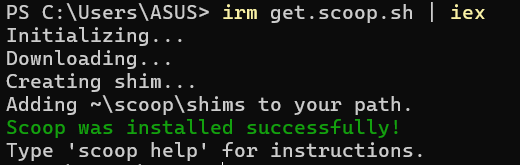
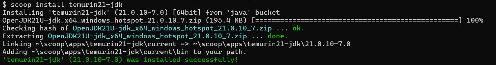
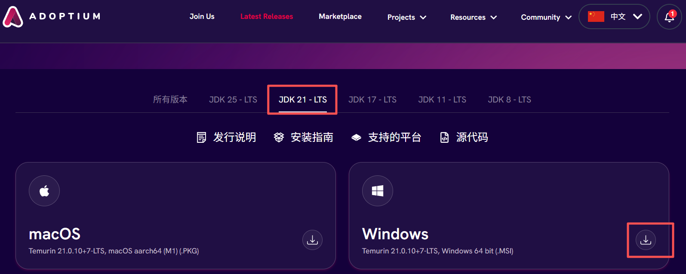
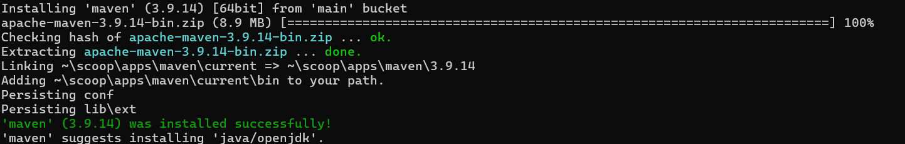
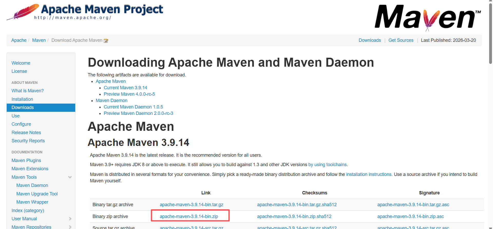
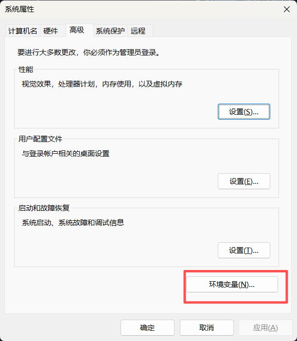
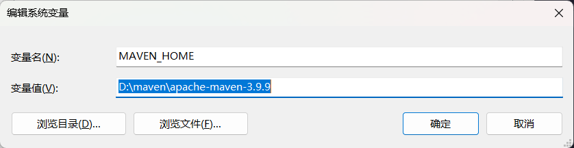
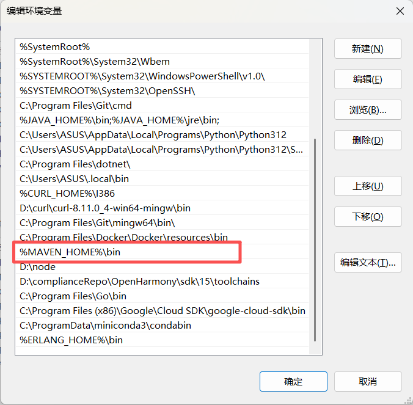

# pre-commit配置指导书

[TOC]
-- 

## 1 概述

本指导书主要用于指导CNAN社区在代码仓中部署pre-commit能力（主要包括代码格式化及OAT扫描能力），并指导社区贡献者如何在本地使用。

### 1.1 GitCode 镜像仓库说明

**重要**: 由于国内网络环境，访问 GitHub 可能受限，CANN 社区已将常用的 pre-commit hooks 仓库镜像到 GitCode。

**常用镜像仓库对照表**:

| GitHub 原仓库 | GitCode 镜像仓库 | 说明 |
|--------------|-----------------|------|
| `https://github.com/pre-commit/pre-commit-hooks` | `https://gitcode.com/pre-commit/pre-commit-hooks` | 基础检查 hooks |
| `https://github.com/pre-commit/mirrors-clang-format` | `https://gitcode.com/pre-commit-clang/mirrors-clang-format` | C++ 格式化 |
| `https://github.com/astral-sh/ruff-pre-commit` | `https://gitcode.com/gh_mirrors/ru/ruff-pre-commit` | Python lint/format |
| `https://github.com/codespell-project/codespell` | `https://gitcode.com/gh_mirrors/co/codespell` | 拼写检查 |
| `https://github.com/crate-ci/typos` | `https://gitcode.com/gh_mirrors/ty/typos` | typos 检查 |
| `https://github.com/pylint-dev/pylint` | `https://gitcode.com/gh_mirrors/pyl/pylint` | Python 代码检查 |
| `https://github.com/PyCQA/bandit` | `https://gitcode.com/gh_mirrors/ba/bandit` | Python 安全检查 |

**使用建议**: 在国内开发时，推荐使用 GitCode 镜像仓库，避免网络访问问题。

## 2 代码仓中部署pre-commit能力指导

1、在代码仓根目录下创建“.pre-commit-config.yaml”文件，如果已经存在，表示该代码仓中已经启用pre-commit能力，可参考后续步骤配置代码格式化及OAT检查能力；

2、在“.pre-commit-config.yaml”文件中配置C++代码格式化能力：

- **在“.pre-commit-config.yaml”文件添加如下配置：**

```
repos:
  - repo: https://gitcode.com/pre-commit-clang/mirrors-clang-format
    rev: v18.1.8
    hooks:
      - id: clang-format
        files: \.(c|h|cpp|hpp|cc|hh|cxx|hxx)$
```

**说明**：
- 对于空的".pre-commit-config.yaml"直接拷贝上述内容
- 如果已经有配置，请忽略首行的"repos:"
- **重要**: 使用 GitCode 镜像仓库替代 GitHub 仓库，避免国内网络访问问题

- **将“.clang-format”配置文件拷贝至代码仓根目录下**
配套提供的“.clang-format”为与CANN社区编程规范配套的格式化模板文件，如果代码仓有与规范不匹配的代码风格，可自主调整配置参数。

3、在“.pre-commit-config.yaml”文件中配置OAT扫描能力：

- **在“.pre-commit-config.yaml”文件添加如下配置：**

```
  - repo: local
    hooks:
      - id: oat-check
        name: OAT Compliance Check
        entry: bash scripts/oat_check.sh
        language: system
        pass_filenames: true
        types: [file]
        stages: [commit]
        verbose: true
```

- **将“oat_check.sh”脚本拷贝至代码仓中的`scripts/`目录下；**

**说明**：“oat_check.sh”脚本如果放在其他路径下，需要在“.pre-commit-config.yaml”中的oat-check配置中同步调整执行“oat_check.sh”脚本路径信息。

4、至此将完成在代码仓中配置pre-commit机制下的代码格式化、OAT检查配置，如果还需要其他功能，可继续在“.pre-commit-config.yaml”中配置。

## 3 社区贡献者使用pre-commit能力

### 3.1 pre-commit安装步骤

步骤 1: 安装 pre-commit 框架

```bash
# 使用 pip（推荐）
pip install pre-commit

# 验证安装
pre-commit --version
# 输出: pre-commit 3.x.x
```

**Windows 用户**: 确保已安装 Python 和 pip。

步骤 2: 进入项目目录

```bash
cd /path/to/your/project

# 例如
cd d:\complianceRepo\CANN
```

步骤 3: 安装 Git Hooks

```bash
# 在项目根目录运行
pre-commit install
```

步骤 4: 验证安装（可选）

```bash
# 测试 hook（不会真正提交）
git commit --allow-empty -m "test pre-commit"
```

后续在提交代码前会自动进行代码格式化处理及触发OAT检查。

### 3.2 OAT使用指导

**OAT（Open Source Audit Tool）** 是一个开源合规性检查工具，自动集成到 Git 提交流程中。

#### 3.2.1 检查内容

**文件类型检查** - 禁止提交二进制文件（.so, .dll, .exe 等）  
**许可证头检查** - 验证源代码文件包含合规的许可证声明  

#### 3.2.2 核心特点

-  **增量检查** - 仅检查待提交文件，速度快（< 5 秒）
-  **自动触发** - 每次 `git commit` 自动运行
-  **详细报告** - 自动生成 `result.txt` 摘要和完整报告
-  **零配置** - Java 和 Maven 自动安装（Linux/macOS）
-  **跨平台** - Windows/Linux/macOS 全支持

#### 3.2.3 必需软件

| 软件 | 版本要求 | 用途 | 安装方式 |
|------|---------|------|----------|
| **Java** | JDK 21+ | 运行 OAT |  **自动安装**（Linux/macOS）<br> 手动安装（Windows）|
| **Maven** | 3.6+ | 打包 OAT |  **自动安装**（Linux/macOS）<br> 手动安装（Windows）|
| **Git** | 2.0+ | 版本控制 | 通常已安装 |
| **pre-commit** | 2.0+ | Hook 框架 | `pip install pre-commit` |

#### 3.2.4 自动安装支持

| 平台 | Java | Maven | 包管理器 | 首次安装时间 |
|------|------|-------|---------|-------------|
| **Linux (Ubuntu/Debian)** | 自动 |  自动 | apt | 5-8 分钟 |
| **Linux (CentOS/RHEL)** |  自动 |  自动 | yum | 5-8 分钟 |
| **macOS** |  自动 |  自动 | Homebrew | 8-10 分钟 |
| **Windows** |  手动 |  手动 | - | 需手动安装 |

#### 3.2.5 重要提示：环境问题自动跳过

**友好的设计**：如果无法安装 Java/Maven 或遇到环境问题，OAT 检查会**自动跳过**，提交仍会继续。

**会自动跳过的场景**

| 场景 | 行为 | 提示 |
|------|------|------|
| Java/Maven 未安装（Windows） |  跳过检查，允许提交 | 提供手动安装指引 |
| Java/Maven 自动安装失败 |  跳过检查，允许提交 | 提示手动安装方法 |
| Maven 打包失败 |  跳过检查，允许提交 | 提供解决方案 |
| OAT 扫描执行失败 |  跳过检查，允许提交 | 提示重新打包 |

** 仍会阻止提交的场景**

| 场景 | 行为 | 原因 |
|------|------|------|
| **发现二进制文件** |  阻止提交 | 真正的合规性问题 |
| **许可证头缺失/错误** | 阻止提交 | 真正的合规性问题 |

**跳过检查的提示示例**

```
[OAT] Windows 系统无法自动安装 Java
[OAT] 请手动下载并安装：
  ...（安装步骤）...

[OAT] 跳过 OAT 检查，继续提交...
[OAT] 建议安装 Java 后再次运行检查
```

**后续手动运行检查**

配置好环境后，可以手动运行检查：

```bash
# 推荐方式
pre-commit run oat-check

# 或直接运行脚本
bash scripts/oat_check.sh
```

#### 3.2.6 合规性问题（阻止提交）

**重要**: 以下问题会**阻止提交**，必须修复。

**1) 发现无效文件类型**

**场景**: 尝试提交二进制文件（.so, .dll, .exe 等）。

**输出**:
```
====================================================================
  发现合规性问题
====================================================================

[OAT] Found 1 compliance issue(s):
  - Invalid File Type: 1
  - License Header Invalid: 0

[OAT] Details saved to: oat_reports/single/result.txt
[OAT] Please check the report and fix the issues.

To view the summary:
  cat oat_reports/single/result.txt

To skip this check temporarily:
  git commit --no-verify
```

**行为**:**阻止提交，必须修复**

**查看详情**:
```bash
cat oat_reports/single/result.txt
```

**报告内容示例**:
```
===================================
OAT Scan Result Summary
===================================
Scan Time: 2026-03-25 14:30:15
Project: CANN
Files Checked: 1

-----------------------------------
Invalid File Type Total Count: 1
lib/libtest.so: BINARY_FILE_TYPE

-----------------------------------
License Header Invalid Total Count: 0

===================================
```

**解决方案**:
```bash
# 方法 1: 移除二进制文件
git reset HEAD lib/libtest.so

# 方法 2: 将二进制文件添加到 .gitignore
echo "*.so" >> .gitignore
echo "*.dll" >> .gitignore
echo "*.exe" >> .gitignore

# 重新提交
git add .gitignore
git commit -m "update: add binary files to gitignore"
```

**2) 许可证头无效**

**场景**: 源代码文件缺少或许可证头格式不正确。

**输出**:
```
====================================================================
  发现合规性问题
====================================================================

[OAT] Found 2 compliance issue(s):
  - Invalid File Type: 0
  - License Header Invalid: 2

[OAT] Details saved to: oat_reports/single/result.txt
```

**行为**: **阻止提交，必须修复**

**查看详情**:
```bash
cat oat_reports/single/result.txt
```

**报告内容示例**:
```
===================================
OAT Scan Result Summary
===================================

-----------------------------------
Invalid File Type Total Count: 0

-----------------------------------
License Header Invalid Total Count: 2
src/main.cpp: MISSING_LICENSE_HEADER
src/utils.cpp: MISSING_LICENSE_HEADER

===================================
```

**解决方案**:

在文件顶部添加许可证头，例如 CANN-2.0：

```cpp
/**
 * This program is free software, you can redistribute it and/or modify it under the terms and conditions of
 * CANN Open Software License Agreement Version 2.0 (the "License").
 * Please refer to the License for details. You may not use this file except in compliance with the License.
 * THIS SOFTWARE IS PROVIDED ON AN "AS IS" BASIS, WITHOUT WARRANTIES OF ANY KIND, EITHER EXPRESS OR IMPLIED,
 * INCLUDING BUT NOT LIMITED TO NON-INFRINGEMENT, MERCHANTABILITY, OR FITNESS FOR A PARTICULAR PURPOSE.
 * See LICENSE in the root of the software repository for the full text of the License.
 */

```

**重新提交**:
```bash
git add src/main.cpp src/utils.cpp
git commit -m "fix: add license headers"
```

---

#### 3.2.7 报告查看

**报告文件位置**

| 报告类型 | 文件路径 | 内容 |
|---------|---------|------|
| **摘要报告** | `oat_reports/single/result.txt` | 关键问题汇总  |

**查看命令**

```bash
# 查看报告
cat oat_reports/single/result.txt

# 使用编辑器查看
code oat_reports/single/result.txt
vim oat_reports/single/result.txt
```

**摘要报告内容**

```
===================================
OAT Scan Result Summary
===================================
Scan Time: 2026-03-25 14:30:15
Project: CANN
Files Checked: 3

-----------------------------------
Invalid File Type Total Count: 0

-----------------------------------
License Header Invalid Total Count: 0

===================================
```

#### 3.2.8 环境问题

**1) Java 未安装（Linux/macOS 自动安装）**

**场景**: 首次提交，系统未安装 Java。

**输出**:
```
====================================================================
  Java 未安装 - 正在尝试自动安装
====================================================================

[OAT] 检测到系统未安装 Java，开始自动安装...
[OAT] 使用 apt 安装 OpenJDK 11...
[OAT] [OK] OpenJDK 11 安装成功
```

**处理**: 自动安装，可能需要输入 sudo 密码。

---

**2) Java 未安装（Windows 手动安装）**

**场景**: Windows 系统无法自动安装 Java。

**输出**:
```
[OAT] Windows 系统无法自动安装 Java
[OAT] 请手动下载并安装：

  1. 访问: https://adoptium.net/zh-CN/temurin/releases/
  2. 下载: Eclipse Temurin JDK 21 (x64)
  3. 安装后重启 Git Bash
  4. 验证: java -version

[OAT] 跳过 OAT 检查，继续提交...
[OAT] 建议安装 Java 后再次运行检查
```

**行为**: **跳过检查，允许提交**

**后续操作**：请参考以下 Windows 环境 Java 安装指导，安装完成后重启终端，运行 `pre-commit run oat-check` 验证环境。

##### Windows 环境 Java 安装指导

OAT 工具需要 **Java 21+**，以下提供三种安装方式。

**方式一：使用 Scoop 包管理器（推荐，适合开发者）**

[Scoop](https://scoop.sh/) 是 Windows 命令行包管理器，安装软件无需管理员权限、自动配置 PATH。

在 **PowerShell**（普通用户）中执行：
```powershell
Set-ExecutionPolicy -ExecutionPolicy RemoteSigned -Scope CurrentUser
irm get.scoop.sh | iex
```


安装 Java：
```powershell
# 添加 Java bucket
scoop bucket add java

# 安装 Eclipse Temurin JDK 21
scoop install temurin21-jdk
```


安装完成后立即生效（无需重启终端），验证：
```powershell
java -version
```

**方式二：手动安装（步骤清晰）**

1. 访问 [https://adoptium.net/zh-CN/temurin/releases/](https://adoptium.net/zh-CN/temurin/releases/)

2. 筛选条件选择：
   - **Operating System**：Windows
   - **Architecture**：x64
   - **Package Type**：JDK
   - **Version**：21（LTS）

3. 下载 `.msi` 安装包（如 `OpenJDK21U-jdk_x64_windows_hotspot_21.x.x_x.msi`）




4. 双击安装包，**全程保持默认选项**，安装向导会自动：
   - 设置 `JAVA_HOME` 环境变量
   - 将 `java` 命令添加到系统 `PATH`

5. 安装完成后，打开新的命令行窗口（CMD 或 Git Bash），验证：
   ```bash
   java -version
   # 预期: openjdk version "21.0.x" ...
   ```

> **国内网络备用下载**：  
> 华为镜像站：[https://mirrors.huaweicloud.com/java/jdk/](https://mirrors.huaweicloud.com/java/jdk/)  
> 阿里云镜像：[https://dragonwell-jdk.io/](https://dragonwell-jdk.io/)（Alibaba Dragonwell，兼容 OpenJDK 21）

**方式三：使用 Winget（Windows 11 / Windows 10 内置）**

```powershell
# 安装 Eclipse Temurin JDK 21
winget install EclipseAdoptium.Temurin.21.JDK
```

---

**3)  Java 自动安装失败**

**场景**: Linux/macOS 自动安装 Java 失败。

**输出**:
```
[OAT] [ERROR] 自动安装失败

[OAT] 自动安装失败，跳过 OAT 检查

手动安装方法:
  Linux:   sudo apt install temurin-21-jdk
  macOS:   brew install openjdk@21
  Windows: https://adoptium.net/zh-CN/temurin/releases/

[OAT] 继续提交（未进行合规性检查）...
[OAT] 建议安装 Java 后再次运行: pre-commit run oat-check
```

**行为**: **跳过检查，允许提交**

**可能原因**:
- 网络连接问题
- 包管理器未配置
- 权限不足
- macOS 未安装 Homebrew

**解决方案**:
```bash
# Linux
sudo apt update
sudo apt install temurin-21-jdk

# macOS - 先安装 Homebrew
/bin/bash -c "$(curl -fsSL https://raw.githubusercontent.com/Homebrew/install/HEAD/install.sh)"
brew install openjdk@21

# 验证
java -version

# 手动运行检查
pre-commit run oat-check
```

---

**4) Maven 未安装（Linux/macOS 自动安装）**

**场景**: 首次提交，系统未安装 Maven。

**输出**:
```
====================================================================
  Maven 未安装 - 正在尝试自动安装
====================================================================

[OAT] 使用 apt 安装 Maven...
[OAT] [OK] Maven 安装成功
```

**处理**: 自动安装，可能需要输入 sudo 密码。

---

**5) Maven 未安装（Windows 手动安装）**

**场景**: Windows 系统无法自动安装 Maven。

**输出**:
```
[OAT] Windows 系统无法自动安装 Maven
[OAT] 请手动下载并安装：

  1. 访问: https://maven.apache.org/download.cgi
  2. 下载: apache-maven-3.x.x-bin.zip
  3. 解压到 C:\Program Files\apache-maven-3.x.x
  4. 添加到系统 PATH
  5. 重启 Git Bash
  6. 验证: mvn -version

[OAT] 跳过 OAT 检查，继续提交...
[OAT] 建议安装 Maven 后再次运行检查
```

**行为**: **跳过检查，允许提交**

**后续操作**：请参考以下 Windows 环境 Maven 安装指导，安装完成后运行 `pre-commit run oat-check` 验证环境。

##### Windows 环境 Maven 安装指导

OAT 工具需要 **Apache Maven 3.6+**，以下提供三种安装方式。

**方式一：使用 Scoop 包管理器（推荐，已安装 Scoop 时）**

```powershell
# 安装 Maven
scoop install maven
```


安装完成后立即生效，验证：
```powershell
mvn -version
```

**方式二：手动安装（步骤清晰）**

1. 访问 [https://maven.apache.org/download.cgi](https://maven.apache.org/download.cgi)

2. 在 **Files** 区域下载 Binary zip archive，如：  
   `apache-maven-3.9.x-bin.zip`

   

3. 解压到一个**不含空格和中文**的路径，例如：  
   `C:\dev\apache-maven-3.9.x`

4. 配置环境变量（**以下操作需管理员权限**）：

   - 右键「此电脑」→「属性」→「高级系统设置」→「环境变量」
   - 在「系统变量」中新建：

     | 变量名 | 变量值 |
     |--------|--------|
     | `MAVEN_HOME` | `C:\dev\apache-maven-3.9.x` |

   - 在「系统变量」中找到 `Path`，点击「编辑」，新增一行：
     ```
     %MAVEN_HOME%\bin
     ```
   - 点击「确定」保存，**关闭所有命令行窗口后重新打开**

    
    
    


5. 打开新的命令行窗口验证：
   ```bash
   mvn -version
   # 预期: Apache Maven 3.9.x ..., Java version: 21.0.x ...
   ```

> **国内网络备用下载**：  
> 华为镜像：[https://mirrors.huaweicloud.com/apache/maven/](https://mirrors.huaweicloud.com/apache/maven/)  
> 阿里云镜像：[https://maven.aliyun.com/](https://maven.aliyun.com/)

**方式三：使用 Winget（Windows 11 / Windows 10 内置）**

```powershell
# 安装 Apache Maven（需重启终端后 PATH 生效）
winget install Apache.Maven
```

**（可选）配置 Maven 国内镜像加速**

首次构建 OAT 工具时需要从中央仓库下载依赖，国内网络较慢。  
编辑文件 `%USERPROFILE%\.m2\settings.xml`（若不存在则新建），添加阿里云镜像：

```xml
<settings>
  <mirrors>
    <mirror>
      <id>aliyun-central</id>
      <mirrorOf>central</mirrorOf>
      <name>阿里云 Maven 中央仓库镜像</name>
      <url>https://maven.aliyun.com/repository/central</url>
    </mirror>
    <mirror>
      <id>aliyun-public</id>
      <mirrorOf>*</mirrorOf>
      <name>阿里云 Maven 公共镜像</name>
      <url>https://maven.aliyun.com/repository/public</url>
    </mirror>
  </mirrors>
</settings>
```

---

**6) Maven 打包失败**

**场景**: Maven 打包 OAT JAR 失败。

**输出**:
```
====================================================================
  Maven 打包失败
====================================================================

[OAT] 无法打包 OAT JAR，跳过 OAT 检查

可能原因:
  1. Maven 配置问题
  2. 网络连接问题（无法下载依赖）
  3. pom.xml 配置错误

建议解决方案:
  1. 手动打包：
     cd ../tools_oat
     mvn clean package -DskipTests

  2. 配置 Maven 镜像（国内网络）：
     编辑 ~/.m2/settings.xml 添加阿里云镜像

[OAT] 继续提交（未进行合规性检查）...
[OAT] 建议修复打包问题后运行: pre-commit run oat-check
```

**行为**:  **跳过检查，允许提交**

**解决方案**:

**方法 1: 手动打包**
```bash
cd ../tools_oat
mvn clean package -DskipTests

# 查看输出，应该看到 BUILD SUCCESS
```

**方法 2: 配置阿里云镜像（国内网络）**
```bash
mkdir -p ~/.m2
cat > ~/.m2/settings.xml <<'EOF'
<settings>
  <mirrors>
    <mirror>
      <id>aliyun</id>
      <mirrorOf>central</mirrorOf>
      <name>Aliyun Maven Mirror</name>
      <url>https://maven.aliyun.com/repository/public</url>
    </mirror>
  </mirrors>
</settings>
EOF

# 重新打包
cd ../tools_oat
mvn clean package -DskipTests
```

**方法 3: 从团队获取 JAR**
```bash
# 如果团队已有编译好的 JAR，直接复制
# 将 JAR 文件复制到 ../tools_oat/target/ 目录
```

**验证修复**:
```bash
pre-commit run oat-check
```

---

**7) tools_oat 克隆失败**

**输出**:
```
[OAT] tools_oat not found. Cloning...
[OAT] [ERROR] Failed to clone tools_oat.
[OAT] You can manually clone from: https://gitcode.com/openharmony-sig/tools_oat.git
```

**原因**: 网络连接问题。

**解决方案**:
```bash
# 方法 1: 检查网络
ping gitcode.com

# 方法 2: 手动克隆
cd ..
git clone https://gitcode.com/openharmony-sig/tools_oat.git

# 方法 3: 配置代理
git config --global http.proxy http://proxy.example.com:8080

# 方法 4: 从团队成员复制
# 让已克隆的同事打包 tools_oat 文件夹给你
```

---

**8) OAT 扫描执行失败**

**场景**: OAT JAR 运行失败。

**输出**:
```
====================================================================
  OAT 扫描执行失败
====================================================================

[OAT] 扫描失败，跳过 OAT 检查

可能原因:
  1. JAR 文件损坏
  2. Java 版本不兼容
  3. OAT 配置问题

建议解决方案:
  1. 删除并重新打包 JAR：
     rm ../tools_oat/target/ohos_ossaudittool-*.jar
     cd ../tools_oat && mvn clean package -DskipTests

  2. 检查 Java 版本（需要 Java 21+）：
     java -version

[OAT] 继续提交（未进行合规性检查）...
[OAT] 建议修复扫描问题后运行: pre-commit run oat-check
```

**行为**: **跳过检查，允许提交**

**解决方案**:
```bash
# 步骤 1: 删除旧 JAR
rm ../tools_oat/target/ohos_ossaudittool-*.jar

# 步骤 2: 重新打包
cd ../tools_oat
mvn clean package -DskipTests

# 步骤 3: 验证 JAR
ls -lh target/ohos_ossaudittool-*.jar

# 步骤 4: 运行检查
cd -
pre-commit run oat-check
```
