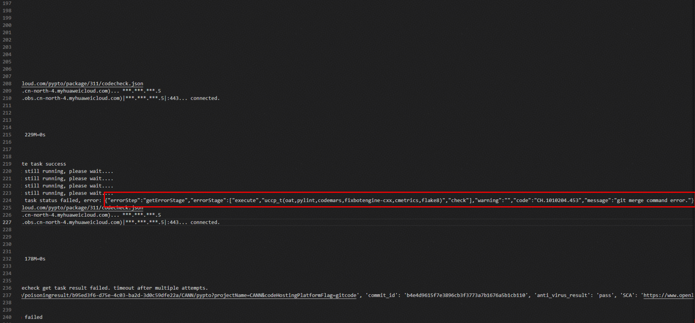
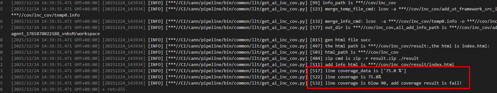

# CANN社区CI工程FAQ（常见问题解答）

## 一、目录（快速检索）

1. [流水线触发失败](#二、流水线触发失败)

2. [静态检查失败](#三、静态检查失败)

3. [单元测试失败](#四、单元测试失败)

## 二、流水线触发失败

### Q1：流水线评论后，评论区很久没有反应？

**解决方案**：可以检查一下是否存在代码冲突，或落后主干过多的情况，拉取主干分支后重新评论

## 三、静态检查失败

### Q1：codecheck任务执行失败，报错信息为git merge command error？

**现象**：日志报错信息示意图如下

**解决方案**：如果在日志中出现该报错，是主仓commit历史和fork仓的历史不同导致的，重新拉取下主仓代码可以解决

## 四、单元测试失败

### Q1：单元测试任务执行失败，报错信息为line coverage is blow xx, add coverage result is fail？

**现象**：日志报错信息示意图如下

**解决方案**：如果在日志中出现该报错，表明单元测试覆盖率不足，请补充相对应的单元测试用例后重新触发

## 五、更新日志

| 更新时间       | 更新内容                               |更新人|
|------------|------------------------------------|---|
| 2026-01-21 | 初始化 FAQ，添加流水线触发失败、静态检查失败等 3 大类常见问题 |社区基础设施团队|