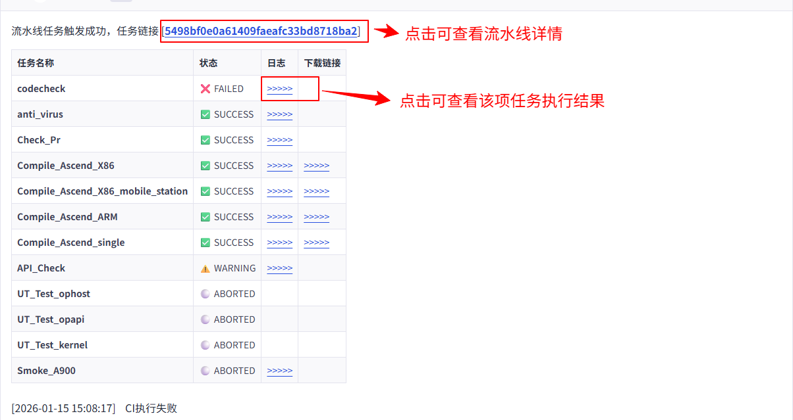
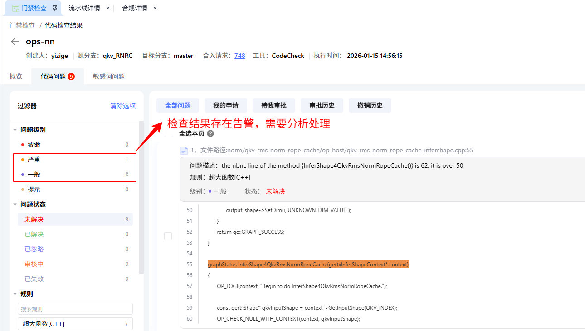
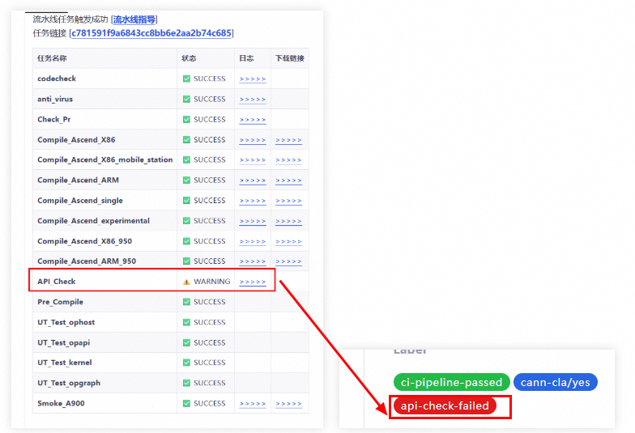
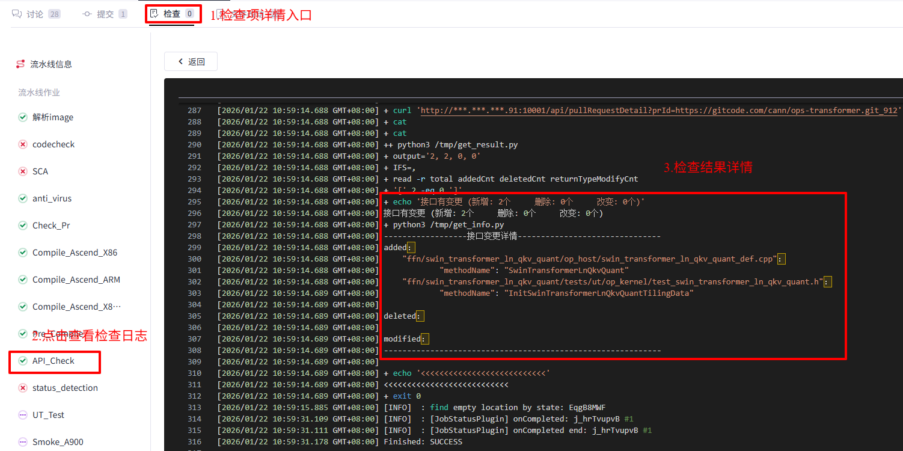
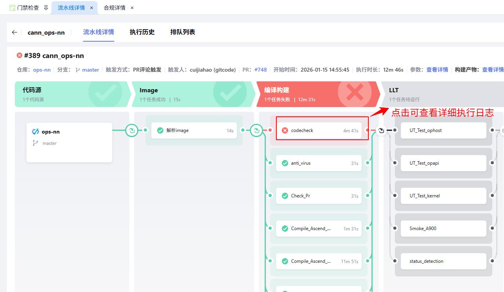
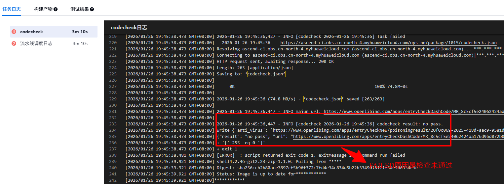

## 一、CI工程检查项概览
- 检查项分为静态检查、编译构建、测试3类，以下是当前CI工程检查项的详细情况：

| 任务分类 | 任务项                                  | 任务项说明 |
|:-----|:-------------------------------------| :--------------------------------------------------------------------------------------------------------------------------------------------------------------------------------------------------------------- |
| 静态检查 | codecheck_{xxx}                      | 静态代码检查，核心覆盖两大维度：1. 安全类检查（算法逻辑安全性、敏感信息（密钥/明文密码等）清理情况、代码注入风险等）；2. 质量类检查（危险函数调用、重复文件/代码片段、代码规范违规、语法错误、潜在空指针/数组越界等问题），提前识别代码层面的潜在风险与缺陷 |
|      | antiposion_{xxx}                     | 恶意文件全量扫描，支持检测文件中隐藏的病毒、木马、蠕虫、间谍软件、广告软件，以及恶意脚本（如恶意Shell/Python脚本）、带宏病毒的文档等，保障代码仓与构建产物的安全性                                                                 |
|      | SCA_{xxx}                            | 代码开源引用合规性检查，通过比对开源代码库，检测PR提交的代码片段是否存在开源代码复用/抄袭情况，若存在匹配项则触发告警，同时核查开源许可证兼容性，避免违规引用风险                                                                 |
|      | codecheck_Pr                         | PR内容合规性校验，重点检查：1. 是否包含空文件、无效文件；2. 是否混入二进制文件（如可执行程序、压缩包等非源码文件）；3. PR描述是否完整、提交规范是否符合要求等，保障PR提交质量                                                     |
|      | API_Check                            | API接口兼容性全量校验，核心检查维度：1. 接口参数（新增/删除/类型变更）兼容性；2. 接口返回值格式/字段兼容性；3. 接口版本迭代后的向前/向后兼容能力，避免因API变更导致下游服务异常                                                 |
|      | StaticCheck_codespell_check          | md 文件内容英文单词拼写检查，识别单词拼写错误、大小写不规范问题，提升文档可读性                                              |
|      | StaticCheck_resource_existence_check | md 文件内容资源文件存在性检查，校验文档中引用的图片、附件等本地资源是否真实存在，避免资源失效导致展示异常                                          |
|      | StaticCheck_link_validity_check      | md 文件内容链接有效性检查，检测文档内超链接是否可正常访问、无死链，保证文档外链可用性                                            |
|      | StaticCheck_tag_closed_check         | 	md 文件内容 HTML 标签闭合检查，校验文档内嵌 HTML 标签是否完整闭合，防止标签语法错误导致文档渲染异常                                             |
|      | StaticCheck_markdownlint             | md 文件内容 Markdown 格式规范检查，遵循通用 Markdown 语法标准，检查标题层级、列表格式、代码块、空格缩进等格式问题，统一文档风格                                                |
|      | codecheck_precommit                  | 代码检查任务，集成代码格式化、基础语法检查、敏感信息筛查、文件规范校验等能力，拦截不符合规范的代码       |
| 编译构建 | Compile_{xxx}_X86                    | X86平台编译构建任务，通过执行代码仓预设的编译命令，完成源码编译、依赖包拉取、可执行文件生成，同时校验编译过程是否无报错，确保X86环境下代码可正常构建                                                         |                                                  |
|      | Compile_{xxx}_ARM                    | ARM平台编译构建任务，适配ARM架构环境，通过执行代码仓预设编译命令，完成源码编译、依赖包适配、ARM架构可执行文件生成，确保ARM环境下代码编译正常                                                     |
| 单元测试 | UT_{xxx}                             | 单元测试任务，针对代码仓中的核心函数、类与模块，运行预设的单元测试（UT）代码，校验逻辑正确性。通过标准：测试用例运行无失败、代码覆盖率不低于代码仓预设阈值。为提升测试效率，部分大型代码仓会按模块拆分为多个UT子任务并行执行，缩短整体测试耗时         |
| 系统测试 | ST_{xxx}                             | 系统集成测试任务，基于完整的系统部署环境，验证多个模块协同工作的正确性，覆盖核心业务流程（如数据处理链路、功能交互流程等）。重点测试系统整体功能完整性、模块间接口调用稳定性、系统性能指标（响应时间、吞吐量等）是否达标             |
| 冒烟测试 | PreSmoke_{xxx}                       | 核心功能快速验证测试，通常按芯片型号拆分多个子任务（如不同Ascend芯片型号）。聚焦系统最核心、最基础的功能点（如关键接口调用、核心业务流程启动等），快速执行测试用例，验证系统是否可正常启动、核心功能是否可用，快速筛选出严重的系统级问题     |
| 评论   | pre_comment                          |  流水线触发后预评论，在自动化任务启动前向 PR 添加评论，包含流水线链接、流水线任务指导等信息，提前告知开发者流水线执行情况，提升协作透明度  |
|    | last_comment                         | 流水线执行完成后总结评论，在所有自动化任务结束后自动生成评论，并添加相对应的标签，汇总任务执行结果（成功 / 失败明细）、失败日志、编译产物、测试覆盖率 / 检查报告链接等信息，方便开发者快速定位问题、完成整改    |

- 检查项任务状态说明

| 状态 | 说明 | 备注 |
| :----------------------| :----------------------  | :------------------------------------------------------------------------------------------------------------------------------------ |
| 🔄 running | 任务执行中 |  |
| ⏳ waiting | 任务待执行 | 任务待调度执行、或者因资源问题排队 |
| ❌ FAILED | 任务执行结果失败 | 任务执行失败，静态检查类告警，存在检查未通过、检查失败2种场景 检查未通过：需要点击“日志”链接分析告警 检查失败：需要通过日志查看失败原因 |
| ⚠️ WARNING | 任务执行结果失败(不影响合入) | 检查项未正式作为门禁，试运行阶段 |
| ✅ SUCCESS | 任务执行成功 |  |
| ⚪ ABORTED | 任务执行中止 | 关联任务失败，未执行任务自动中止 |

## 二、问题定位指导
### PR 流水线异常排查操作指南
#### 1. 查看 PR 内容与流水线运行结果
- 流水线运行结束后，系统会自动在 PR 评论区写入完整的运行结果。请重点关注任务状态，若存在异常任务项，其状态会明确标记为 **“FAILED”**。  

- 点击FAILED任务项，可查看任务执行结果。

- 当API_Check任务执行状态为WARNING时，会标识api_ckeck_failed标签，该标签不影响PR合入。

- Committer需要关注检查结果，并充分评估接口变更影响后再确定代码是否合入。

#### 2. 跳转查看流水线日志
在 PR 评论区的运行结果表格中，找到对应任务行的链接并点击，即可跳转至流水线运行详情页面。  
- 定位到状态为**FAILED**的失败任务，点击该任务可直接查看详细运行日志；  
- 若需本地分析，可通过页面下载按钮将完整日志保存至本地。

**注** 点击FAILED任务节点可查看详细运行日志
#### 3. 分析日志中的错误信息
- 打开失败任务的日志后，通过「查找」功能（快捷键 Ctrl+F/Command+F）搜索 **“error”** 关键字（不区分大小写），快速定位核心错误信息，同时可结合上下文查看错误发生的具体环节（如编译、测试、合规检查等），为后续排查提供依据。  

#### 4. 匹配 FAQ 获取解决方案
根据步骤3定位的错误类型（如编译失败、SCA 合规检查失败、单元测试覆盖率不达标等），查阅本文档第三章的「常见问题解答（FAQ）」，匹配对应的问题场景并获取标准化解决方案。  

#### 5. FAILED任务重试
- 如果您认为FAILED任务不是代码问题，或是偶发问题，也可以点击重试按钮；
- 重试按钮位于PR顶部标签栏->检查处，不同于重新触发，重试只会执行原先的FAILED任务。

## 三、常见问题FAQ

当 CI 流水线运行过程中出现异常时，请优先查阅本 [FAQ](ci_faq.md) 获取解决方案

## 四、求助渠道
- 若FAQ 中未覆盖相关错误，可按 FAQ 文档中的反馈渠道提交问题，也可以联系我们支撑人员进行处理
1. 根据[CIE支撑矩阵](https://gitcode.com/cann/infrastructure/blob/main/docs/services.md#%E4%BA%8C%E7%BB%84%E4%BB%B6%E4%BB%93%E5%BA%93-cie-%E6%94%AF%E6%92%91%E7%9F%A9%E9%98%B5)联系对应的CIE处理解决
2. 联系[基础设施团队](https://gitcode.com/cann/infrastructure/blob/main/docs/services.md#%E4%B8%80%E5%9F%BA%E7%A1%80%E8%AE%BE%E6%96%BD%E6%94%AF%E6%92%91%E7%9F%A9%E9%98%B5)支撑
