# CANN社区会议指南

## 一、介绍

CANN社区在[社区会议平台](https://meeting.osinfra.cn/cann) 提供参与会议、会议预定功能。

## 二、如何参与会议
### 1. 浏览会议日历
您可以浏览会议日历，选择感兴趣的参与。
### 2. 加入会议
>  在接入之前需要注册华为账号（[注册链接](https://id1.cloud.huawei.com/CAS/portal/userRegister/regbyphone.html?reqClientType=7&loginChannel=7000000&regionCode=cn&loginUrl=https%3A%2F%2Fid.meeting.osinfra.cn%2F&lang=zh-cn&themeName=red&clientID=114589635&service=https%3A%2F%2Fid.meeting.osinfra.cn%2Foneid%2Foidc%2Fauthorize%3Fredirect_uri%3Dhttps%253A%252F%252Fmeeting.osinfra.cn%252Fcann)），并登录会议系统。

当会议创建后，并进入会议开始时间，我该通过什么方式参加会议？
1. 在日历中选中会议
2. 点击会议连接
3. 选择浏览器入会或者客户端入会（当前截图演示浏览器入会）


+ 注意：你也可以下载蓝版welink后通过客户端入会，入会的时候输入会议ID， 比如截图的会议ID: 987098521

+ 在手机端可以通过Welink入会，流程如下：
  1. 打开Welink会议链接
      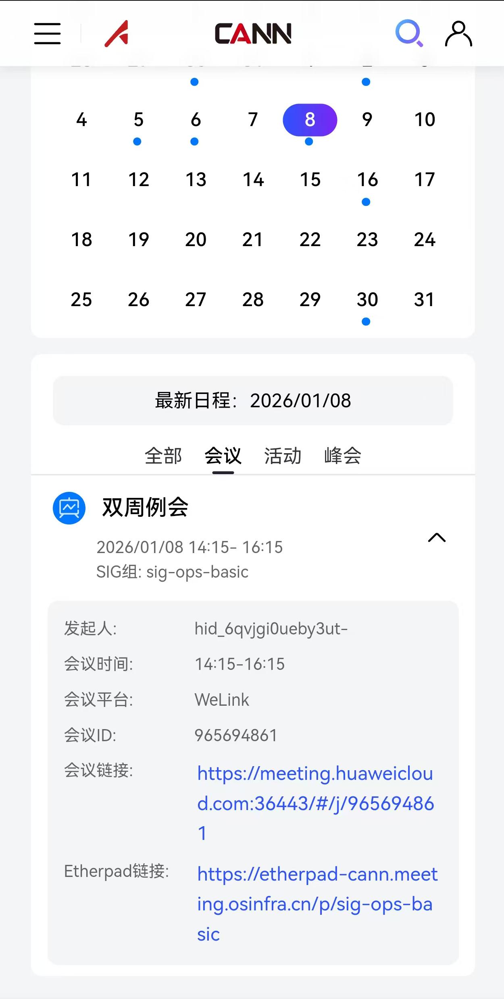
  2. 首次入会需要下载Welink App，点击客户端入会
      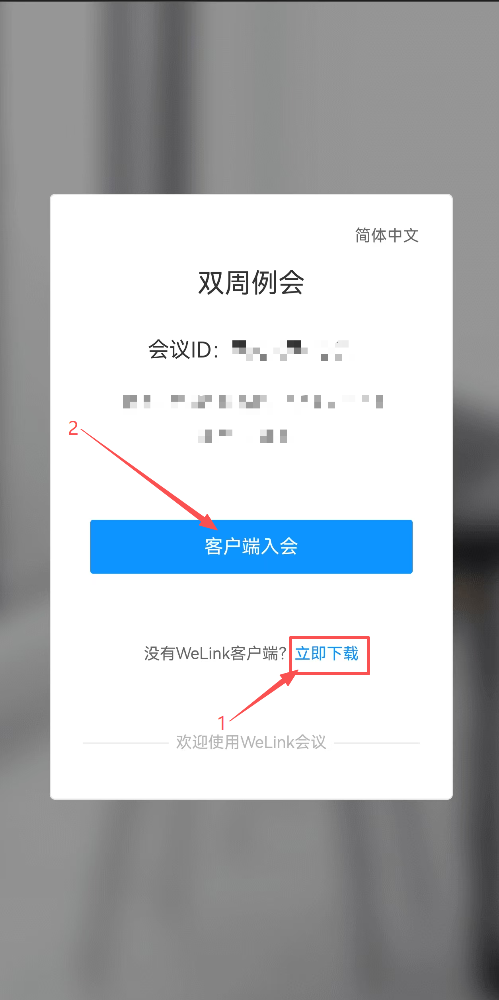
  3. 安装完成后，需要输入手机号与接受验证码登录Welink App
      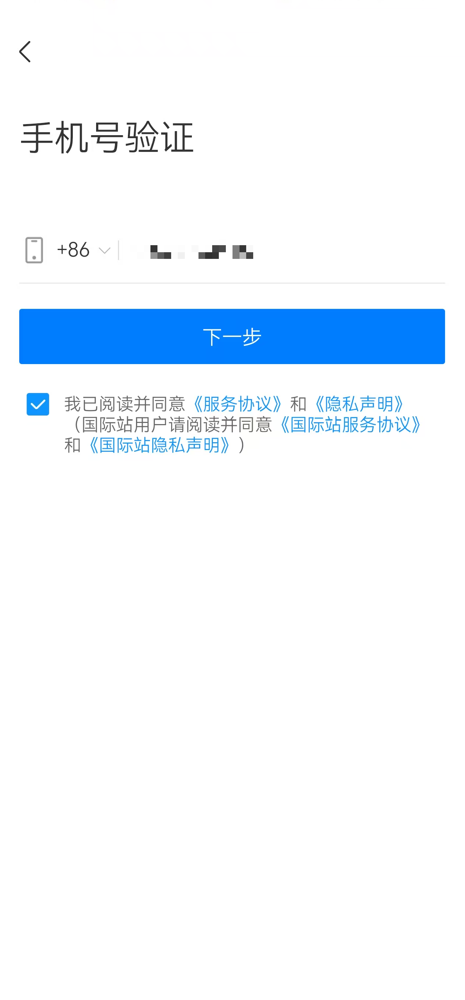
  4. 验证通过后，自动跳转至目标会议入会
      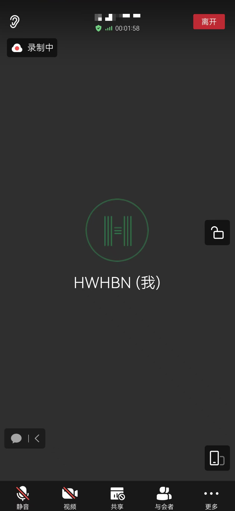


4. 进会后请修改你的个人信息，<font color="red">注意不要泄露较敏感个人信息，例如工号。</font>

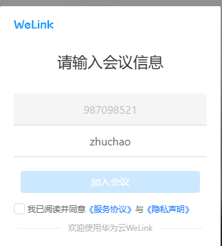

你可以使用在线会议文档记录会议纪要

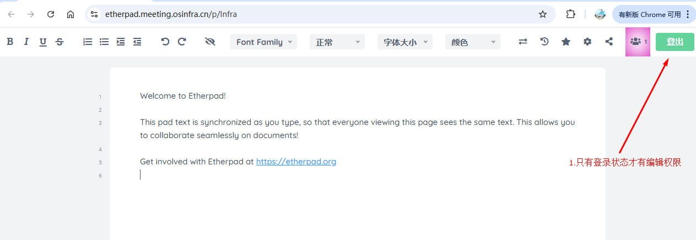

## 三、如何组织会议

### 1.定会申请权限

CANN社区SIG maintainer、committer拥有创建会议权限，您需要登录[社区会议平台](https://meeting.osinfra.cn/cann)的个人中心将gitcode账号与华为账号绑定，绑定之后您就可以预定会议。

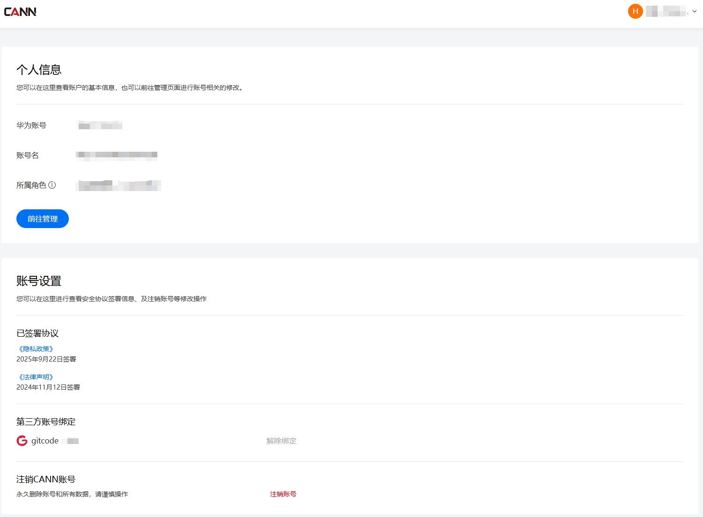

+ 注意：<font color="red">权限每隔1小时刷新一次，配置后请耐心等待</font>

当您拥有定会权限时，界面如下图所示：

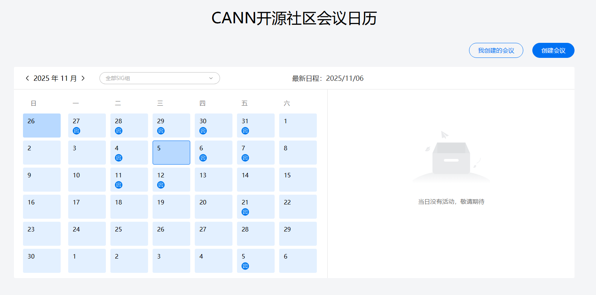

### 2.创建会议

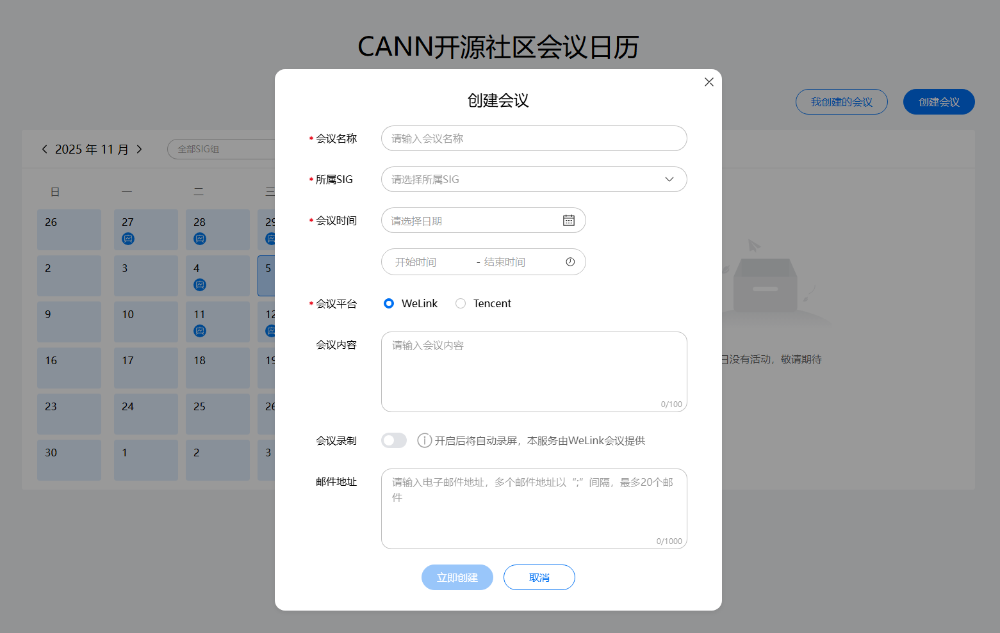

填写会议内容：

+ 会议名称： 这场会议的主题
+ 所属SIG组：选择所需要开会议的SIG组
+ 会议时间：选择对应的会议时间，会议时间包含单次会议与周期会议
+ 会议平台：社区的会议能力由第三方提供的，目前只支持WeLink会议（蓝版）
  + WeLink会议：详细内容见：https://www.huaweicloud.com/product/welink-download.html
+ 会议内容：请输入会议的议题或者大概内容，详细的议题内容后续可以在etherpad里面填写。
+ 会议录制：开启此选项，会议会自动录制，会议结束后会自动保存在第三方会议平台中，一天之内会议回放会被同步上传至官网，在官网中显示已开启录制的视频与语音转文字结果。
+ 邮件地址：填写需要通知参加会议的核心人员和邮件列表，以“；”间隔，最多填写20个邮箱地址。发送成功后可以在对应的邮件列表归档中查看此通知邮件，如果没有则存储拦截情况，请联系基础设施 [chenglang11@huawei.com](mailto:chenglang11@huawei.com)处理；如果联系不上，请联系infrastructure SIG maintainer或者在CANN/infrastructure仓提交issue。

创建的会议会在会议平台上进行公开。

### 2.1 SIG会议模板初始化

SIG会议通常使用Etherpad作为会议协作与纪要记录工具，建议在首次会议前完成模板初始化。

**Etherpad模板结构：**

- **置顶区域（固定保留）**：例会注意事项，包括汇报材料模板链接、轮值主持说明、议题申报截止规则（建议会前48小时截止）、纪要要求（会上对齐、会后不修改）、纪要排序规则等。
- **会议基本信息区**：Date、Time、议题申报链接、会议链接、纪要&签到链接、会议主持、下次主持、与会人、请假人。
- **遗留问题进展区**：跟踪上次会议遗留问题的最新进展。
- **议题区**：按顺序列出本次议题、汇报人、讨论结论及遗留问题。

**Etherpad模板内容如下（可直接复制使用）：**

```
================================================================================
！！！以下为例会注意事项，建议保留并始终置顶；请勿覆盖！！！
================================================================================
1、汇报材料使用模板：https://gitcode.com/cann/community/blob/master/templates/ppt_template.pptx
2、例会结束前，指定下次会议的主持人，主持人负责：
a)提前预定会议链接（建议会议本次结束后，即开始预订下次会议并设置会议模板，供SIG成员/社区开发者申报议题）；
b)提醒遗留问题责任人提前准备遗留问题进展更新；
会议轮流主持顺序：MaintainerA->MaintainerB（Maintainer间轮值）或 MaintainerA->MaintainerB->CommitterC（Maintainer&Committer间轮值）  #首次SIG会议对齐确定，2种轮值方式均可，更新后可删除注释
3、议题申报建议：例会开始前的48小时截止议题的申报，议题内容建议提前和SIG Maintainer/主持人预沟通，提高会议效率；
4、纪要要求：会上进行对齐，会后不允许进行修改
5、每次会议的纪要信息按时间越近越靠前排序，放在注意事项后；
================================================================================
！！！以上为例会注意事项，新增会议或申报议题建议在下方插入！！！
================================================================================

Date日期：20<YY>-<MM>-<DD>  #请更新为具体会议日期，更新后可删除注释
Time时间：<HH>:<MM>~<HH>:<MM>  #请更新为具体会议时间，更新后可删除注释
议题申报链接：https://etherpad-cann.meeting.osinfra.cn/p/<sig-name> #请更新为对应sig名称，更新后可删除注释
会议链接：<会议预订链接>  #通过https://meeting.osinfra.cn/cann平台预订，更新后可删除注释
纪要&签到链接：https://etherpad-cann.meeting.osinfra.cn/p/<sig-name> #请更新为对应sig名称，更新后可删除注释
会议主持：MaintainerA #请更新为姓名，更新后可删除注释
下次主持：MaintainerB #请更新为姓名，更新后可删除注释
与会人：MaintainerA、MaintainerB、CommitterC  #在每次SIG会议开始前，提醒各SIG成员/与会者自主签到，更新后可删除注释
请假人：CommitterD  #请更新为姓名，若无人请假可留空，更新后可删除注释

遗留问题进展：
1、<遗留问题描述>  #请从上一次SIG会议中提取会议遗留问题，更新后可删除注释
进展：<遗留问题描述>   #请更新上一次SIG会议遗留问题进展，更新后可删除注释

议题：
1、<议题名称A>  汇报人：<议题汇报人>  #请更新本次议题名称及议题汇报人，更新后可删除注释
结论：<议题A结论>  #请在SIG会议议题结束后，刷新议题结论并在会议结束前确认所有议题结论，更新后可删除注释
遗留问题：<议题A遗留问题描述>   #请记录本议题遗留问题，并在会议结束前确认遗留问题描述，更新后可删除注释

2、<议题名称B>  汇报人：<议题汇报人>  #请更新本次议题名称及议题汇报人
结论：<议题B结论>  #请在SIG会议议题结束后，刷新议题结论并在会议结束前确认所有议题结论，更新后可删除注释
遗留问题：<议题B遗留问题描述>   #请记录本议题遗留问题，并在会议结束前确认遗留问题描述，更新后可删除注释
```

**首次SIG会议模板初始化步骤：**

1. 登录 [社区会议平台](https://meeting.osinfra.cn/cann) 预订首次SIG会议。
2. 在 Etherpad 上创建SIG专属页面（如 `https://etherpad-cann.meeting.osinfra.cn/p/sig-<name>`），社区已预置模板，若未预置，可手动复制粘贴并根据需求修改。
3. 根据 [首次SIG会议议题](#41-首次sig会议) 填充预设议题：
   - 社区章程介绍
   - 成员介绍与背景互通
   - SIG职责与议题范围
   - 沟通渠道与会议频率确认
   - 角色与权限说明
   - 分工讨论
   - SIG会议主持轮值方式
   - Roadmap规划
   - 协作规范确立
   - 会议纪要规范
4. 在模板中填写会议链接、基本信息，并开放议题申报区域供SIG成员及社区开发者提交议题。
**常规SIG会议单次模板初始化步骤：**

1. 打开SIG专属 Etherpad 页面，在置顶注意事项下方的**最顶部**（按时间越近越靠前排序）插入新的单次会议模板内容。
2. 复制模板结构中的基本信息区、遗留问题进展区、议题区，填入本次会议对应的信息：
   - 更新 Date、Time、会议链接、会议主持、下次主持等信息
   - 从上一次会议纪要中提取遗留问题，填入遗留问题进展区
   - 根据 [常规SIG会议议题](#42-常规sig会议) 及社区申报的议题，填充本次议题列表
3. 在预订会议时同步更新会议链接，确保与 Etherpad 中的链接一致。

**单次会议模板（从首次会议模板中截取）：**

```
Date日期：20<YY>-<MM>-<DD>  #请更新为具体会议日期，更新后可删除注释
Time时间：<HH>:<MM>~<HH>:<MM>  #请更新为具体会议时间，更新后可删除注释
议题申报链接：https://etherpad-cann.meeting.osinfra.cn/p/<sig-name> #请更新为对应sig名称，更新后可删除注释
会议链接：<会议预订链接>  #通过https://meeting.osinfra.cn/cann平台预订，更新后可删除注释
纪要&签到链接：https://etherpad-cann.meeting.osinfra.cn/p/<sig-name> #请更新为对应sig名称，更新后可删除注释
会议主持：MaintainerA #请更新为姓名，更新后可删除注释
下次主持：MaintainerB #请更新为姓名，更新后可删除注释
与会人：MaintainerA、MaintainerB、CommitterC  #在每次SIG会议开始前，提醒各SIG成员/与会者自主签到，更新后可删除注释
请假人：CommitterD  #请更新为姓名，若无人请假可留空，更新后可删除注释

遗留问题进展：
1、<遗留问题描述>  #请从上一次SIG会议中提取会议遗留问题，更新后可删除注释
进展：<遗留问题描述>   #请更新上一次SIG会议遗留问题进展，更新后可删除注释

议题：
1、<议题名称A>  汇报人：<议题汇报人>  #请更新本次议题名称及议题汇报人，更新后可删除注释
结论：<议题A结论>  #请在SIG会议议题结束后，刷新议题结论并在会议结束前确认所有议题结论，更新后可删除注释
遗留问题：<议题A遗留问题描述>   #请记录本议题遗留问题，并在会议结束前确认遗留问题描述，更新后可删除注释

2、<议题名称B>  汇报人：<议题汇报人>  #请更新本次议题名称及议题汇报人
结论：<议题B结论>  #请在SIG会议议题结束后，刷新议题结论并在会议结束前确认所有议题结论，更新后可删除注释
遗留问题：<议题B遗留问题描述>   #请记录本议题遗留问题，并在会议结束前确认遗留问题描述，更新后可删除注释
```

**议题申报机制：**

- 在 Etherpad 模板中设置"议题申报"区域，SIG成员和社区开发者可自行填写申报议题。
- 主持人定期检查申报内容，根据议题紧急程度和相关性排入议程。
- 建议议题申报截止时间为会议前48小时，便于主持人整理议程。

### 3.修改会议

如果您的会议时间需要调整，您可以进行修改会议，请根据下面步骤进行操作：

1. 点击【我创建的会议】

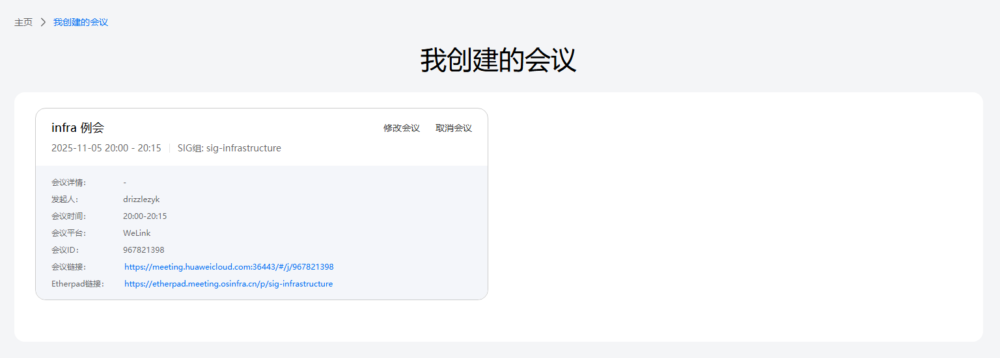

2. 点击【修改会议】

+ 注意：<font color="red">修改会议暂不支持修改邮件地址</font>

### 4.主持会议

#### 4.1 首次SIG会议

首次SIG会议旨在完成SIG初始化，涵盖团队组建、角色分工、运作规则确立及Roadmap规划，帮助成员建立共识、明确方向，建议涵盖以下议题：
- **社区章程介绍**：向参会成员介绍CANN社区的组织架构、行为准则、决策流程与角色晋升机制，帮助新成员快速融入社区。
- **成员介绍与背景互通**：参会成员依次介绍自身技术领域、过往项目经验、可用时间及兴趣方向，促进团队成员相互了解，为后续分工协作奠定基础。
- **SIG职责与议题范围**：明确SIG的技术边界、交付物范围及质量标准，同步SIG对应的代码仓库、上游依赖及协作方信息，使成员对SIG定位有统一认识。
- **沟通渠道与会议频率确认**：明确SIG的内部沟通渠道（邮件列表、即时通讯群组等）及例行会议频率（双周/月度），确保信息传递畅通。
- **角色与权限说明**：介绍Maintainer、Committer、Contributor的角色定义、选拔标准与晋升路径，说明各角色在代码评审、仓库管理等方面的权限范围。
- **分工讨论**：根据成员背景与意愿，初步分配Roadback各模块负责人、代码评审人、文档维护人、社区运营对接人等角色，确保各项事务均有明确责任人。
- **SIG会议主持轮值方式**：明确SIG会议的轮值主持机制，包括轮值周期、主持人职责（议程准备、会议控场、纪要跟进）及交接流程，确保会议的可持续运作。
- **Roadmap规划**：讨论并确定SIG的近期目标（3-6个月）与中长期规划，明确关键里程碑与交付节点，形成可追踪的Roadmap文档。
- **协作规范确立**：明确代码评审流程（含评审时效要求）、PR合并策略（如Squash/Merge）、Issue管理规范（标签体系、优先级定义）、版本发布节奏等日常协作规则。
- **会议纪要规范**：建议在会上使用Etherpad实时协作形成纪要，讨论结论当场达成一致意见，避免会后反复确认；同步机制维持已有方式（通过邮件列表发送通知），确保信息可追溯。

#### 4.2 常规SIG会议

常规SIG会议旨在跟踪SIG日常运作进展，涵盖Issue/PR回顾、Roadmap对齐、需求讨论及社区运营等，持续推动SIG的常态化运作，建议围绕以下维度开展讨论：

- **Issue/PR回顾**：Review近期的Issue进展与PR提交情况，推动遗留问题闭环，识别阻塞项并协调资源解决。关注长期未关闭的Issue，及时清理僵尸Issue。
- **Roadmap进展同步**：对照当前Roadmap逐项检查任务进度（On-track/At-risk/Blocked），及时识别风险并调整优先级或重新排期。
- **需求讨论**：对新增需求进行技术可行性分析、优先级排序与排期确认。对于跨SIG依赖的需求，明确对接人与协作接口。
- **SIG运营与宣传推广**：讨论SIG的社区运营与宣传推广活动，包括技术分享选题、最佳实践案例征集、用户调研开展、SIG介绍文档优化、社区品牌宣传等，持续提升SIG在社区中的可见度与影响力。
- **技术洞察**：跟踪所在领域的前沿技术动态、上下游社区版本演进及关键特性变化，定期输出技术分析报告，为SIG技术选型和Roadmap调整提供参考依据。
- **技术分享与方案评审**：鼓励成员在会议上进行技术分享（新特性设计、踩坑复盘、性能优化等），贡献评审中的重大方案变更在会议上进行集体评审，促进知识沉淀与经验交流。
- **培训赋能**：针对SIG新人或社区贡献者开展 onboarding 培训、代码评审规范培训、工具使用培训等，降低参与门槛，提升贡献效率与质量。
- **社区问题反馈与回顾**：收集成员在SIG运作过程中遇到的实际问题与改进建议，回顾过往决策的执行效果，持续优化协作流程与治理规则。
- **健康度检查**：关注SIG的活跃度指标（如Issue响应时长、PR合并周期、会议出席率），对活跃度下降的原因制定改进措施。
- **SIG成员任免讨论**：根据成员的贡献情况（代码贡献量、评审活跃度、社区参与度等）讨论Committer/Maintainer的晋升提名，对长期不活跃成员启动退出机制，保持SIG核心团队的活力。
- **下次会议预告**：确定下次会议的时间、议题及轮值主持人，确保会议节奏连续。

#### 4.3 会议主持注意事项

- 主持人应至少提前2-3天通过邮件列表发送会议议程，便于参会人员提前准备。
- 主持人应在会前确认会议设备正常（麦克风、摄像头、屏幕共享），如需录制请确保录制功能已开启并告知参会者。
- 会议开场时简要介绍本次议程安排与预计时长，并在开始正式议题前提醒与会者通过 Etherpad 在本次会议与会人行完成签到，确保参会记录可追溯。
- 控制会议时长，每个议题建议设定讨论时限，超时议题视优先级决定是否延至下次会议讨论。
- 鼓励参会人员按照议题顺序逐一讨论，避免话题发散；对争议性议题可组织线下/专题会议讨论，不在例会上过度纠缠。
- 注意引导新参会者发言，尤其关注首次参会成员的疑问与反馈，避免会议被少数成员主导。
- 会议结束前主持人应小结本次会议的关键结论与待办事项，明确责任人与截止时间，确保结论共识到位。
- 对于未能在本次会议上讨论的议题，记录并排入下次会议议程，避免遗漏。
- 会议结束后24小时内整理并发布会议纪要，纪要内容应包括：参会人员、讨论议题、关键结论、遗留问题及责任人/截止时间。
- 如遇参会人数不足或确无实质议题，主持人可决定取消当期会议，但需提前通知并说明原因。

### 5.取消会议

如果你的会议时间需要取消，你可以进行取消会议，请根据下面步骤进行操作：

+ 限制：在会议过期或者在半个小时之内即将开始的会议，比如昨天的会议会无法删除；比如半个小时之内即将开始的会议无法删除，这是系统默认半个小时为会议准备时间，大家都准备参加会议，此时取消会议，会对用户造成一定的影响。

1. 点击【我创建的会议】
2. 点击【取消会议】并在弹窗中【确认取消】

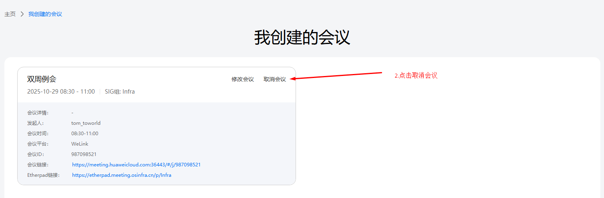

### 6.会议回放

在创建会议时可以勾选会议录制，勾选后会议内容会被录制并上传至平台。
用户可以在官网日历处查看智能回放的内容。

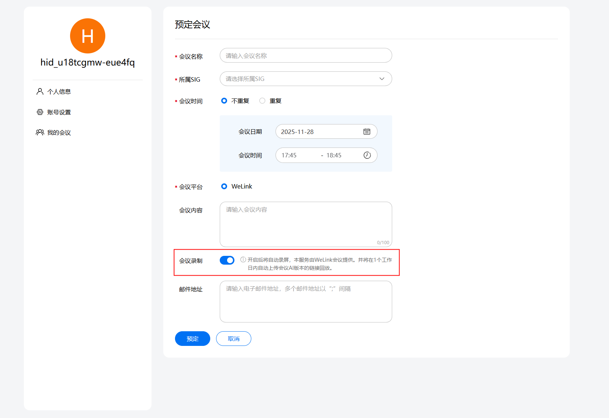

会议结束后一天内，会议视频会被处理并上传，可以在会议日历中查看回放链接。

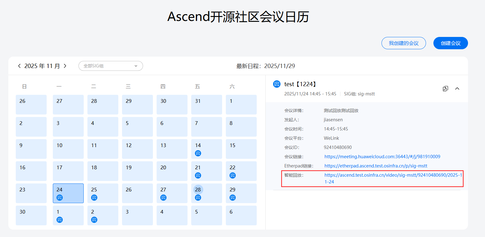

会议回放提供语音转文字功能。
智能回放暂不支持人工二次编辑内容。

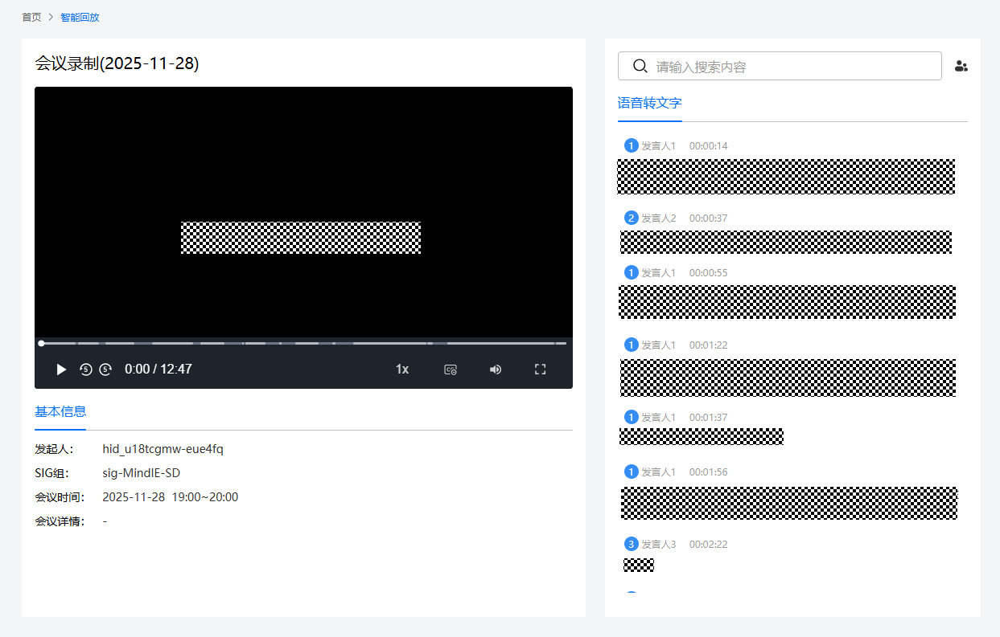


## 四、FAQ

1.创建会议的时候显示“会议时间冲突，请调整会议时间”？

> A:  这是因为会议时间已经存在会议，以你创建会议的起始和结束时间的半个小时内无会议来判断，如果您遇到该提示，请尝试更换一个会议时间，如果一直出现该提示，请联系 [@ZeesangPie](https://gitcode.com/ZeesangPie) | [chenglang11@huawei.com](mailto:chenglang11@huawei.com) 处理；如果联系不上，请联系infrastructure SIG maintainer或者在CANN/infrastructure仓提交issue。

2.WeLink会议出现“云会议室资源正在召开另外一场会议”？

> A:  可能是因为上一场的会议没有结束，或有人没有退出导致，请稍等再重试一下，如果长时间出现该提示，请联系 [@ZeesangPie](https://gitcode.com/ZeesangPie) |  [chenglang11@huawei.com](mailto:chenglang11@huawei.com) 进行处理。如果联系不上，请联系infrastructure SIG maintainer或者在CANN/infrastructure仓提交issue。

3.如何主动关闭会议？

> A: 会议无法主动关闭，当所有参会人员离开会议后，会议会自动关闭。

4.手机端如何参与会议？

> A: 手机端下载蓝版Welink APP，登录之后输入会议号即可参会。

5.会议实际时长超过会议预定时长

> A: 会议会自动延长15分钟，超过15分钟后会议会自动结束，请合理安排会议时间。