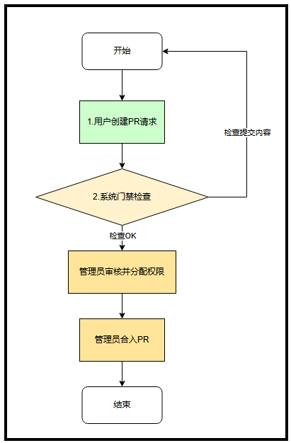
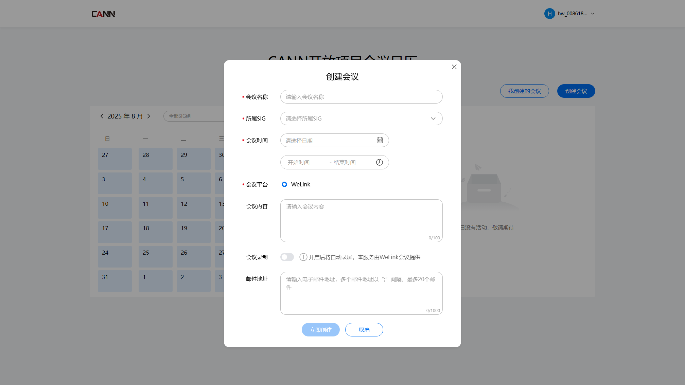

# CANN社区会议服务
会议服务平台链接：https://meeting.osinfra.cn/cann/

## 本目录功能
通过修改`meeting.yaml`，实现会议创建的权限申请。

## 申请流程



### 申请流程详解

#### 通过创建PR来修改meeting.yaml
fork本仓库，在fork的仓库中修改[meeting.yaml](./meeting.yaml)文件，添加会议创建权限申请信息，然后提交PR。

```yaml
- sig_name: XXX1        # SIG组
  meeting_creators:     # 申请人列表
    - account: XXX1     # 申请人的华为账号名，用于绑定创建会议的权限。可通过登录https://id1.cloud.huawei.com/AMW/portal/userCenter/index.html#/security 查看获取账号名
    - account: XXX2
- sig_name: XXX2
  meeting_creators:
    - account: XXX
```

因为[会议系统](https://meeting.osinfra.cn/cann/) 使用华为账号作为账号服务，因此`account`字段是您登录会议系统时使用的华为账号的`账号名`字段

PR提交并合入后，您的权限应该会在24小时内开通

## 查看权限是否生效
登录会议服务平台，查看“创建会议”按钮是否可点击进入会议创建页面。


## 4.注意事项
隐私声明：用户填写的yaml内容，本平台仅用于维护和管理用户的会议创建权限，不会挪作他用。